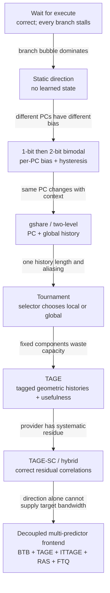
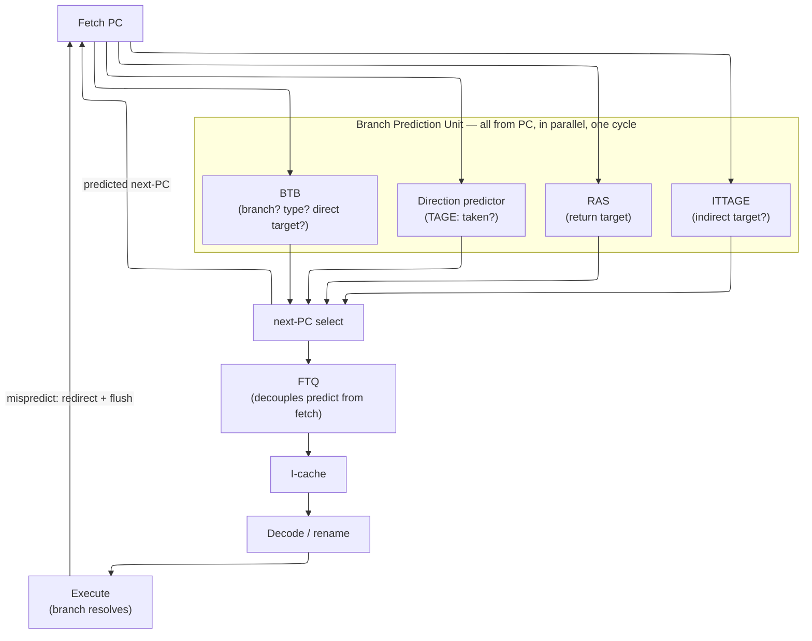
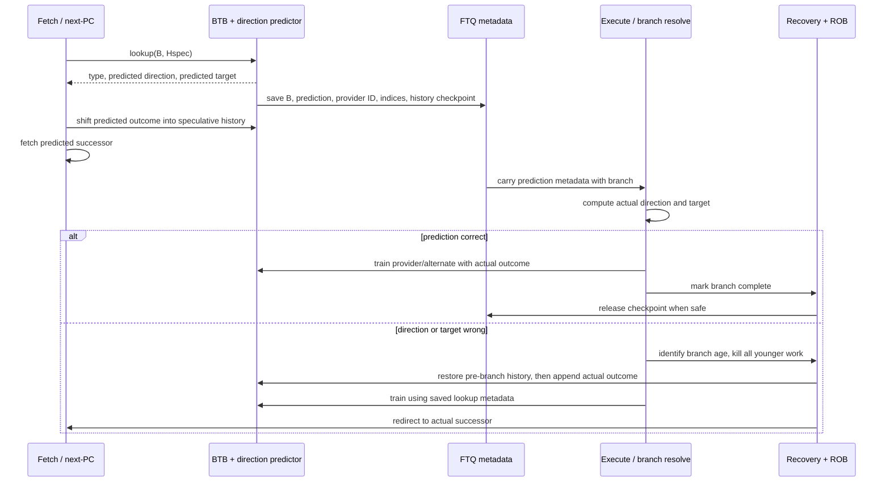
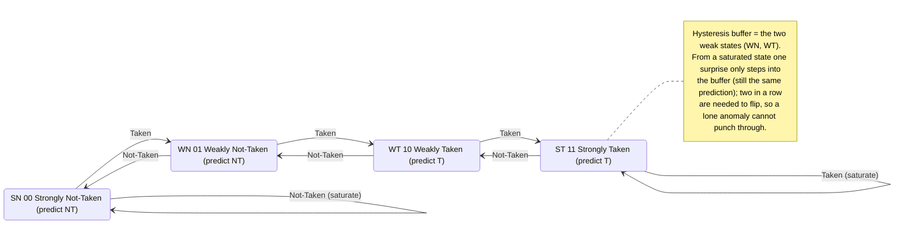
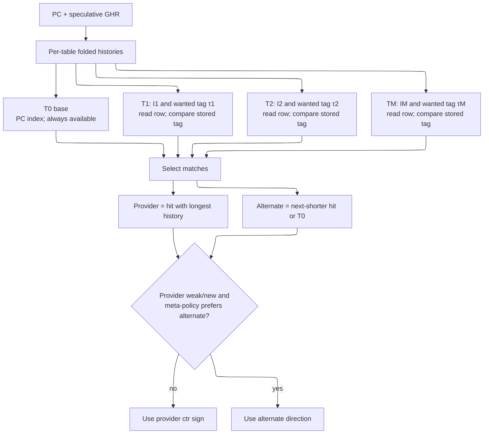
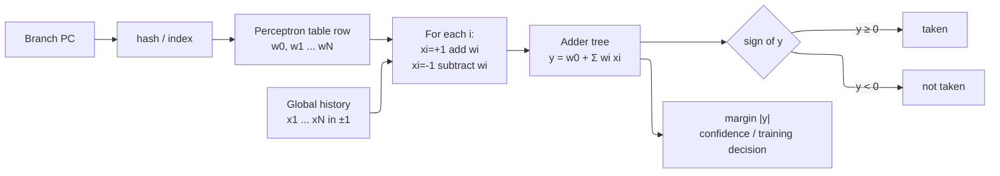

# Branch Prediction — The Speculative Frontend

> **First-time reader orientation:** A branch changes which instruction should execute next. Waiting until every branch finishes would repeatedly empty the pipeline, so the frontend predicts direction and target, follows that path speculatively, and repairs the machine when wrong. A program counter (PC) names an instruction address; a branch target buffer (BTB) remembers likely destinations.

> **Abbreviation key — skim now and return as needed:** central processing unit (CPU); graphics processing unit (GPU); instruction set architecture (ISA); reduced instruction set computer (RISC); instructions per cycle (IPC);
> cycles per instruction (CPI); misses per thousand instructions (MPKI); design-space exploration (DSE); out-of-order (OoO); translation lookaside buffer (TLB);
> reorder buffer (ROB); static random-access memory (SRAM); dynamic random-access memory (DRAM); first in, first out (FIFO); level-one cache (L1);
> level-two cache (L2); last-level cache (LLC); branch target buffer (BTB); fetch target queue (FTQ); tagged geometric-history-length predictor (TAGE);
> reliability, availability, and serviceability (RAS); program counter (PC); complementary metal-oxide-semiconductor (CMOS); fan-out-of-four (FO4); floating point (FP);
> exclusive OR (XOR); kilobyte (KB).

> **Prerequisites:** [CPU_Architecture](../01_Core_Foundations/01_CPU_Architecture.md) (the pipeline and its fetch stage, hazards), [OoO_Execution](../03_Out_of_Order_Backend/01_OoO_Execution.md) (rename and the ROB), and [Speculative_Execution](03_Speculative_Execution.md) (the full predict–validate–recover lifecycle).
> **Hands off to:** [Cache_Microarchitecture](../04_Cache_Hierarchy/01_Cache_Microarchitecture.md) & [Memory](../00_Design_Methodology/02_CPU_PPA_and_Physical_Implementation.md) (the I-cache the front end drives), [TLB_and_Virtual_Memory](../05_Virtual_Memory/01_TLB_and_Virtual_Memory.md) (the iTLB (instruction TLB) in the fetch path), [Xiangshan_CPU_Design](../07_Core_Case_Studies/01_Xiangshan_CPU_Design.md) (a complete open core built around TAGE-SC-L + ITTAGE).

---

## 0. Why this page exists

A pipelined machine has to choose the address it fetches **next** before it can possibly know the outcome of the instruction it is fetching **now**. A branch's direction and target are not settled until it executes — many stages downstream of fetch — yet fetch must hand the front end a next-PC *every cycle*. That gap is not an implementation wart; it is structural, and it leaves exactly three options:

1. **Stall until the branch resolves.** Deterministic, and ruinous. With a resolution depth of $s_r$ stages and branch density $b$, every branch injects an $s_r$-cycle bubble, adding $b\cdot s_r$ to CPI. At $b=0.2$ (a branch every five instructions) and $s_r=12$, that is $+2.4$ CPI — the machine spends most of its cycles idle.
2. **Guess statically** (e.g. predict-not-taken). Free, but a fixed guess is wrong on ~40–50 % of dynamic branches, so it pays most of the stall anyway.
3. **Guess dynamically** — a trained predictor that is wrong only a few percent of the time, and pays the bubble *only on mispredicts*.

Option 3 is the only viable one, which is the whole point: **speculation across branches is mandatory, not optional.** Branch prediction is the discipline of making that mandatory guess wrong as rarely as physically possible, because every wrong guess discards all the work fetched behind it. This page derives each front-end structure from the fact it must produce early, makes **TAGE** the theoretical centrepiece (why *tagged geometric history lengths* are the accuracy/storage sweet spot), and quantifies why a deep, wide core lives or dies by its predictor.

### 0.1 The cost model, and why deeper *and* wider makes it dominant

A branch resolves in execute; a mispredict is detected there and the front end is redirected and refilled. The cost of one mispredict is the **penalty** $P$ — cycles from the branch entering the pipe to correct-path instructions reaching the same point — which is essentially the fetch-to-resolve depth. Averaged over the stream, this is the same formula the OoO page uses for the misprediction limiter ([OoO_Execution](../03_Out_of_Order_Backend/01_OoO_Execution.md) §6):

$$
\text{CPI} \;=\; \text{CPI}_{ideal} \;+\; \underbrace{\frac{\text{MPKI}}{1000}}_{b\,\cdot\,m}\times P
$$

where MPKI = mispredicts per 1000 instructions $=1000\,b\,m$, $b$ = branches per instruction ($\approx 0.2$), $m$ = per-branch mispredict rate, $P$ = penalty in cycles. The added CPI is a **fixed tax**: a fixed number of cycles per thousand instructions, set by the predictor ($m$) and the pipeline depth ($P$), independent of how wide the machine is.

**The accounting identity behind the tax.** That added term is not an empirical fit; it is a conservation count. Ask how many *extra* cycles branches inject per instruction retired, and three independent factors chain multiplicatively:

$$
\text{CPI}_{\text{bp}} \;=\; \underbrace{f_{\text{br}}}_{\text{branches / insn}}\;\times\;\underbrace{p_{\text{miss}}}_{\text{mispredicts / branch}}\;\times\;\underbrace{c_{\text{penalty}}}_{\text{lost cycles / mispredict}}
$$

where $f_{\text{br}}=b$ is the branch fraction, $p_{\text{miss}}=m$ the per-branch mispredict rate, and $c_{\text{penalty}}=P$ the cycles one mispredict costs — identical to $\frac{\text{MPKI}}{1000}P$ above, since $\text{MPKI}=1000\,f_{\text{br}}p_{\text{miss}}$. Each factor is owned by a different actor — $f_{\text{br}}$ by ISA/compiler, $p_{\text{miss}}$ by the predictor, $c_{\text{penalty}}$ by pipeline geometry — so halving any one halves the tax. This *is* the CPI-stack branch term of [CPU workload and performance methods](../00_Design_Methodology/01_CPU_Workloads_Performance_and_DSE.md), derived at the branch's own granularity.

**What sets $c_{\text{penalty}}$: it is a refill depth, not a constant.** A mispredicted branch's outcome is known only at its resolve stage $s_r$; every stage between fetch and $s_r$ is holding wrong-path work that must be squashed, and the front end must re-steer and refill those stages from the correct target. So

$$
c_{\text{penalty}} \;\approx\; s_r \;=\; \text{(fetch-to-resolve depth)} \;\approx\; \text{front-end refill depth},
$$

which is *why* $P$ tracks pipeline depth: a 10-stage core resolving at stage ~7 pays $P\approx6$–8; a 20-stage core resolving at stage ~17 pays $P\approx12$–18 (the §9 table).

**Why the cost is superlinear in pipeline depth.** The CPI term $f_{\text{br}}p_{\text{miss}}c_{\text{penalty}}$ is only *linear* in $c_{\text{penalty}}$, but the true cost of depth compounds through two channels:

1. **The penalty grows** — $c_{\text{penalty}}\approx s_r$ scales with stage count.
2. **The squashed work grows with it** — at width $W$, a $P$-deep shadow holds up to $W\!\cdot\!P$ in-flight speculative slots, *all* discarded per mispredict. The wasted-slot rate is $f_{\text{br}}\,p_{\text{miss}}\,(W\!\cdot\!P)$: the **product** $W\!\cdot\!P$. A design that deepens *and* widens together (they move together historically) quadruples the work thrown away per mispredict when both double.

The sharpest form: deeper pipes buy *less* frequency per stage — the clock period floors at $t_{\text{cyc}}=T_{\text{logic}}/N_{\text{stage}}+t_{\text{latch}}$ ($t_{\text{latch}}$ = per-stage latch/skew overhead) — while the branch tax keeps rising with $N_{\text{stage}}$. Time per instruction, $T\propto t_{\text{cyc}}\big(\text{CPI}_{\text{ideal}}+f_{\text{br}}p_{\text{miss}}\,\kappa N_{\text{stage}}\big)$ with $c_{\text{penalty}}=\kappa N_{\text{stage}}$, is a **convex U** in $N_{\text{stage}}$ (useful term falls as $1/N_{\text{stage}}$, branch term rises linearly). Expanding the product, $T\propto T_{\text{logic}}\,\text{CPI}_{\text{ideal}}/N_{\text{stage}}+t_{\text{latch}}f_{\text{br}}p_{\text{miss}}\kappa\,N_{\text{stage}}+\text{const}$ (the two cross-terms are constant in $N_{\text{stage}}$), so $dT/dN_{\text{stage}}=0$ gives $T_{\text{logic}}\,\text{CPI}_{\text{ideal}}/N_{\text{stage}}^2=t_{\text{latch}}f_{\text{br}}p_{\text{miss}}\kappa$, i.e. minimized at

$$
N_{\text{stage}}^\star \;=\; \sqrt{\frac{T_{\text{logic}}\,\text{CPI}_{\text{ideal}}}{t_{\text{latch}}\,f_{\text{br}}\,p_{\text{miss}}\,\kappa}}\;\;\propto\;\;\frac{1}{\sqrt{p_{\text{miss}}}}.
$$

*Optimal pipeline depth scales as $1/\sqrt{p_{\text{miss}}}$* (Hartstein–Puzak): a better predictor is what *permits* a deeper pipe at all, and past $N^\star$ the mispredict drain makes deeper *slower*. This is the quantitative core of §0's thesis; §0.2 turns it into an area argument.

*Worked number — 95% vs 99% at depth.* Take $f_{\text{br}}=0.2$, a 15-stage pipe ($c_{\text{penalty}}=P\approx14$), width $W=4$ ($\text{CPI}_{\text{ideal}}=0.25$):

- **95% accurate** ($p_{\text{miss}}=0.05$): $\text{CPI}_{\text{bp}}=0.2\times0.05\times14=\mathbf{0.14}$ — a tax *larger than half the ideal CPI itself* (0.25), so realized throughput is $0.25/(0.25+0.14)=64\%$ of peak. 95% *sounds* good and is a disaster.
- **99% accurate** ($p_{\text{miss}}=0.01$): $\text{CPI}_{\text{bp}}=0.2\times0.01\times14=\mathbf{0.028}$, realized $0.25/0.278=90\%$ of peak.

The 5× accuracy jump is worth $+26$ points of peak IPC. And **99% is still not "good enough" once the machine is aggressive**: hold accuracy at 99% but go to $W=8,\,P=20$ — tax $=0.2\times0.01\times20=0.04$ CPI on an ideal CPI of $0.125$, realized $0.125/0.165=76\%$, a fifth of the machine surrendered *at 99%*. This is exactly why the frontier chases 99.5%+ (TAGE-SC-L, §4.4): every doubling of $W\!\cdot\!P$ demands the mispredict rate be *halved* just to stand still (proven next).

That fixed tax is exactly what makes misprediction *dominant* on aggressive cores. Express the realized throughput as a fraction of peak $W$ (issue width, $\text{CPI}_{ideal}=1/W$):

$$
\frac{\text{IPC}_{eff}}{W} \;=\; \frac{1}{1 + W\cdot\dfrac{\text{MPKI}}{1000}\cdot P}
$$

The denominator carries the **product $W\times P$**. Depth raises $P$ directly; width shrinks $\text{CPI}_{ideal}=1/W$ so the same fixed tax eats a larger share of it. A machine built to be both deep and wide surrenders a fraction of its peak that grows with the product of the two things it spent all its area on:

- **W = 4, P = 14, MPKI = 8** → tax $0.112$, realized $= 1/(1+4\cdot0.112)=69\%$ of peak.
- **W = 8**, same P and MPKI → realized $= 1/(1+8\cdot0.112)=53\%$ of peak.

Doubling width from 4→8 raised realized IPC only $2.76\to4.22$ (1.53×, not 2×) and *lost* 16 points of peak utilisation — because the branch tax was unchanged while the thing it is measured against halved. This is the Amdahl-flavoured reason a 6-wide, 12–18-stage core cannot be built without a near-perfect predictor: the front end is the tax collector on all of that width and depth, and the only knobs are **cut $P$** (resolve earlier) or **cut $m$** (predict better). Everything below is about cutting $m$.

### 0.2 The accuracy floor scales with depth × width — why predictors grew

Set a throughput target: keep the branch tax to at most a fraction $\tau$ of the ideal CPI (say $\tau=0.1$, i.e. give up ~9% of peak, since realized $=1/(1+\tau)$). From §0.1, realized $=1/(1+W f_{\text{br}} p_{\text{miss}} P)$, so the target is $W f_{\text{br}} p_{\text{miss}} P \le \tau$, which rearranges to a **tolerable mispredict rate**

$$
p_{\text{miss}}^\star \;\le\; \frac{\tau}{f_{\text{br}}}\cdot\frac{1}{W\,P}, \qquad\text{i.e. required accuracy } \;1-p_{\text{miss}}^\star \;\ge\; 1-\frac{\tau}{f_{\text{br}}\,W\,P},
$$

where $W$ = issue width, $P$ = mispredict penalty, $f_{\text{br}}$ = branch fraction, $\tau$ = allowed tax-to-ideal ratio. The load-bearing fact: **the accuracy the front end must hit is fixed by the product $W\!\cdot\!P$** — the depth×width of everything downstream. This is the *drain-cost* argument in reverse: each mispredict drains the $W\!\cdot\!P$-slot speculative shadow (§0.1), so holding the wasted-slot fraction constant forces $p_{\text{miss}}\propto 1/(WP)$. Double the width, or double the depth, and you must **halve** the mispredict rate merely to stand still.

*Worked number* ($\tau=0.1,\ f_{\text{br}}=0.2$):

- $W=4,\,P=14$: $p_{\text{miss}}^\star \le 0.1/(0.2\cdot4\cdot14)=0.0089$ → need **≥99.11% accuracy**.
- $W=8,\,P=20$: $p_{\text{miss}}^\star \le 0.1/(0.2\cdot8\cdot20)=0.0031$ → need **≥99.69% accuracy**.

Going 2× wider and ~1.4× deeper cuts the tolerable mispredict rate $2.85\times$ (0.89% → 0.31%).

**Why this grew predictor *area*.** Through the useful regime MPKI falls as roughly the inverse square-root of predictor storage (§4.3: "MPKI halves per ~4× storage" ⇒ $p_{\text{miss}}\propto S^{-1/2}$). Inverting, cutting the mispredict rate by a factor $\rho$ costs

$$
S \;\propto\; p_{\text{miss}}^{-2} \;\Longrightarrow\; \Delta S \approx \rho^{2},
$$

where $S$ = predictor storage and $\rho$ = mispredict-rate reduction factor. So the $2.85\times$ accuracy demand above costs $\rho^2\approx\mathbf{8\times}$ predictor storage. *A machine 2× wider and 1.4× deeper needs ~8× the branch-predictor area to run at the same fraction of its peak* — the quantitative reason front-end predictor budgets climbed from a few hundred bytes on early pipelines to 32–64 KB (TAGE-SC-L in modern P-cores, §4.3) exactly as pipelines deepened and widened. Predictor area is not fashion; it is the $\rho^2$ tax of the $W\!\cdot\!P$ it protects, and it is why §0.1's $N_{\text{stage}}^\star\propto1/\sqrt{p_{\text{miss}}}$ and this $S\propto p_{\text{miss}}^{-2}$ co-evolved: deeper pipes and bigger predictors are the same design decision seen from two sides.

### 0.3 How prediction evolved: follow the residual error

The predictor family did not grow by accumulating unrelated algorithms. Each generation kept the previous generation as a fallback and added state for the class of misses that remained:



The state evolution is equally important. Static prediction remembers nothing. Bimodal adds one saturating counter per indexed PC. Global-history prediction adds a shift register and a table indexed by a hash of PC and history. TAGE adds partial tags to reject destructive aliases, several history lengths so each branch can find an appropriate context, and usefulness counters to protect entries that have beaten their shorter-history alternatives. A separate provider-versus-alternate policy can temporarily prefer the alternate when a newly allocated provider is still weak. The complete frontend finally adds separate target/type state, a return stack, speculative-history checkpoints, and a fetch target queue (FTQ).

The costs also evolve. Each accuracy feature increases lookup energy, alias corner cases, training latency, and recovery state. If a tiny embedded workload already has a two-bit-predictor misses-per-thousand-instructions (MPKI) below its performance target, TAGE can lose on energy and clock period. If a server workload has a large code footprint, a sophisticated direction predictor can still lose because the branch target buffer (BTB) misses or the instruction cache cannot supply the predicted target. Optimization must therefore classify residual misses—direction, target, return, indirect, capacity, or latency—instead of treating “branch mispredict” as one number.

---

## 1. What must be predicted, and why one structure cannot do it

To advance, fetch needs one thing: the **next-PC**. Producing it from the current PC *before decode* means answering a chain of questions the pipeline would otherwise only settle much later:

| Question the next-PC needs | Settled for certain at | Speculative structure that answers it early |
|---|---|---|
| Is this fetch block even a branch? | decode | **BTB** (presence) — §2 |
| Where does it go (direct target)? | decode | **BTB** (target) — §2 |
| Is a conditional branch taken this time? | execute | **direction predictor** (TAGE) — §3–4 |
| Where does a *return* go? | execute | **RAS** — §6 |
| Where does an *indirect* branch go this time? | execute | **ITTAGE / indirect target cache** — §5.1 |

The organizing idea of the whole front end is one sentence: **every predictor is a speculative cache of a fact the pipeline will only confirm later, pulled forward to the one cycle fetch can use it.** They are separate structures because the facts have different *natures*, and that nature dictates what each must remember:

- "Is this PC a branch, and (for a direct branch) where does it statically go" is a property of the **PC** — cache it by PC. → BTB (branch target buffer).
- "Is it taken this time" is a property of **dynamic bias and recent history**, not of the PC alone. → direction predictor.
- "Where does this return go" is a property of **call context**, and is *not* a function of the branch PC at all. → RAS (return address stack).



The loop `PC → predict → next-PC → PC` closes every cycle; the FTQ (§7) lets it run ahead of the I-cache; and the one back-edge from execute is the mispredict recovery that §0's tax pays for. Hold that picture and the rest is filling in each box.

### 1.1 One dynamic branch from prediction to retirement

A block diagram shows ownership; a lifecycle shows why each metadata field exists. Assume a conditional branch at PC `B` is fetched under speculative global history `Hspec`. “Speculative” means the history already contains predicted outcomes of older branches that have not resolved. The frontend must use it to predict far ahead, but also be able to undo it.



The FTQ entry is not merely a target address. It is the **receipt for the prediction**: the branch PC, predicted direction and target, branch type, the component that provided the answer, enough table index/tag context to update the same logical entry later, and a history checkpoint or checkpoint identifier. Without that receipt, execute could know the prediction was wrong but not reliably train the structure that made it; recomputing an index from the *current* history is wrong because dozens of later predictions may already have shifted the global history register (GHR).

**Why history is updated speculatively.** Waiting until execute to shift an outcome would make every younger branch predict with stale context, erasing correlations between nearby branches. The frontend therefore shifts the predicted bit immediately. Correct predictions make that state eventually true; a misprediction restores the checkpoint and shifts the actual bit. This is the same speculate–validate–recover pattern used by the rename map. The enabling control is an age-tagged checkpoint stack or circular checkpoint file, not an unstructured “flush” signal.

**Training policy is a design choice.** Updating at execute adapts quickly, but a wrong-path branch can train before an older branch later squashes it. Updating at retirement avoids wrong-path pollution, but delays learning by the ROB residence time and needs the prediction receipt to survive until commit. A common design resolves this by updating direction confidence at resolution while attaching an epoch or validity check to allocation, or by allowing speculative update with an undo mechanism. The correct choice depends on phase-change speed, checkpoint storage, and tolerance of wrong-path pollution.

**Timing effect and losing cases.** A correct lookup keeps fetch producing a block every cycle. A late L2-BTB response may still redirect after one or two incorrect blocks; a TAGE answer that takes two cycles needs a fast preliminary predictor whose answer can be overridden. These overrides are not full execute-time mispredicts, but they consume fetch bandwidth and must be counted separately. Adding tables can reduce direction MPKI while increasing override bubbles or extending the next-PC critical path enough to lower frequency—an apparent accuracy win that loses system performance.

**Observable proof.** Split events into `direction_miss`, `target_miss`, `btb_miss`, `ras_miss`, `indirect_target_miss`, `late_override`, and `checkpoint_full_stall`; report each as MPKI and lost cycles. Track provider-table selection, useful-counter promotions, allocations, tag collisions, and accuracy by history length. Assertions should prove that a resolved branch trains with its saved lookup context, a redirect restores exactly the pre-branch history plus the actual outcome, all younger FTQ/ROB entries are invalidated, and a late response from the killed epoch cannot redirect fetch. Those observations distinguish “the algorithm is inaccurate” from “the algorithm is accurate but cannot deliver its answer on time.”

---

## 2. The BTB: "is this a branch, and where?" from the PC alone

### 2.1 Why it must exist — a timing argument that dictates its contents

The fetch engine picks the next PC in the *same cycle* it launches the I-cache access — several stages before decode can even confirm the fetched bytes are a branch. If it waited for decode, every taken branch would cost a decode-to-fetch bubble (3–5 cycles). So the BTB must reconstruct, from the PC alone, everything decode would otherwise have to tell it. That job — and nothing more — fixes what every entry holds:

| The entry must remember… | …because the next-PC needs to know |
|---|---|
| a **tag** (upper PC bits) | that *this* PC is really the cached branch, not an aliasing neighbour — a bogus redirect is worse than none |
| a **target PC** | *where* to steer next fetch, for a direct branch whose offset decode hasn't computed yet |
| a **branch type** (cond / call / return / indirect) | *who acts next cycle* — a return must pop the RAS, a call push it, an indirect not blindly trust one stored target |

That is the whole entry. A structure that stored only "one target per PC" would mispredict every return and every polymorphic indirect branch — which is exactly why the type field, not the target, is the subtle part. There is no bit-field layout worth memorising here; those three obligations *are* the state.

### 2.2 The capacity–latency knee: why the BTB is a cache hierarchy

The BTB has a cache's central conflict: it wants to be **large** (cover a big code footprint so few branches miss) and **fast** (redirect within the single fetch cycle). SRAM access time grows with capacity (roughly $\sqrt{\text{capacity}}$ for the array plus decode), so one structure cannot be both. The resolution is the same split L1/L2 data caches make — separate *capacity* from *latency*:

| Level | Entries | Latency | Role |
|---|---|---|---|
| L1 BTB | 64–128 | 1 cycle (in the fetch cycle) | hot branch working set, zero-bubble redirect |
| L2 BTB | 2K–8K | 2–3 cycles | cold/large-footprint branches, cheap 1–2-cycle redirect |
| (miss both) | — | 3–5 cycles | branch only recognised at decode |

The 3–5-cycle decode-time recovery is precisely the cost the L2 BTB exists to avoid on all but the coldest branches, and its 1–2-cycle redirect is the price of admission. This is a **coverage-vs-latency** trade with a cache-miss cost model: BTB miss rate rises as the dynamic branch working set approaches capacity, and each miss on a taken branch costs the decode redirect. That is why large-footprint server and interpreter workloads — thousands of active branch sites — are frequently *front-end-bound* and drive the enormous BTBs (and even decoupled, run-ahead fetch, §7) of Golden Cove, Apple, and Neoverse, while an embedded core with a tiny code footprint ships a single small BTB.

**Quantifying the knee.** The $\sqrt{\text{capacity}}$ law is geometric: a single-ported SRAM of $C$ cells laid out roughly square has word- and bit-lines of length $\propto\sqrt{C}$, and first-order RC delay scales with that length, so access time $\propto\sqrt{C}$ — doubling entries costs $\sqrt{2}\approx1.41\times$ latency. Hence an L1 BTB cannot simply be grown into the L2's job: from 64 → 2048 entries the array delay rises $\sqrt{2048/64}=\sqrt{32}\approx5.7\times$, straight through the 1-cycle budget — the split into fast-small + slow-large is forced, not chosen. The miss cost that sizing fights is a CPI adder $f_{\text{br}}\,t\,\mu_{\text{BTB}}\,c_{\text{dec}}$, where $t$ = taken fraction, $\mu_{\text{BTB}}$ = taken-branch BTB miss rate, and $c_{\text{dec}}\approx3$–5 cycles the decode-recognition penalty. *Worked:* a server workload with a ~4000-branch working set against a 2K-entry L2 BTB might miss $\mu_{\text{BTB}}\approx8\%$ of taken branches; at $f_{\text{br}}=0.2,\,t=0.6,\,c_{\text{dec}}=4$ that is $0.2\times0.6\times0.08\times4=\mathbf{0.038}$ CPI — comparable to a *good direction predictor's entire tax* (§10, problem 2). That parity is why front-end-bound cores grow the BTB as aggressively as the direction predictor: past a point, the next branch mispredict is a *target* miss, not a *direction* miss.

Match the structure to the residual miss rate: the whole design lever is coverage of the branch working set, not raw capacity.

---

## 3. Direction prediction: bias first, then correlation

A BTB says *where* a taken branch goes; it says nothing about *whether* a conditional is taken — and a perfect target is worthless if you step onto it on a branch that should have fallen through. Direction is a separate question, so it earns a separate structure, and what that structure must remember is derived in two layers.

### 3.1 Layer one — bias with hysteresis

Most branches are heavily skewed: a loop back-edge is taken $N{-}1$ of $N$ times, an error check almost never fires. The minimum state that captures skew is a small saturating counter per branch. The classic **2-bit** counter (states strongly/weakly not-taken → weakly/strongly taken; predict taken when in the top half) is chosen not because 2 bits store more skew than 1, but for **hysteresis**: it takes *two* consecutive surprises to flip the prediction, so a loop that is taken 99 times then falls through once loses only *one* prediction at the exit instead of two (one at the exit, one on re-entry). One bit would double the error on every loop boundary. That is the entire reason 2-bit is the floor and 1-bit is not used.

The state machine this names is small enough to draw in full — a taken outcome steps one notch toward **ST**, a not-taken one notch toward **SN**, and both ends saturate:



The prediction is just the high bit — the right pair predicts taken, the left pair not-taken — and the middle pair **WN**/**WT** is the **hysteresis buffer**: a lone surprising outcome out of a saturated end (SN or ST) only lands *inside* that buffer and keeps the prediction, so flipping it takes *two* consecutive surprises — a single anomaly cannot punch through. The Markov chain below quantifies this exact walk.

**Worked update sequence — watch one counter ride a loop.** Start cold at `SN` and feed the outcomes a short loop produces: it runs, takes its single not-taken exit, re-enters, runs again, and only then breaks for good. Predict = high bit (`WT`/`ST` ⇒ taken); a taken outcome steps up one notch, a not-taken steps down, both ends saturate.

| Step | State before | Predict | Outcome | Result | State after |
|---|---|---|---|---|---|
| 1 | `SN 00` | NT | T | miss | `WN 01` |
| 2 | `WN 01` | NT | T | miss | `WT 10` |
| 3 | `WT 10` | T | T | hit | `ST 11` |
| 4 | `ST 11` | T | T | hit | `ST 11` |
| 5 | `ST 11` | T | N | **miss** | `WT 10` |
| 6 | `WT 10` | T | T | hit | `ST 11` |
| 7 | `ST 11` | T | T | hit | `ST 11` |
| 8 | `ST 11` | T | N | miss | `WT 10` |
| 9 | `WT 10` | T | N | miss | `WN 01` |

Steps 1–2 are the one-time cost of *learning* the bias. Step 5 is the payoff: the loop's single not-taken exit only knocks the saturated `ST` down to `WT`, which *still predicts taken*, so the re-entry at step 6 is correct — a 1-bit counter would have flipped at step 5 and missed step 6 as well. It takes two *consecutive* surprises (steps 8–9) to flip a saturated counter to not-taken. That one-anomaly tolerance is the hysteresis the Markov chain (next) and the $1/N$-vs-$2/N$ loop count (below) make precise.

**The Markov-chain derivation.** Model the counter as a 4-state Markov chain over $\{{\tt SN}{=}0,{\tt WN}{=}1,{\tt WT}{=}2,{\tt ST}{=}3\}$: a taken outcome increments (saturating at 3), a not-taken decrements (saturating at 0), and the prediction is the top bit (states 2, 3 ⇒ predict taken). Drive it with a branch taken i.i.d. with probability $p$ (write $q=1-p$, and $r=p/q$ the *odds*). Each up-step carries a factor $p$ and each down-step a factor $q$, so adjacent stationary masses sit in ratio $r$ — the stationary distribution is a *truncated geometric in the odds*:

$$
\pi_i=\frac{r^{\,i}}{1+r+r^2+r^3}=\frac{r^{\,i}}{(1+r)(1+r^2)},\qquad i\in\{0,1,2,3\},
$$

where $\pi_i$ = steady-state probability of state $i$. A misprediction occurs from a predict-NT state (0 or 1) on a taken outcome (prob $p$), or from a predict-T state (2 or 3) on a not-taken outcome (prob $q$). Summing and simplifying (the $p+qr^2=r$ identity collapses it),

$$
m_{\text{2-bit}}(p)\;=\;p(\pi_0+\pi_1)+q(\pi_2+\pi_3)\;=\;\frac{r}{1+r^2}\;=\;\frac{p(1-p)}{\,1-2p+2p^2\,}.
$$

Sanity: $p=\tfrac12\Rightarrow m=\tfrac12$ (unbiased is unpredictable); $p\to1\Rightarrow m\to0$. At $p=0.9$, $m_{\text{2-bit}}=\frac{0.9\cdot0.1}{0.82}=11.0\%$ — against the 1-bit i.i.d. rate $2p(1-p)=18\%$, so even on memoryless bias the second bit is $\sim0.61\times$ the error, approaching $\tfrac12$ as $p\to1$.

**Why 2 bits beat 1 bit — hysteresis made exact.** The i.i.d. model understates the case; the counter earns its second bit on *runs*, which is what loop branches produce. Take the period-$N$ loop pattern (back-edge taken $N{-}1$ times, then the exit) $\underbrace{{\tt T\,T}\cdots{\tt T}}_{N-1}{\tt N}$, repeating:

- **1-bit** (predict = last outcome) mispredicts *twice* per period: at the exit (last body outcome was T → predicts T, branch falls through) and on re-entry (exit outcome was N → predicts N, loop is taken again) → $m_{\text{1-bit}}=2/N$.
- **2-bit** saturates at ${\tt ST}$ during the run, so the single not-taken exit only knocks it to ${\tt WT}$ — *still predicting taken* — and the next re-entry is correct. Only the exit is missed → $m_{\text{2-bit}}=1/N$.

So the second bit **halves** the loop-boundary misprediction, *matching the best static prediction* ($1/N$, only the unavoidable exit) while learning the bias online — where one bit pays a spurious extra miss on every re-entry. *Worked number:* a 100-iteration loop → 1-bit $2\%$, 2-bit $1\%$ mispredict on that branch; a 6-deep nest of such loops turns that 1-point-per-loop saving into the gap between a usable and a useless front end. This one-anomaly tolerance is *exactly* why 2-bit is the floor — and it generalises: TAGE's per-entry direction counter is **3-bit** for the same reason, one more notch of hysteresis for its longer, noisier contexts (§4.1).

Bias alone tops out around **85–90 %** accuracy. It cannot predict a branch whose outcome depends on *context* — `if (x) …` followed by `if (x && y) …`, where the second branch's behaviour is decided by the first. For those, per-branch bias is structurally blind.

### 3.2 Layer two — global history and the correlation it captures

The leap past the bias ceiling is the observation that a branch's outcome often *correlates with the recent outcomes of other branches*. Remember a slice of that history and you can tell the contexts apart. The **global history register (GHR)** is an $N$-bit shift register of the last $N$ branch outcomes (1 = taken); indexing the prediction by GHR as well as PC lets one static branch predict differently under different histories. This is the single idea behind every predictor from two-level adaptive through TAGE.

**gshare** is the cheapest way to use both. Rather than one table per history pattern (exponential), it hashes bias and history into *one* small table by XOR:

$$
\text{index} \;=\; \text{PC}[k{-}1{:}0] \;\oplus\; \text{GHR}[k{-}1{:}0]
$$

into a $2^{k}$-entry array of 2-bit counters. The XOR **decorrelates aliasing**: two branches sharing a PC-index but differing in history land on different counters, and vice versa, cutting destructive interference ~30 % versus pure PC-indexing. gshare is untagged and simply *tolerates* the collisions that remain, because the counters self-correct — which is both its cheapness (~2 KB, ~89–92 %) and its ceiling.

**Worked index ($k=8$, 256 entries) — one branch splits across histories; two branches can silently collide.** The index is the low 8 PC bits XOR the low 8 GHR bits:

```text
PC[7:0]  = 0x2C = 0010 1100     branch A
GHR[7:0] = 0xB3 = 1011 0011     history H1
XOR      = 0x9F = 1001 1111  -> entry 159

A @ H2 (0xB7):  0x2C ^ 0xB7 = 0x9B  -> entry 155   (one history bit flipped)
B @ H' (0x4F):  0xD0 ^ 0x4F = 0x9F  -> entry 159   (silent collision with A@H1)
```

The middle line is the *win*: flip a single history bit and branch $A$ trains a *different* counter, so one static branch can predict taken under `H1` and not-taken under `H2` — the correlation a bias-only table is blind to. The last line is the *ceiling*: a different branch $B$ under history `0x4F` also hashes to entry 159, and being untagged gshare cannot tell $B$'s context from $A$'s, so if their biases oppose they quietly corrupt one counter. That silent, undetectable collision is exactly the destructive aliasing §3.3 attacks and TAGE's tags fix.

**Why history-indexing captures correlation — and why XOR specifically.** Indexing by PC alone learns the *marginal* bias $P(\text{taken}\mid\text{PC})$; indexing by $(\text{PC},h)$ learns the *conditional* $P(\text{taken}\mid\text{PC},h)$ per recent-history pattern $h$. Conditioning never raises uncertainty — $H(\text{dir}\mid\text{PC},h)\le H(\text{dir}\mid\text{PC})$, the gap being the mutual information $I(\text{dir};h\mid\text{PC})$ that recent branches carry about this one. *That gap is the correlation a bias-only predictor is structurally blind to* (§3.1's `if(x)…if(x&&y)` case): the second branch is $\approx\tfrac12$ marginally but near-deterministic given the first. So the entire leverage of history is a conditional-entropy reduction, and any predictor that captures it must give distinct histories distinct state. XOR is the minimal hash that keeps them distinct in a fixed $2^k$ table: for *fixed* $h$ the map $\text{PC}\mapsto\text{PC}\oplus h$ is a bijection, and for *fixed* PC the map $h\mapsto\text{PC}\oplus h$ is a bijection — so the same PC under two histories $h_1\ne h_2$ is *guaranteed* two different indices ($\text{PC}\oplus h_1\ne\text{PC}\oplus h_2$), the precondition for storing $P(\text{taken}\mid\text{PC},h)$ separately. Concatenating $k/2$ PC bits with $k/2$ history bits would throw away half the resolution on each axis; XOR overlays all $k$ bits of both, spending the whole table on the joint context.

**The pigeonhole cost XOR cannot lift.** A table of $2^k$ counters holds at most $2^k$ distinct contexts, but the live working set of $(\text{PC},h)$ pairs is far larger. If $n$ roughly-uniform live contexts hash into $2^k$ slots, the expected fraction *sharing* a slot with another is

$$
1-\Big(1-\tfrac{1}{2^k}\Big)^{n-1}\;\approx\;1-e^{-n/2^k},
$$

where $n$ = live context count and $2^k$ = table size; at load factor $n=2^k$ this is $1-e^{-1}=63\%$. Those collisions are *destructive* whenever the co-residents carry opposite bias — and here is XOR's real role and its ceiling: a bijective hash changes *which* contexts collide (decorrelating a hot branch from its PC-neighbours, the ~30% win above) but cannot change *how many* collide — that count is fixed by the load factor, by pigeonhole. Being **untagged**, gshare cannot even detect a collision: it is a *silent* corruption of two branches training one counter. The untagged cures are only more entries (linear area) or fewer live contexts; the structural cure — a tag that *detects* the collision so you can decline the entry — is what §3.3 motivates and TAGE adds.

### 3.3 The two problems a single-length predictor cannot escape

Two theoretical facts about gshare-style predictors set up everything TAGE does:

**Aliasing.** A single shared table of $2^k$ counters is a hash table with no tags. When the working set of distinct $(\text{PC}, \text{history})$ contexts approaches $2^k$, unrelated contexts with *opposite* bias collide and corrupt each other. Untagged predictors can only fight this by growing the table (linear in area) — there is no way to *know* a collision happened, so a collision is a silent wrong prediction.

**The wrong history length, for every branch at once.** A branch whose outcome truly depends on the last $h$ prior branches needs history length $\ge h$. But index it with $L \gg h$ bits and the extra $L-h$ bits are effectively random *for this branch*, splitting its training examples across up to $2^{L-h}$ redundant entries — training slows by that factor and table pressure (and aliasing) explodes. Concretely, if the branch is seen every $\Delta$ instructions, each of its $2^{L-h}$ shadow-entries is refreshed only every $2^{L-h}\Delta$ instructions, so the saturating counter takes $2^{L-h}\times$ longer to converge to the true bias — the branch is effectively *un-warmed* for that long after every phase change, a pure exponential penalty in the over-length $L-h$. Conversely, too-short history is simply blind to deep correlation. Since real code mixes branches whose true correlation depth $h$ ranges from 1 to hundreds, **no single history length is right**, and a fixed-$L$ predictor loses accuracy at both ends of the spectrum. The ideal $L$ is *per-branch* and unknown a priori.

TAGE resolves both at once. That is the next section, and it is the heart of the page.

---

## 4. TAGE: letting each branch pick its own history length

TAGE (TAgged GEometric history length, Seznec & Michaud 2006) has been a dominant high-performance direction-predictor family since the Championship Branch Prediction contests. TAGE-SC-L is a competition-grade extension, while current public XiangShan Kunminghu documentation names a TAGE plus Statistical Corrector (TAGE-SC) implementation. Treat exact commercial predictor compositions as vendor-specific unless the vendor documents them. TAGE is best understood not as "gshare with more tables" but as the direct answer to §3.3's two problems.

### 4.1 TAGE architecture, lookup, and allocation

> [!important] Do not confuse table size with history length
> In a sequence such as $4,8,16,32,\ldots$, the geometric quantity is normally the **number of history bits used by each component**, not its number of rows. A long-history table may have exactly the same row count as a short-history table.

TAGE combines one untagged base predictor $T_0$ with tagged components $T_1\ldots T_M$. Component $T_i$ uses a history length $L_i$, with the $L_i$ values spaced approximately geometrically. The base captures branch bias; progressively longer components install exceptions for contexts that the shorter components could not predict.

The usual tagged entry is:

```text
partial tag | signed direction counter (ctr) | usefulness counter (u)
```

- **`ctr` predicts direction.** Its sign (or high bit) selects taken/not-taken; its magnitude is the entry's prediction strength. Three-bit signed counters are common in classic TAGE descriptions.
- **`tag` identifies the context.** It is a separately stored, partial signature of the PC and the history used by that table. It is not the table index and it is not a copy of the entire PC or GHR.
- **`u` controls retention.** It records whether this entry has proved more useful than the shorter-history alternate. It is principally replacement state, **not the direction-confidence counter and not normally part of the tag-hit test**.

The base $T_0$ is normally a PC-indexed bimodal table with no tag. It therefore always supplies a fallback prediction.

#### Two hashes per tagged component: row selection and identity

For every $T_i$, hardware derives both an index and a wanted tag from the current branch PC and the first $L_i$ bits of speculative branch history:

$$
I_i = H^{idx}_i\!\left(PC,\operatorname{Fold}_{k_i}(GHR[0:L_i])\right)
$$

$$
\tau_i = H^{tag}_i\!\left(PC,\operatorname{Fold}_{t_i}(GHR[0:L_i])\right)
$$

where $2^{k_i}$ is the number of rows in table $i$ and $t_i$ is its stored tag width. Folding compresses a potentially hundreds-of-bits history into the small number of index/tag bits; index and tag use different mixes so that an index collision is unlikely also to be a tag collision.

Lookup performs:

```text
candidate_i = Ti[I_i]
hit_i       = (candidate_i.tag == tau_i)
```

The index answers **which row can be read**. The tag answers **whether that row represents this PC/history context**. Many contexts inevitably share an index; a partial tag lets most wrong contexts be rejected instead of silently sharing a direction counter as they would in gshare.

#### Provider and alternate selection

All components are conceptually accessed in parallel. Among the tagged hits, the component using the greatest $L_i$ is the **longest-history match** and becomes the **provider**. The next-shorter tagged hit—or $T_0$ if there is none—is the **alternate**.

"Longest matching entry" therefore means **the matching entry from the table with the longest history**, not the entry with the longest matching tag prefix. Basic TAGE uses the provider counter's direction. Many later implementations add a small `use-alt-on-new-allocation` policy: if the provider counter is still in a weak state after allocation, a meta-counter may temporarily choose the alternate. This is separate from the per-entry `u` counter.



The prediction receipt saved with the branch carries at least the provider/alternate identities, selected row indices, original prediction, counter states needed by policy, and a history checkpoint or equivalent recovery metadata. Recomputing the indices at resolution would be wrong because speculative history has advanced.

#### Resolution, training, and usefulness

When the actual outcome $t\in\{-1,+1\}$ becomes known:

1. Move the provider's signed `ctr` one saturated step toward $t$.
2. If provider and alternate disagreed, update `u`: increment it when the provider was correct and the alternate wrong; decrement it when the provider was wrong and the alternate correct. Agreement supplies no evidence about which component was more useful.
3. If the final prediction was wrong and longer components exist, attempt allocation in a table **longer than the longest tag-matching component**.
4. Periodically age the `u` counters so old entries eventually become replaceable after program phase changes.

Some implementations also update the alternate under restricted conditions, allocate more than one entry, or alter allocation after detecting a newly allocated provider. For example, if the meta-policy selected the alternate and was wrong while the weak longest-match direction was actually correct, allocation can be suppressed—the long entry needs training, not an even longer replacement. Those are policy variants; the invariant is that `ctr` learns direction while `u` manages whether the entry deserves scarce long-history storage.

#### Allocation: specialization, not promotion

TAGE does **not** normally insert every branch into the shortest tagged table and then copy it upward. Allocation is triggered by failure:

```text
current provider = Tp                     # p=0 means the base
if final_prediction != actual and p < M:
    candidates = selected rows in T(p+1) ... TM whose u == 0
    if candidates are non-empty:
        choose one candidate               # usually randomized / biased nearby
        candidate.tag = wanted_tag_for_that_table
        candidate.ctr = weak(actual)       # weakly taken or weakly not-taken
        candidate.u   = 0                  # unproven; immediately replaceable
    else:
        age/decrement candidate u values   # often no allocation this time
```

Only tables with longer history than the longest matching component are eligible because the miss suggests the available context was insufficient. The new entry does **not** copy the shorter table's prediction—the available prediction logic just failed. Its tag is set from the current PC and the current history as folded for the destination table, and its direction counter is initialized weakly toward the outcome that exposed the miss. Tags change only when an entry is allocated or replaced, not on every counter update.

The original TAGE proposal allocates at most one longer-history entry on a misprediction, prefers `u=0` entries, biases selection toward nearer longer components, and initializes the new counter weakly correct with `u=0`. Public implementations such as gem5 use the same essential pattern, with tunable allocation details.

#### Worked lookup and allocation

Assume $T_0,T_1,T_2,T_3,T_4$ use histories $0,4,8,16,32$:

| Component | Tag hit? | Counter prediction | Role |
|---|---:|---:|---|
| $T_4$, $L=32$ | no | — | allocation candidate |
| $T_3$, $L=16$ | yes | not taken | **provider** |
| $T_2$, $L=8$ | yes | taken | **alternate** |
| $T_1$, $L=4$ | no | — | — |
| $T_0$, $L=0$ | always | taken | fallback |

If the branch is actually taken, $T_3$ trains one step toward taken and loses usefulness relative to $T_2$. Because the prediction missed, TAGE may allocate the already-selected row of $T_4$ if its `u=0`: it writes $T_4$'s computed 32-history tag, a weakly-taken counter, and `u=0`. On a future occurrence with the same relevant 32-bit context, that tag can match and $T_4$ becomes the provider. A different 32-bit context computes a different index and/or tag, so the new entry does not match. This is how a single static branch can acquire different predictors for different dynamic contexts without entries being copied from table to table.

**Compact reference pseudocode:**

```text
# PREDICT
for i in 1..M in parallel:
    Ii, taui = hashes(PC, fold(GHR, Li))
    hit[i]   = (Ti[Ii].tag == taui)
provider = greatest i with hit[i], otherwise T0
alternate = next-greatest hit, otherwise T0
prediction = choose(provider.ctr, alternate, new-entry meta-policy)

# UPDATE
provider.ctr = sat_toward(provider.ctr, actual)
if provider.prediction != alternate.prediction:
    provider.u = sat_toward(provider.u, provider.prediction == actual)
if prediction != actual:
    allocate weak(actual), tag=tauj, u=0 in an eligible j > provider
```

### 4.2 Why *geometric* spacing — reach that is exponential in table count

The history lengths—not necessarily row counts or tag widths—follow an approximate geometric series. To span $L_{min}$ through $L_{max}$ with $M$ tagged components at ratio $\alpha$:

$$
L_{max} = L_{min}\,\alpha^{\,M-1} \;\;\Longrightarrow\;\; M \;=\; 1 + \log_{\alpha}\!\frac{L_{max}}{L_{min}}
$$

Thus a modest table count spans very short and very long correlation distances. Exact lengths are rounded and tuned rather than restricted to powers of two. Geometric coverage works because useful branch correlation distances span orders of magnitude: allocating equal table count to every additive interval would overrepresent long-distance ranges or require too many components.

> [!answer] Are tag lengths different in different tables?
> **They can be, and often are, but TAGE does not require them to be.** Each table has its own tag width $t_i$. A design may use one width everywhere for regularity, or gradually increase $t_i$ for longer-history components. For example, a public gem5 configuration uses tag widths `9, 9, 10, 10, 11, 11, 12` bits across seven tagged tables. This is an implementation choice, not the geometric sequence in TAGE's name.

Why spend more tag bits in some long-history tables?

- A wrong long-history match can override every correct shorter match, so reducing its false-hit probability is valuable.
- A longer history describes a larger universe of possible contexts; a slightly wider signature reduces destructive aliasing among them.
- But every extra tag bit is paid in every row and participates in the compare path, so widths are kept partial and small.

If unrelated contexts reaching the same row produce approximately uniform tags, a $t_i$-bit tag passes a false match with probability about $2^{-t_i}$. That is a design intuition, not a guarantee: the real rate depends on hash quality and workload correlation. Index width and tag width remain independent. A 1,024-row component needs a 10-bit index but might store a 9-, 10-, or 12-bit tag.

An illustrative layout—not a required TAGE configuration—is:

| Component | History $L_i$ | Rows | Index bits $k_i$ | Stored tag $t_i$ |
|---|---:|---:|---:|---:|
| $T_0$ base | 0 | 2,048 | 11 | none |
| $T_1$ | 4 | 1,024 | 10 | 8 |
| $T_2$ | 8 | 1,024 | 10 | 8 |
| $T_3$ | 16 | 1,024 | 10 | 9 |
| $T_4$ | 32 | 1,024 | 10 | 10 |
| $T_5$ | 64 | 512 | 9 | 11 |
| $T_6$ | 128 | 512 | 9 | 12 |

This table also makes the naming precise: **history length, row count, index width, and tag width are four different parameters.**

### 4.3 The accuracy-per-byte argument: what the tags buy

Tags cost storage. Ignoring banking/ECC, a useful first-order budget is

$$
S_{TAGE}=2^{k_0}c_0+\sum_{i=1}^{M}2^{k_i}(t_i+c_i+u_i)\quad\text{bits},
$$

where $2^{k_i}$ is the row count, $t_i$ the partial-tag width, $c_i$ the direction-counter width, and $u_i$ the usefulness width. With a 3-bit `ctr`, 2-bit `u`, and an 8–12-bit tag, a tagged row costs roughly 13–17 bits versus a 2-bit gshare row. TAGE accepts that per-row cost because tags reject most destructive aliases, longer-context entries are allocated only when shorter prediction fails, and only the tagged components pay for tags.

The following figures are useful order-of-magnitude teaching numbers for SPEC-style integer workloads, not invariant properties of the algorithms; MPKI depends on trace set, storage accounting, warm-up, update policy, and whether target misses are included:

| Predictor | Storage | MPKI | Accuracy |
|---|---|---|---|
| bimodal (2-bit) | 1 KB | 12–15 | 85–88 % |
| gshare (12-bit GHR) | 2 KB | 8–11 | 89–92 % |
| TAGE, 4 components | 8 KB | 3–4 | 96–97 % |
| TAGE, 8 components | 16 KB | 2.5–3.5 | 97–99 % |
| TAGE-SC-L | 32–64 KB | 2–2.4 | ~99–99.2 % |

Additional storage initially reduces capacity/aliasing misses, then shows diminishing returns as the residual branches require features the base TAGE organization does not encode well. Cash the representative gshare/TAGE difference out in §0's model for a 6-wide, $P=14$ core:

- gshare, MPKI $\approx 10$: peak realized $= 1/(1+6\cdot0.010\cdot14)=54\%$.
- TAGE, MPKI $\approx 3$: peak realized $= 1/(1+6\cdot0.003\cdot14)=80\%$.

For those assumptions, moving gshare → TAGE recovers **~26 points of peak IPC**. The hardware price is parallel bank reads, folded-history maintenance, tag compares, priority selection of provider/alternate, and checkpointed speculative history. Large implementations commonly pipeline or bank this work and use an FTQ or a fast preliminary prediction so that predictor accuracy does not directly lengthen the next-PC clock path.

### 4.4 SC and L: correcting the residue

**TAGE-SC** adds a **Statistical Corrector (SC)** for residual correlations that the selected TAGE provider misses. Published SC designs are generally additive/GEHL-style structures: several hashed tables return small signed counters, those values and a TAGE-bias term are summed, and a sufficiently strong opposing sum may reverse the TAGE answer. This is mathematically perceptron-like—hashed signed features plus a threshold—but it is not necessarily one conventional PC-indexed perceptron weight vector. The override is trained and gated so that weak SC evidence does not disturb a confident TAGE answer.

**TAGE-SC-L** adds a small **loop predictor** that records regular trip-count behavior and can supply the exceptional loop-exit prediction directly. The pattern is the recurring one: use TAGE for context selection, an additive SC for weak distributed evidence, and specialized loop state for counted-loop exits. TAGE-SC-L remains a major research and branch-prediction-competition reference; exact production implementations and workload accuracy are vendor- and configuration-specific.

---

## 5. Indirect branches and the perceptron alternative

### 5.1 Indirect targets: ITTAGE

Indirect branches (virtual dispatch, switch tables, function pointers) have a target that *varies at runtime*, so a BTB storing one target per PC mispredicts them whenever a site has multiple targets. But the target is usually *history-selected*, not random — the same call site tends to reach the same target under the same recent history. **ITTAGE** reuses TAGE's tagged-geometric structure but stores a **target PC** per entry instead of a direction bit: the longest matching history selects the target. Current Kunminghu V2 documentation describes five tagged ITTAGE tables. It is clean evidence that TAGE is a *general* mechanism for “predict a fact from the longest reliable history,” not a direction-only trick.

### 5.2 Perceptron predictor: long-history correlation as a dot product

The perceptron predictor (Jiménez and Lin, 2001) replaces a table of pattern-specific direction counters with a table of small signed **weight vectors**. Its central bet differs from TAGE's:

- TAGE asks, “Which complete recent-history context has a trained counter?”
- A perceptron asks, “Which individual history positions correlate positively or negatively with this branch?”

#### Physical organization and lookup

Encode taken as $+1$ and not-taken as $-1$. For an $N$-bit global history, define

$$
x_0=1,\qquad x_i\in\{-1,+1\}\quad(1\le i\le N).
$$

The constant $x_0$ supplies a bias term. A PC hash selects one of $P$ perceptron rows:

$$
p=H(PC)\bmod P,
$$

and that row stores $N+1$ signed, saturating weights $(w_0,w_1,\ldots,w_N)$. Prediction forms the signed sum

$$
y=w_0+\sum_{i=1}^{N}w_i x_i,
\qquad
\widehat{t}=\begin{cases}
+1 & y\ge0\\
-1 & y<0.
\end{cases}
$$

Because each $x_i$ is only $\pm1$, multiplication is just **add $w_i$ or subtract $w_i$**. Hardware needs a weight-table read, conditional sign inversion, an adder tree, and a sign test—not a general multiplier.



The magnitude $|y|$ is a natural **margin or confidence**: a sum barely above zero is fragile, while a large positive or negative sum means many learned correlations agree strongly. This is different from TAGE, whose main prediction comes from one selected saturating counter.

The prediction receipt must preserve the selected row, the history vector used for the dot product, $y$, and the predicted sign until the branch resolves. Training with the current GHR at resolution would update the wrong correlations because many younger predictions may already have shifted the history.

#### What the weights mean

- $w_0>0$: this branch has an unconditional taken bias; $w_0<0$: not-taken bias.
- $w_i>0$: the current branch tends to have the **same** outcome as the branch $i$ positions back.
- $w_i<0$: it tends to have the **opposite** outcome.
- $|w_i|$: strength of that learned correlation, bounded by the weight width.

This interpretation is useful but not perfectly branch-specific: several static branches may hash to the same perceptron row, so their updates can interfere just as contexts alias in table predictors.

#### Training rule and why correct low-margin predictions still train

Let the resolved outcome be $t\in\{-1,+1\}$. The classic training condition is:

$$
\text{train if }(\widehat{t}\ne t)\;\lor\;(|y|\le\theta),
$$

where $\theta$ is a training threshold, normally tuned as a function of history length and hardware budget. When training:

$$
w_0\leftarrow\operatorname{sat}(w_0+t),
$$

$$
w_i\leftarrow\operatorname{sat}(w_i+t x_i)\qquad(1\le i\le N).
$$

If the prediction was wrong, the update moves the decision boundary toward the observed example. If it was correct but $|y|$ was small, training continues to build margin; stopping after the first barely-correct result would leave the predictor vulnerable to noise and aliasing. Saturation bounds storage and prevents an old phase from creating unbounded weights.

**Numerical example.** Let

```text
history x = [+1, -1, +1, +1]
weights   = w0=-1, [w1,w2,w3,w4]=[2,-3,1,1]
```

Then

$$
y=-1+2(+1)+(-3)(-1)+1(+1)+1(+1)=6,
$$

so the predictor chooses taken with margin 6. If the branch is actually not-taken ($t=-1$), training produces, before saturation:

```text
w0: -1 → -2
w1:  2 →  1      because t·x1 = -1
w2: -3 → -2      because t·x2 = +1
w3:  1 →  0
w4:  1 →  0
```

The pattern that just supported the wrong taken prediction now contributes less strongly the next time it appears.

#### Storage scaling

For $P$ perceptron rows, history length $N$, and $b_w$ bits per signed weight:

$$
S_{perc}=P(N+1)b_w\quad\text{bits}
$$

plus GHR, indexing, threshold, and pipeline metadata. A 256-row predictor with $N=64$ and 8-bit weights costs

$$
256\times65\times8=133{,}120\text{ bits}=16.25\text{ KiB}.
$$

The important scaling is linear in history length per row. An exact pattern-history table that represented every possible $N$-bit history separately would require $2^N$ counters. Real gshare avoids that exponential storage by hashing into a much smaller table, but then many patterns alias. A perceptron instead compresses long history into $N$ learned coefficients, preserving long-distance **linear** correlations without enumerating every history pattern.

#### Accuracy limits and hardware costs

1. **Linear separability.** One perceptron implements one hyperplane. It cannot represent XOR: “taken iff exactly one of the last two outcomes was taken.” No values of $w_0,w_1,w_2$ place `(+,-)` and `(-,+)` on one side while placing `(+,+)` and `(-,-)` on the other. TAGE can represent such a pattern by assigning separate counters to the different indexed contexts.
2. **Dot-product latency.** Reading many weights and reducing them through an adder tree is usually harder to place on an early next-PC path than reading one small counter. Designs use pipelining, ahead prediction, partial sums, banking, or a fast predictor followed by a neural override.
3. **Read and update energy.** One prediction consumes an entire vector; a training event may write many weights. Multi-branch-per-cycle frontends therefore face banking and update-bandwidth problems.
4. **Aliasing.** PC-indexed perceptron rows are still shared. Unrelated branches can train the same vector, and longer history does not by itself solve that capacity problem.
5. **Phase adaptation.** Wide saturated weights can retain stale correlations. Threshold policy, small weights, decay, or feature-specific mechanisms trade stability against relearning speed.

#### From the original perceptron to hashed and multiperspective predictors

Later neural predictors do not always store one monolithic vector per PC. A **hashed perceptron** reads signed weights from several banks indexed by different PC/history hashes and sums them. **Path-based** and **piecewise-linear** designs incorporate branch addresses or multiple weight vectors to improve latency or escape the single-hyperplane limit. **Multiperspective perceptron (MPP)** predictors hash several control-flow views—global outcomes, local history, path/address information, loop-related features, and other contexts—into weight tables and threshold their sum. The 2016 MPP work and its 2025 update also demonstrate combining these features with TAGE-SC-L rather than treating TAGE and perceptrons as mutually exclusive.

TAGE's Statistical Corrector belongs to the same broad additive family: it sums hashed signed evidence and may override TAGE. It is best described as **perceptron-like or GEHL-style**, not automatically as a literal copy of the original PC-indexed perceptron organization.

| Design question | TAGE | Original perceptron |
|---|---|---|
| Representation | selected counter for a tagged PC/history context | weighted sum of individual history positions |
| Long-history cost | more components, folded hashes, tags | more weights per row |
| Direction confidence | provider counter strength; optional meta-policy | dot-product margin $|y|$ |
| Natural strength | irregular/context-specific patterns | distributed linear correlations over long history |
| Structural weakness | finite tagged capacity; context aliasing | non-linearly-separable patterns; vector aliasing |
| Critical datapath | SRAM reads + tag compares + priority select | SRAM vector read + add/sub reduction tree |
| Allocation | on-demand entry replacement in longer tables | no entry promotion; train selected weights |

The architectural conclusion is not that one family universally wins. TAGE is an efficient **context selector**; perceptron-family structures are efficient **evidence accumulators**. Modern high-accuracy research predictors frequently combine these roles, while exact commercial predictor composition should be treated as undocumented unless the vendor publishes it.

---

## 6. The RAS: returns are context-determined, not PC-determined

A return's target is the one control-transfer target that is **not a function of the branch PC**: the same `ret` returns to a different caller on every dynamic invocation, so a PC-indexed BTB mispredicts it the instant a function has more than one call site. Yet the target is not *unpredictable* — it is exactly the address after whichever CALL is currently outstanding, and calls and returns **nest perfectly**. That nesting *is* the structure it demands: "last call made is first to return" is precisely LIFO discipline, so the predictor is a **stack** of return addresses whose only extra state is a top pointer — push on CALL, pop on RETURN. Everything else follows: an entry is one return address wide, and depth is sized to typical call nesting.

**Sizing.** Call depth is 5–25 levels across C/C++, managed runtimes, and kernels; a **16-entry** RAS covers >95 % of SPEC call depths, **32** covers >99.9 %, and deeper only adds SRAM latency for no accuracy. Returns are ~15 % of branches, and a 32-entry RAS mispredicts <0.05 % of them, so its contribution to overall MPKI is negligible. The RAS is therefore a *solved* problem — which is exactly why it gets a tiny, cheap structure while direction and indirect prediction get TAGE.

**Why those depths, quantitatively.** A $K$-entry RAS predicts every return correctly as long as live call depth $\le K$; a call at depth $>K$ overflows and overwrites the oldest frame, so its eventual return mispredicts. If the depth a return sees has tail $\Pr[\text{depth}>K]$, the RAS return-mispredict rate is essentially that tail. Real call depth is light-tailed — deep recursion is rare, most nesting is a bounded chain of ordinary calls — so the tail falls roughly *geometrically*, each added entry cutting the residual miss by a near-constant factor. That is exactly the shape "16 → >95%, 32 → >99.9%" describes: doubling 16→32 drops the miss tail ~50×, and the next doubling buys a tail already far below the RAS noise floor, so returns *saturate* at 32 and the area is better spent on TAGE. The contribution to total MPKI is $1000\,f_{\text{br}}\,f_{\text{ret}}\,\Pr[\text{depth}>K]$, where $f_{\text{ret}}$ = return fraction of branches; with $f_{\text{br}}=0.2,\,f_{\text{ret}}=0.15$ and a 32-entry tail $<5\times10^{-4}$ that is $<0.015$ MPKI — under 1% of TAGE's ~2.4 (worked in §10, problem 4).

**Speculative repair (the one subtlety).** Because fetch pushes and pops the RAS *speculatively*, a mispredict must restore the top pointer to its value before the wrong path. The cheap, standard fix is to checkpoint the top pointer per in-flight branch — the same per-branch checkpoint machinery the OoO core uses for the rename map ([OoO_Execution](../03_Out_of_Order_Backend/01_OoO_Execution.md) §2.5). The pointer is only $\lceil\log_2 K\rceil$ bits ($=5$ for a 32-entry RAS), so a full set of checkpoints is $\lceil\log_2 K\rceil\times(\text{in-flight branches})$ — a few hundred bits, trivial next to the address payload it protects. Pointer-only repair can leave *stale data* in popped entries ("RAS corruption") in deep speculation; cores that care (Apple, ARM Cortex-X) keep a full shadow-RAS per checkpoint (~4 KB for 16 checkpoints vs ~140 bytes pointer-only), buying corruption-freedom for area. Most cores take the cheap side because the residual corruption rate is already below the RAS's negligible MPKI floor.

---

## 7. The decoupled front end: FTQ, and the fetch-width wall

### 7.1 Why prediction and fetch are decoupled

The branch predictor and the I-cache have different natural latencies and stall for different reasons, so coupling them makes each stall the other. A **Fetch Target Queue (FTQ)** — a small FIFO of predicted fetch addresses — sits between them and lets the **predictor run ahead** of fetch. Two payoffs, and they are the whole reason the modern front end is "decoupled":

1. **Latency hiding.** The predictor's multi-cycle work (a TAGE lookup, §4.3) is not on the per-cycle fetch critical path; the FTQ absorbs bursts and bubbles.
2. **Prefetch for free.** The run-ahead addresses in the FTQ *are* an I-cache prefetch stream — target lines can be fetched before the pipe reaches them, hiding I-cache miss latency on predicted-taken branches.

This is the front-end analogue of the OoO window: decouple a producer (prediction) from a consumer (fetch/decode) with a queue, exactly as the ROB decouples execution from commit.

**How deep must the FTQ be — Little's law.** For the run-ahead to hide an I-cache miss, the predictor must sprint far enough in front of fetch that a target line is *requested* before fetch arrives at it. If the predictor runs $\Delta$ fetch-blocks ahead and each block is consumed in ~one cycle, the run-ahead time is $\Delta\,t_{\text{cyc}}$; to cover a miss of latency $L_{\text{miss}}$ that must be $\ge L_{\text{miss}}$, so the queue needs

$$
D_{\text{FTQ}} \;\gtrsim\; \frac{L_{\text{miss}}}{t_{\text{cyc}}}\quad\text{blocks},
$$

where $D_{\text{FTQ}}$ = FTQ depth, $L_{\text{miss}}$ = latency to prefetch across, $t_{\text{cyc}}$ = cycle time — Little's law with the queue as the buffer of in-flight prefetch distance (occupancy = rate × latency). An $L_{\text{miss}}=12$-cycle L2 hit wants ~12 blocks; a longer LLC/DRAM miss wants far more, which is why front-end-bound server cores (§2.2) run *deep* FTQs: the depth is set by the memory latency it is prefetching across, not by the pipeline length. It is why large-footprint, front-end-bound workloads (§2.2) benefit from a *deep* FTQ and a predictor that can sprint ahead of the cache.

### 7.2 The taken-branch bubble and the real fetch-width ceiling

Two effects cap *effective* fetch bandwidth below the nominal width, and both are branch-driven:

- Even a **correctly predicted taken** branch can cost a bubble if the redirected target is not ready in time — the fundamental "taken penalty," which the FTQ + prefetch exist to hide.
- A wide fetch block holds **multiple branches**, and the first taken one **truncates** the block: everything fetched past it is discarded. So the useful instructions per fetch are bounded by the run to the first taken branch:

$$
\mathbb{E}[\text{useful insns per fetch}] \;\approx\; \frac{1}{b\cdot t}
$$

where $b$ = branch density ($\approx0.2$), $t$ = taken fraction ($\approx0.6$). The derivation is a geometric waiting time: scanning instructions in fetch order, each is independently a *taken branch* with probability $b\cdot t$ (it must be both a branch and taken), so the count up to and including the first taken branch is geometric with mean $1/(bt)$ — and the block truncates there. That is $\approx 8$ instructions — so a fetch engine wider than ~8 buys nothing on integer code *unless* it can predict past multiple taken branches per cycle (multi-ported BTB, multi-branch direction lookup), which is exactly what Apple's and Golden Cove's front ends do. This is the concrete reason 8-wide fetch does not yield 8 IPC on branchy code, and why fetch width and branch-prediction throughput must scale together.

(The I-cache mechanics the FTQ drives — critical-word-first fill, line-fill buffers, next-line prefetch, the iTLB — belong to [Cache_Microarchitecture](../04_Cache_Hierarchy/01_Cache_Microarchitecture.md), [Memory](../00_Design_Methodology/02_CPU_PPA_and_Physical_Implementation.md), and [TLB_and_Virtual_Memory](../05_Virtual_Memory/01_TLB_and_Virtual_Memory.md); the front end's job is to feed them a correct, run-ahead address stream.)

---

## 8. Real cores: where the trade-offs land

The mainstream high-performance cores make the same bet — a near-perfect predictor is the price of deep, wide execution (§0.1) — and differ mainly in predictor family and front-end depth. This parallels the OoO page's Golden Cove vs Zen 4 comparison, from the front-end side.

| Feature | Intel Golden Cove (2021) | AMD Zen 4 (2022) | XiangShan Kunminghu V2/V3 docs (open) |
|---|---|---|---|
| Direction predictor | publicly inferred TAGE-family | publicly inferred perceptron/TAGE-family | documented TAGE-SC |
| Direction accuracy | workload/configuration dependent | workload/configuration dependent | not fixed by the public module specification |
| Indirect | dedicated indirect + BTB | dedicated indirect | documented ITTAGE; V2 guide lists five tagged tables |
| BTB | large, multi-level (~L1 + few-K L2) | multi-level (L0/L1/L2, ~8–10 K) | multi-level + FTQ |
| RAS | implementation not fully public | implementation not fully public | documented speculative/committed persistent design |
| Front end | decoupled, deep FTQ, multi-branch fetch | decoupled, op-cache fed | decoupled BPU + FTQ |
| Mispredict penalty | microbenchmark dependent | microbenchmark dependent | 13 cycles in the typical V2 configuration table |

The commercial columns are intentionally cautious because exact predictor composition and accuracy are not contractual product specifications. XiangShan is the one column that can be read module by module: uFTB, FTB, TAGE-SC, ITTAGE, and a persistent RAS feed a decoupled FTQ, with explicit speculative history and redirect recovery ([Xiangshan_CPU_Design](../07_Core_Case_Studies/01_Xiangshan_CPU_Design.md)).

### 8.1 Verification must separate prediction, timing, and recovery

A predictor can pass an end-of-program architectural test while silently losing most of its intended performance, so verification needs three layers:

| Layer | Questions | Directed stress and evidence |
|---|---|---|
| Functional prediction | Does each counter saturate correctly? Does provider/alternate selection choose the longest valid tag match? | Exhaust every 2-bit/3-bit counter transition; force tag aliases; create branches whose correct history lengths differ |
| Delivery timing | Is a prediction available in the cycle its consumer expects? Are late overrides and BTB-level redirects handled once? | Back-to-back taken branches, multiple branches per fetch block, L1/L2 BTB disagreement, FTQ empty/full transitions |
| Recovery | Does a mispredict restore PC, GHR, path history, RAS, and checkpoints to one consistent branch boundary? | Nested calls/returns across a mispredict, two unresolved branches resolving in reverse order, redirect concurrent with cache/TLB replay |
| Learning quality | Does training reduce repeated misses without destructive pollution? | Warm-up curves, MPKI by branch PC/type/provider, allocation usefulness, alias conflict matrices, phase-change traces |

The central recovery invariant is: **after branch `B` redirects, every surviving frontend state must be derivable from instructions no younger than `B`, followed by `B`'s actual outcome.** It applies simultaneously to the PC, speculative histories, RAS top, FTQ tail, and predictor-update epoch. Verifying each structure in isolation misses cross-structure skew—for example, restoring the GHR but not the RAS, or killing the FTQ entry while a delayed predictor response still carries its old epoch.

---

## 9. Numbers to memorize

| Parameter | Typical | Range | Why this value (section) |
|---|---|---|---|
| Branch frequency (INT) | 1 per 5 insns | 1 per 4–7 | $b\approx0.2$; sets the MPKI scale (§0.1) |
| Branch frequency (FP) | 1 per 15–25 | — | long loops, few branches |
| Per-branch mispredict rate | ~2 % | 1–5 % | $m$ at ~98 % accuracy (§0.1) |
| MPKI, gshare | 8–11 | — | untagged aliasing ceiling (§3.3) |
| MPKI, TAGE-SC-L | 2–2.4 | 2–4 | tagged geometric history (§4.3) |
| L1 BTB entries | 64–128 | — | 1-cycle hot working set (§2.2) |
| L2 BTB entries | 2K–8K | 2K–16K | coverage vs 2–3-cycle latency (§2.2) |
| BTB decode-miss penalty | 3–5 cyc | — | recognised only at decode (§2.2) |
| Direction predictor storage | 16–64 KB | 8–64 KB | accuracy-per-byte knee (§4.3) |
| GHR length (gshare) | 8–16 bits | — | single compromise length (§3.2) |
| GHR reach (TAGE longest) | 256–500+ bits | — | geometric, $M\approx\log_\alpha L_{max}$ (§4.2) |
| TAGE components | 4–8 | 4–12 | geometric spacing (§4.2) |
| TAGE tag width | table-dependent, often ~8–12 bits | partial, not full PC/history | false-hit protection; may grow modestly with history (§4.2) |
| RAS depth | 16–32 | 16–64 | covers 95–99.9 % call nesting (§6) |
| Indirect accuracy (BTB / ITTAGE) | 85 % / 95 % | — | one vs history-selected target (§5.1) |
| Mispredict penalty | 12 cyc | 8–18 | fetch-to-resolve depth $P$ (§0.1) |
| Effective useful fetch/block | ~8 insns | — | first-taken truncation $1/(bt)$ (§7.2) |
| 2-bit i.i.d. mispredict | $\dfrac{r}{1+r^2}$ | $r=\tfrac{p}{1-p}$ | steady-state bias floor (§3.1) |
| Loop mispredict, 2-bit vs 1-bit | $1/N$ vs $2/N$ | — | hysteresis halves it (§3.1) |
| Tolerable mispredict $p_{\text{miss}}^\star$ | $\propto 1/(W P)$ | — | accuracy floor = depth×width (§0.2) |
| Predictor storage vs accuracy | $S\propto p_{\text{miss}}^{-2}$ | — | ~8× area for 2×W, 1.4×P (§0.2, §4.3) |
| Optimal pipeline depth | $\propto 1/\sqrt{p_{\text{miss}}}$ | — | better predictor → deeper pipe (§0.1) |
| Perceptron vs PHT storage | $O(N)$ vs $O(2^{N})$ | — | linear-history scaling (§5.2) |

**Penalty vs pipeline depth** (the $P$ that drives §0.1): 10-stage pipe → 5–8 cyc · 15-stage → 8–12 cyc · 20-stage → 12–18 cyc. **Accuracy vs predictor** (SPEC INT 2006 MPKI): static 20–25 · bimodal 12–15 · gshare 8–11 · tournament 6–9 · TAGE-4 3–4 · TAGE-8 2.5–3.5 · TAGE-SC-L 2–2.4. **Hardest workloads**: data-dependent indirect (`mcf`), virtual dispatch (`gcc`), interpreter switches (`perlbench`) — 3–5 MPKI even under TAGE; FP loops are ~0.3.

---

## 10. Worked problems

**1 — Why depth × width makes the predictor the limiter.** A 6-wide core, 15-stage pipe, resolves branches at stage ~13 so $P\approx14$; predictor MPKI $=8$. Fraction of peak realized $=1/(1+W\cdot\frac{\text{MPKI}}{1000}\cdot P)=1/(1+6\cdot0.008\cdot14)=1/1.672=60\%$. Now *widen* to 8-wide (same P, MPKI): $1/(1+8\cdot0.008\cdot14)=53\%$ — wider hardware, *smaller* fraction of it realized, because the fixed branch tax is unchanged. The only recovery is a better predictor: at MPKI $=3$ (TAGE), the 8-wide core reaches $1/(1+8\cdot0.003\cdot14)=75\%$. Prediction, not width, is the first lever — the same conclusion the OoO page reaches from the back end.

**2 — What TAGE's tags buy, in CPI.** Same 6-wide, $P=14$ core. gshare (MPKI 10): added CPI $=\frac{10}{1000}\cdot14=0.14$. TAGE-SC-L (MPKI 2.4): added CPI $=\frac{2.4}{1000}\cdot14=0.034$. The predictor swap removes $0.106$ CPI; against an ideal CPI of $1/6=0.167$, that is the difference between $\text{IPC}_{eff}=3.3$ and $4.97$ — a $1.5\times$ swing on branchy code, bought with ~14–30 KB of tag-carrying tables. This is the §4.3 accuracy/storage argument as a wall-clock number.

**3 — Geometric history reach.** How many tagged components reach a 512-bit history from a 4-bit shortest tagged length at ratio $\alpha=2$? $M=1+\log_2(512/4)=1+\log_2 128=1+7=8$ components. Linear spacing at step 4 would need $512/4=128$ tables for the same reach — geometric turns a 128-table problem into an 8-table one. *That* is the "G" earning its place.

**4 — Why the RAS is left small.** Returns are $f_{\text{ret}}\approx15\%$ of branches; a 32-entry RAS mispredicts $m_{\text{ret}}<0.05\%$ of them. Its MPKI contribution is $1000\,b\,f_{\text{ret}}\,m_{\text{ret}}=1000\times0.2\times0.15\times0.0005\approx\mathbf{0.015}$ MPKI — about $0.6\%$ of TAGE-SC-L's ~2.4, i.e. negligible. That is the whole justification for spending ~140 bytes on a LIFO while direction prediction gets 32–64 KB: the return problem is already solved to three digits past the point that matters. Correctly, no core spends TAGE-scale area on returns; the LIFO already solved it (§6).

---

## Cross-references

- **Down the stack (what this is built from):** [CPU_Architecture](../01_Core_Foundations/01_CPU_Architecture.md) (the pipeline and fetch stage whose bubble this eliminates; the resolution depth that sets $P$), [CMOS_Fundamentals](../../../00_Fundamentals/01_CMOS_Fundamentals.md) (the FO4 unit and SRAM access-time scaling behind §2.2's capacity–latency knee and §4.1's folded-history/tag-select datapath).
- **Up / adjacent (what builds on it):** [Speculative_Execution](03_Speculative_Execution.md) (history checkpoints, validation, transient state, and recovery beyond the predictor), [OoO_Execution](../03_Out_of_Order_Backend/01_OoO_Execution.md) (the backend this front end feeds), [Cache_Microarchitecture](../04_Cache_Hierarchy/01_Cache_Microarchitecture.md) & [Memory](../00_Design_Methodology/02_CPU_PPA_and_Physical_Implementation.md) (the I-cache the FTQ drives and prefetches), [TLB_and_Virtual_Memory](../05_Virtual_Memory/01_TLB_and_Virtual_Memory.md) (the iTLB in the fetch path), [Xiangshan_CPU_Design](../07_Core_Case_Studies/01_Xiangshan_CPU_Design.md) (a current open implementation with TAGE-SC, ITTAGE, persistent RAS, and FTQ), [CPU workload and performance methods](../00_Design_Methodology/01_CPU_Workloads_Performance_and_DSE.md) (where CPI/penalty models feed design-space exploration).
- **The theory this page leans on:** the §0.1 tax is the branch term of the CPI stack ([CPU workload and performance methods](../00_Design_Methodology/01_CPU_Workloads_Performance_and_DSE.md)); the §7.1 FTQ depth is Little's law (occupancy = rate × latency) applied to prefetch distance, the same identity that sizes the OoO window and GPU occupancy ([CPU workload and performance methods](../00_Design_Methodology/01_CPU_Workloads_Performance_and_DSE.md)); TAGE's geometric series (§4.2) is a logarithmic covering of correlation distances, while perceptron storage (§5.2) is a linear compression of long-history correlation into signed weights.

---

## References

1. Seznec, A. and Michaud, P., ["A Case for (Partially) Tagged Geometric History Length Branch Prediction"](https://jilp.org/vol8/v8paper1.pdf), *Journal of Instruction-Level Parallelism*, 2006. The original TAGE — §4.
2. Seznec, A., "TAGE-SC-L Branch Predictors," *CBP-4*, 2011 (and CBP-5, 2016). The competition/reference TAGE-SC-L family — §4.4.
3. Seznec, A., "A 64-Kbytes ITTAGE Indirect Branch Predictor," *CBP-3*, 2011. Tagged-geometric target prediction — §5.1.
4. Jiménez, D.A. and Lin, C., ["Dynamic Branch Prediction with Perceptrons"](https://www.cs.utexas.edu/~lin/papers/hpca01.pdf), *HPCA-7*, 2001. The original PC-indexed perceptron architecture, threshold training, and linear-separability limit — §5.2.
5. Jiménez, D.A., "Multiperspective Perceptron Predictor," *CBP-5*, 2016. Hashed, multi-feature perceptron prediction — §5.2.
6. McFarling, S., "Combining Branch Predictors," *DEC WRL TN-36*, 1993. gshare and the tournament idea — §3.2, §5.2.
7. Kessler, R.E., "The Alpha 21264 Microprocessor," *IEEE Micro*, 19(2), 1999. Tournament predictor and speculative RAS repair — §5.2, §6.
8. Yeh, T.-Y. and Patt, Y.N., "Two-Level Adaptive Branch Prediction," *MICRO-24*, 1991. The GHR and correlation — §3.2.
9. XiangShan Team, “Kunminghu BPU, FTQ, and RAS Design Documents,” current public documentation — [BPU](https://docs.xiangshan.cc/projects/design/en/kunminghu-v3/frontend/BPU/), [FTQ](https://docs.xiangshan.cc/projects/design/en/kunminghu-v3/frontend/FTQ/), [RAS](https://docs.xiangshan.cc/projects/design/en/latest/frontend/BPU/RAS/).
10. Jiménez, D.A., ["Multiperspective Perceptron Predictor"](https://ericrotenberg.wordpress.ncsu.edu/files/2025/06/cbp2025-final53-Jimenez.pdf), *CBP-6*, 2025. Updated MPP and TAGE-SC-L combination — §5.2.
11. gem5 Project, [TAGE implementation and entry/folded-history structures](https://gem5.googlesource.com/public/gem5/+/387fc6964e27d085acaf15628045734875b7a0eb/src/cpu/pred/tage_base.hh), [lookup/allocation logic](https://gem5.googlesource.com/public/gem5/+/387fc6964e27d085acaf15628045734875b7a0eb/src/cpu/pred/tage_base.cc), and [example table/tag-width parameters](https://gem5.googlesource.com/public/gem5/+/e48285c244a9afb910f3a4a8beb21531cd8a4426/src/cpu/pred/BranchPredictor.py). A public implementation example for folded histories, table-dependent tag widths, and allocation policy — §4.

---

[Section Index](00_Index.md) · [Root Index](../../../Index.md) · next ➡ [Fetch, Decode, and Micro-Operation (µop) Delivery](02_Fetch_Decode_and_Uop_Delivery.md)
