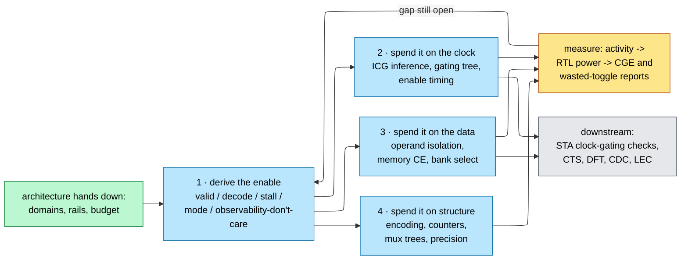
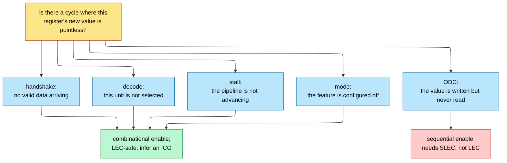
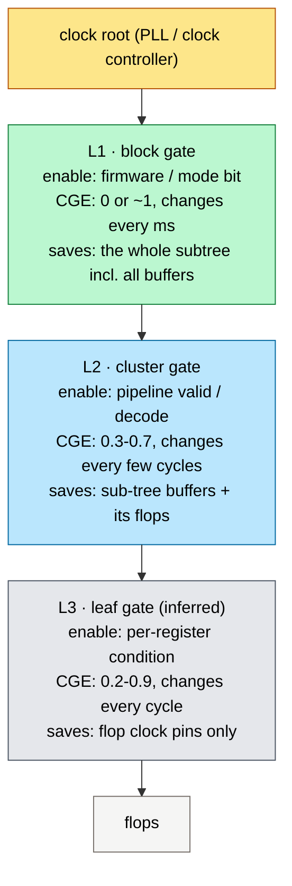
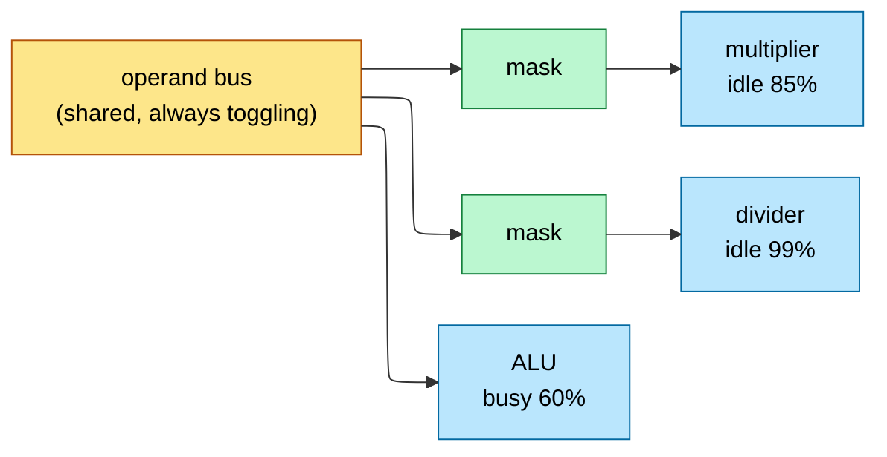
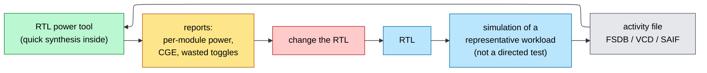

# RTL Low-Power Design and Coding — Spending the Levers One Keystroke at a Time



> **Prerequisites:** [Power Reduction Techniques](04_Power_Reduction_Techniques.md) §2 (the ICG cell derived from the glitch requirement, the $CGE$ saving formula, granularity, and the operand-isolation break-even — this page *uses* that mechanism and re-derives none of it), [Power Fundamentals](01_Power_Fundamentals.md) §2 (the $\alpha C V_{DD}^2 f$ split and the clock-tree share), [Block Activity and Power](02_Block_Activity_and_Power.md) §§5, 8–9 (glitch power, occupancy-to-$\alpha$, and SAIF/FSDB annotation — the measurement half of §8 below), [RTL Design Methodology](../03_Frontend_RTL_and_Verification/01_RTL_Design_Methodology.md) (the coding-style baseline this page adds a power axis to), [Low-Power Architecture](03_Low_Power_Architecture_and_Domain_Partitioning.md) (the domain boundaries you are handed, and may not redraw).
> **Hands off to:** [Power-Aware Verification and UPF Checking](10_Power_Aware_Verification_and_UPF_Checking.md) (how everything written here is *proved*, including the gating equivalence and the X-free boundary this page only promises), [Low Power in CPU, GPU, and NPU](11_Low_Power_in_CPU_GPU_and_NPU.md) (which of these patterns actually pays in each architecture, with the per-engine numbers), [UPF/CPF Power Intent](05_UPF_and_CPF_Power_Intent.md) (the intent file that declares the domains your RTL must not fight), [Synthesis and Optimization](../04_Synthesis/01_Synthesis_and_Optimization.md) and [Synthesis Flow and QoR Closure](../04_Synthesis/04_Synthesis_Flow_and_QoR_Closure.md) (the tool that turns `if (en)` into a cell), [STA](../06_Signoff/01_STA.md) (the clock-gating check the enable path must pass), [DFT and ATPG](../06_Signoff/02_DFT_and_ATPG.md) (why every ICG has a test port).

---

## 0. Why this page exists

[Power Reduction Techniques](04_Power_Reduction_Techniques.md) is the map of levers: which term each lever attacks, what it saves, what it costs, and when it is worth deploying. It is deliberately written one level above the keyboard — it will tell you that clock gating removes $CGE \cdot N \cdot C_{clk/FF} V_{DD}^2 f$ and that the enable must be latched, and then it stops, because the *understanding* is separable from the typing.

This page is the typing. It exists because the gap between "clock gating saves power" and "this module's clock gating saves 34 % and passes timing, DFT, CDC, and equivalence checking" is where a front-end low-power job actually lives, and it is a gap that reading the lever map does not close. Three specific things go wrong in that gap, and each generates a section here:

1. **The enable is the hard part, not the gate.** Synthesis will happily infer an ICG from any `if (en)`. Whether that saves anything depends entirely on whether `en` is false often, is *known* to be false early enough, and is false for reasons the tool could not have discovered on its own. Nobody is short of ICG cells; designs are short of good enables. §2 is about where enables come from.
2. **The obvious code is often the wrong code.** Two RTL descriptions that pass the same testbench and prove logically equivalent can differ by 30 % in power, because one of them told the tool the enable and the other buried it in a mux, or because one of them let a 32-bit operand bus toggle into an idle multiplier. §§3, 5, 6, 7 are the pattern catalogue.
3. **A gated design is a different design downstream.** A gated clock creates a clock-gating check in STA, a skew problem in CTS, a shift-power and controllability problem in DFT, a new crossing question in CDC, and — if the gating is sequential — an equivalence-checking problem that combinational LEC cannot solve. An RTL engineer who does not anticipate those hands the back end a design that has to be un-gated late. §9 is that anticipation.

The organizing claim: **at RTL you own exactly two of the five terms in the power equation — $\alpha$ and, weakly, $C$ — and you own them completely.** $V_{DD}$ belongs to the architect and the regulator, $V_t$ to the library and synthesis, $f$ to the PLL and the governor. But no tool downstream of you can recover an activity factor you gave away, because no tool downstream of you knows which cycles were pointless. Synthesis cannot know that the texture unit's operands are meaningless when `tex_valid` is low; it can only see that they change. That asymmetry — the tool can optimize what you tell it, and can never discover what you did not — is the whole reason this page is longer than "instantiate an ICG."

A note on scope, because the boundary matters in interviews. This page is about **RTL you write**. Synthesis-side power optimization (gate-level clock-gate merging, cell swapping, multi-$V_t$ recovery, pin swapping, path balancing) lives in [04 Synthesis](../04_Synthesis/01_Synthesis_and_Optimization.md); it is real and it is worth 10–20 %, but it operates on a structure you have already fixed. The RTL decisions here are worth 2–5× more and are made in an afternoon, which is why the industry rule of thumb puts **70–80 % of the achievable dynamic-power reduction at or above RTL**, and why "we will fix power in synthesis" is the sentence that precedes a respin of the power budget.

---

## 1. What the RTL engineer actually controls

Start with the equation and cross out what is not yours:

$$P = \underbrace{\alpha}_{\textbf{yours}} \cdot \underbrace{C}_{\text{partly yours}} \cdot \underbrace{V_{DD}^2}_{\text{architect}} \cdot \underbrace{f}_{\text{governor}} \;+\; \underbrace{V_{DD} I_{leak}}_{\text{library, synthesis, power gating}}$$

**$\alpha$ — entirely yours.** Every toggle in the design happens because some RTL line let it happen. The clock net's $\alpha$ is 1 by construction, and clock gating is the only way to lower it. Datapath $\alpha$ is set by whether you let inputs change when the output is unused. Control $\alpha$ is set by encoding. This is the term the page is about.

**$C$ — partly yours.** You do not choose wire capacitance, but you choose *how many* wires and *how far* they go. A 512-bit bus routed across a block because a module boundary was drawn carelessly is capacitance you created; so is a 64-entry CAM where a 16-entry direct-mapped structure would have served, and so is a broadcast to 32 lanes where a tree of registered hops would have done. Structural choices (§7) move $C$; they are just harder to un-make later than an enable.

**$f$ and $V_{DD}$ — not yours, but you can waste them.** You cannot set the frequency, but you can force it up by writing a critical path that needs a higher $V_{DD}$ to close. That is the least-discussed RTL power sin: a design that misses timing at the target voltage gets voltage, and voltage is the cubic term. A pipeline stage added at RTL to relieve the critical path can save more power (by letting the block close at the nominal corner instead of a boosted one) than every ICG in the module. [Power Fundamentals](01_Power_Fundamentals.md) §3 has the arithmetic; the RTL consequence is that **timing slack is a power resource**, and you should think of it that way when you decide whether to spend it.

**$I_{leak}$ — barely yours.** Leakage is a library and implementation matter, except in one respect that is entirely RTL: **state you keep is state that leaks and must be retained.** A 4096-entry table that could have been 512 entries costs leakage every nanosecond the block is powered, costs retention flops or a retention SRAM if the block sleeps, and costs restore time on every wake. Sizing decisions are leakage decisions.

### 1.1 The four RTL knobs, in order of payoff

| # | Knob | Attacks | Typical block-level saving | Cost | Where in this page |
|---|---|---|---|---|---|
| 1 | **Clock gating** (enable extraction, gating hierarchy) | $\alpha_{clk}$, which is the largest single $\alpha$ in the design | 20–40 % of total dynamic; up to 60 % on control-heavy blocks | ICG area (~1–1.5× a flop each), enable timing, DFT hooks | §§2–4 |
| 2 | **Data gating / operand isolation** | $\alpha_{comb}$, including glitch | 5–20 % of total dynamic; 40–70 % of the *isolated unit's* power | one gating layer in the datapath, timing risk | §5 |
| 3 | **Memory access shaping** (CE gating, banking, way selection) | $\alpha$ and effective $C$ of the densest structures | 10–30 % on memory-heavy blocks | address/select timing, area for banking | §6 |
| 4 | **Structural and encoding choices** | $C$ and $\alpha$ together | 2–10 %, occasionally much more on wide buses | area, sometimes timing | §7 |

The order is not arbitrary. Clock gating first because the clock is the only net in the design with $\alpha = 1$ and it reaches every sequential element; everything else competes for the remainder. And notice what is *not* on the list: nothing here requires a new cell, a new rail, or a change to the floorplan. These are all things you can do to a module this week.

### 1.2 The one number that decides whether any of it matters

Before optimizing, get the **block's power decomposition**: what fraction is clock network, sequential, combinational, and memory. Without it you will optimize the wrong term. A planning-grade split for a typical synchronous digital block at an advanced node:

| Component | Share of block dynamic power | What moves it |
|---|---|---|
| Clock network (buffers, wires, flop clock pins) | 20–35 % | clock gating, and only clock gating |
| Sequential (flop internal + output switching) | 15–25 % | clock gating, flop count reduction |
| Combinational logic (incl. glitch) | 25–40 % | data gating, pipelining, arrival balancing |
| Memory (SRAM/RF active energy) | 10–40 % (block-dependent; dominant in caches, register files, scratchpads) | CE gating, banking, access reduction |

If the block is 35 % clock and you spend a week on operand isolation in a datapath that is 8 % of the total, you have capped your win at a few percent. [Block Activity and Power](02_Block_Activity_and_Power.md) §6 has the decomposition method; §8 of this page has the tool loop that produces the numbers for *your* block.

---

## 2. Enable derivation: where a real clock gate comes from

The ICG is a commodity. The enable is the design.

An enable is a *claim*: "no flop behind this gate needs a new value this cycle." The claim has to be true (or the design breaks), it has to be true often (or the gate saves nothing), and it has to be *knowable early* (or the gate cannot close timing). Those three properties — correctness, coverage, arrival — are the entire subject.

### 2.1 The five families of enable

Almost every real enable in a digital design comes from one of five sources. Learning to recognize them is how you find gating opportunities that the synthesis tool cannot.

**(a) Handshake / validity enables — the free ones.** Any pipeline with `valid`/`ready`, any FIFO with `push`/`pop`, any bus with `awvalid`/`wvalid` already carries a signal that means "this stage has work." A stage register whose write condition is `valid_in && ready_out` gates itself:

```systemverilog
// The enable already exists. Use it as a clock condition, not a mux select.
always_ff @(posedge clk or negedge rst_n) begin
  if (!rst_n)                  stage_q <= '0;
  else if (valid_i && ready_o) stage_q <= stage_d;   // ICG inferred here
end
```

This is the highest-value habit on the page, because it costs nothing and it applies everywhere. In a stalling pipeline the coverage is exactly the stall rate plus the bubble rate, which in real workloads is routinely 30–70 %.

**(b) Decode enables — the structural ones.** In any unit with multiple functional sub-units behind a shared decode, only one sub-unit is used per operation. The decoder's one-hot output *is* a set of enables: `en_alu`, `en_mul`, `en_div`, `en_fpu`. Coverage is `1 − (fraction of ops that use this unit)`, which for a divider in a general-purpose core is >99 %. This is where the biggest single wins usually live, and the tool cannot find them because it cannot know that the multiplier's result is discarded when `op != MUL` — the mux downstream *looks* like ordinary logic.

**(c) Stall / backpressure enables — the dynamic ones.** A pipeline that stalls holds state. The `stall` signal is an enable inverted. The trap here is the one in §2.4: `stall` often arrives late, because it is computed from hazard detection across several stages.

**(d) Mode / configuration enables — the coarse ones.** Features that are off for an entire workload: a debug/trace unit, an unused codec profile, half the vector width in a scalar-heavy phase, a second texture pipe that this frame never uses. Coverage approaches 100 % and the enable is static for millions of cycles, so this is the cheapest possible gating — one ICG near the clock root, driven by a configuration register. The design work is not the gate; it is defining a clean "this feature is off" signal and making sure nothing inside the feature is needed by anything outside it.

**(e) Observability-don't-care (ODC) enables — the earned ones.** The register updates, but nobody will ever read the result. A destination register written by an instruction that will be squashed; a prefetch buffer entry whose consumer has already moved on; a partial sum in a MAC array during the drain phase. These enables are *derived* rather than found, which is why they are the ones that separate a low-power designer from a designer. They are also the ones that break combinational equivalence checking (§9.5), because the gated design genuinely produces different values on those don't-care cycles.



### 2.2 The three properties of an enable, and how each fails

**Correctness.** The enable must be false *only* on cycles where no flop behind it needs to change. The asymmetry matters: gating too little wastes power; gating too much corrupts state, and it corrupts it in the most unpleasant way available — the register silently keeps a stale value, and the bug appears many cycles later somewhere else. The two classic correctness failures are (i) an enable that forgets a rare update path (an error-status bit that must latch even when the main pipeline is idle), and (ii) an enable that is correct in the current design and becomes wrong when someone adds a consumer.

**Coverage — the clock-gating efficiency $CGE$.** The fraction of cycles the gate is closed. This is measured, not asserted, and §8 shows how. Two enables can both be correct and differ by 10× in value.

**Arrival.** The enable must be stable before the ICG's latch closes, i.e. it must meet setup to the **falling** edge of the clock (for a transparent-low ICG). This is a half-cycle-ish budget in the *previous* cycle, and it is why the most powerful enables are often unusable: an enable computed from this cycle's data cannot gate this cycle's clock. The fix is always one of three: compute the enable a cycle earlier from registered state; widen the enable pessimistically (a superset that is easier to compute — gate less, but gate in time); or accept a one-cycle-late enable and gate the *next* cycle, which is correct whenever the enable's "off" periods are longer than one cycle.

$$\text{enable path budget} \;\approx\; \frac{T_{clk}}{2} \;+\; t_{\text{clock-tree insertion below the ICG}} \;-\; t_{cq} - t_{setup,ICG} - \text{margin}$$

The clock-tree term is why leaf-level gating has a *more* relaxed enable budget than root-level gating: a leaf ICG sits at the end of the clock tree, so the enable had the whole insertion delay to catch up. Move the ICG toward the root to gate more buffers (§4) and you lose that grace. That trade — **more saving, tighter enable** — is the central tension of gating-tree design.

### 2.3 The enable-quality table

For every gating candidate in a block, fill this in before writing the RTL. It is also an excellent thing to be able to sketch on a whiteboard.

| Candidate | Flops $N$ | Enable source | Expected $CGE$ | Enable arrival | LEC-safe? | Verdict |
|---|---|---|---|---|---|---|
| Texture address stage | 96 | `tex_valid && !stall` | 0.55 | registered, early | yes | infer, leaf |
| FP divider datapath | 380 | `op == DIV` decode | 0.98 | decode, 1 cycle early | yes | infer + isolate operands |
| Debug trace buffer | 2200 | `cfg_trace_en` (CSR) | ~1.0 when off | static | yes | one module-level ICG near root |
| Score-board update | 24 | `wb_valid && !squash` | 0.4 | `squash` is late | yes | widen: gate on `wb_valid` only |
| Speculative rename copy | 128 | branch will resolve not-taken | 0.3 | not knowable in time | **no (ODC)** | needs SLEC; defer |

The last two rows are the interesting ones: a *late* enable gets widened (accept $CGE$ 0.4 → 0.3 to make timing), and an ODC enable gets flagged for the verification cost before it is written, not after.

### 2.4 The hazard: an enable that depends on what it gates

The failure that catches people is circular: the enable is computed from a register that is itself behind the gate. Once the gate closes, the enable's source stops updating, and the gate can never reopen. This is a *deadlock*, not a corruption, so it survives short directed tests and appears in a long random run or, worse, in silicon.

```systemverilog
// WRONG: cnt only advances when gated on, and the enable comes from cnt.
always_ff @(posedge clk) if (cnt != 0) cnt <= cnt - 1;   // gate: (cnt != 0)
// ... elsewhere, someone sets cnt from the SAME gated domain. Once cnt hits 0
// nothing inside the domain can ever make it non-zero again.
```

The rule that prevents it: **the enable's transitive fan-in must contain at least one always-clocked (ungated) sequential element, or a signal from outside the gated group.** In practice that means every gated group needs a wake path — an ungated request/valid input, an always-on control register, or an interrupt — and this is exactly the same argument as the always-on domain in [Power Gating](07_Power_Gating_Retention_and_Wake_Sequencing.md) §9, one level of hierarchy down. Assertion form, worth putting in your project's checker library:

```systemverilog
// Liveness: the group cannot be gated forever while work is outstanding.
property p_gate_can_reopen;
  @(posedge clk) disable iff (!rst_n)
    (work_outstanding && !en) |-> ##[1:MAX_GATE_CYCLES] en;
endproperty
a_gate_can_reopen : assert property (p_gate_can_reopen);
```

---

## 3. The clock-gating coding canon

### 3.1 The inference contract

Every synthesis tool implements roughly the same contract, and knowing it exactly is the difference between getting the gate you wanted and getting a recirculating mux:

> **The tool will extract an ICG when the register's next-state function has the form `q <= en ? d : q`, the enable condition is separable from the data, and the resulting group of flops sharing that enable meets the minimum-fanout threshold.**

Three clauses, three ways to lose. *Separable* means the enable must be recoverable as a Boolean condition on the assignment, not tangled into the data expression. *Group* means flops are gathered by identical enable functions — two registers with logically identical but syntactically different enables may or may not be merged depending on the tool's effort level. *Threshold* means a `set_clock_gating_style -minimum_bitwidth` (or equivalent) below which the tool declines, because §04.2's break-even says a 3-flop gate at low $CGE$ loses.

The canonical, always-correct form:

```systemverilog
// The house style. One reset branch, one enable branch, nothing else.
always_ff @(posedge clk or negedge rst_n) begin
  if (!rst_n)      q <= RESET_VALUE;
  else if (en)     q <= d;
end
```

That is it. No `else`, no recirculation, no ternary on the data. The absent `else` is the point: it says "hold," and "hold" is what becomes a gate.

### 3.2 Patterns that break inference — and their repairs

This table is worth memorizing; every row is a real review comment.

| # | Pattern that fails | Why the tool cannot gate it | Repair |
|---|---|---|---|
| 1 | `q <= en ? d : q;` on the data path | Legal, and *usually* still inferred — but it is a mux description, and with mixed enables in one block the tool may keep the mux | Move the condition to `else if (en)` |
| 2 | `if (en) q <= d; else q <= q;` | Identical to (1); the explicit self-assignment invites a recirculating mux | Delete the `else` |
| 3 | Enable buried in the data: `q <= {8{en}} & d;` | The tool sees a data function, not a hold condition; the register updates every cycle | Separate: `else if (en) q <= d;` |
| 4 | Two different enables in one `always_ff` for one register | Enable is not a single condition; tool may give up | One register, one enable — split the block |
| 5 | Enable that includes the reset: `if (en \|\| !rst_n)` | Reset is not an enable; gating the reset path is a correctness bug (§3.5) | Keep reset in its own branch, outside the enable |
| 6 | Mixed blocking/non-blocking, or a variable assigned in two `always` blocks | Not a clean register description at all | Fix the coding-style violation first |
| 7 | Very small register groups (1–3 flops) | Below the tool threshold — correctly declined | Gather more flops behind one enable, or accept it |
| 8 | Enable is a constant / tied off in this configuration | Tool constant-propagates; no gate, and none needed | Nothing — but check it was intended |
| 9 | `always_ff @(posedge clk)` with an inferred latch elsewhere in the block | Latch inference errors mask the register description | Fix the latch |
| 10 | Gated *variable* used as a clock: `always_ff @(posedge gclk_local)` where `gclk_local` came from an `assign` | Tool sees a user-created clock; may refuse or may create an unconstrained generated clock | Never build clocks with `assign` (§3.4) |

### 3.3 Explicit instantiation, and the wrapper every project should own

Inference is right for the leaf level. Explicit instantiation is right when you want a *specific* gate at a *specific* place — module-level gating, root gating, gating whose enable you have deliberately pipelined, or gating you need to appear identically in every configuration regardless of tool effort. The mistake is instantiating the vendor cell directly in a hundred places, because the cell name is library-specific, the test pin is library-specific, and the simulation model is library-specific.

Own one wrapper. Everything else in the project instantiates the wrapper.

```systemverilog
// -----------------------------------------------------------------------------
// prj_clk_gate — the project's single clock-gating wrapper.
//   * Behavioural model for simulation (glitch-free by construction).
//   * Library ICG for synthesis, selected by one define.
//   * Test enable ORed in so DFT can force the clock on during scan shift.
// -----------------------------------------------------------------------------
module prj_clk_gate (
  input  logic clk_i,        // free-running source clock
  input  logic en_i,         // functional enable (setup to the FALLING edge)
  input  logic test_en_i,    // scan_enable | test_mode — forces the clock on
  output logic clk_o         // gated clock
);
`ifdef SYNTHESIS
  // Library cell. One place in the project knows this name.
  CKLNQD8 u_icg (.CP(clk_i), .E(en_i), .TE(test_en_i), .Q(clk_o));
`else
  // RTL model: transparent-LOW latch, then AND. Matches the cell's semantics
  // so that a functional-sim waveform and a gate-sim waveform agree.
  logic en_latched;
  always_latch if (!clk_i) en_latched <= en_i | test_en_i;
  assign clk_o = clk_i & en_latched;
`endif

`ifndef SYNTHESIS
  // The enable must be stable across the high phase. This assertion is the
  // single most useful thing in the wrapper: it catches a combinational enable
  // that glitches, which is invisible in a zero-delay functional sim but is a
  // clock glitch in silicon.
  a_en_stable_when_high : assert property (
    @(posedge clk_i) 1'b1 |-> $stable(en_latched)
  ) else $error("prj_clk_gate: latched enable moved during the high phase");
`endif
endmodule
```

Three things in that module are doing real work and are worth being able to justify out loud:

- **The behavioural model is a transparent-low latch, not `assign clk_o = clk_i & en_i;`.** If you model the ICG as a plain AND, your simulation is *more permissive* than silicon: an enable that changes mid-high-phase produces a runt in the netlist but looks fine in RTL sim, so the bug ships to gate-level simulation instead of being caught on day one.
- **`test_en_i` is ORed with the enable, never ANDed and never replaced.** During scan shift, every flop must clock. An ICG whose enable happens to be low during shift silently drops shift cycles and every ATPG pattern fails — the classic "the design works but has 0 % scan coverage" bug. See [DFT and ATPG](../06_Signoff/02_DFT_and_ATPG.md).
- **The `SYNTHESIS` define selects the library cell** rather than letting inference build one, so the gate exists at exactly this hierarchy level with exactly this fan-in.

### 3.4 The four forbidden constructs

| Forbidden | Why | Instead |
|---|---|---|
| `assign gclk = clk & en;` | Runt pulses — the derivation is in [04 §2.2](04_Power_Reduction_Techniques.md). No STA arc, no CTS handling, no DFT hook | `prj_clk_gate` |
| `always_ff @(posedge clk) if (x) gclk <= ~gclk;` (clock built in logic) | A clock generated by a data path; unconstrained generated clock, huge skew, CDC nightmare | A real clock divider with a proper SDC `create_generated_clock` — see [Clock Division and Switching](../03_Frontend_RTL_and_Verification/04_Clock_Division_and_Switching.md) |
| Using a gated clock as a *data* signal (`if (gclk) ...` in logic, or sampling it) | Ties data timing to the clock tree; the value depends on insertion delay | Use the enable, never the clock |
| Gating the reset, or the clock to a reset synchronizer | The domain cannot be reset while gated; reset release then happens on an edge that may never come | Reset synchronizers run on the **ungated** clock; see §3.5 |

### 3.5 Reset, and the two rules

**Rule 1: never gate the clock feeding a reset synchronizer.** The async-assert/sync-deassert synchronizer ([Async Design and CDC](../03_Frontend_RTL_and_Verification/06_Async_Design_and_CDC.md) §9) needs edges to walk the deassertion through its two flops. If its clock is gated, the domain asserts reset fine and then never leaves it — or leaves it thousands of cycles later when something unrelated opens the gate. The reset synchronizer belongs on the free-running clock, upstream of every ICG.

**Rule 2: during reset, force the gates open — or prove you do not need to.** Two schools, and you should be able to argue both:

```systemverilog
// School A: force the clock on during reset. Simple, always correct, costs
// a few cycles of full-power clocking at reset. This is the default.
assign icg_en = en_functional | ~rst_n_sync;

// School B: leave the gates closed and rely on the async reset to set state.
// Correct ONLY if every flop behind the gate has an async reset, and nothing
// behind the gate needs a synchronous reset-time initialization.
assign icg_en = en_functional;
```

School B is common in large arrays where the reset-time clock burst is a real IR-drop event (thousands of flops toggling at once), and it is where a specific bug lives: one flop in the group has *no* async reset because someone wanted a smaller cell, so it comes out of reset holding X, and the X is not corrected until the gate opens. Power-aware simulation with X-propagation enabled ([Power-Aware Verification](10_Power_Aware_Verification_and_UPF_Checking.md) §9) is what finds it.

### 3.6 The DFT contract, stated once

Every ICG in the design has four obligations, and an RTL engineer who forgets them will be asked about them in the DFT review:

1. **Shift transparency.** `test_en` (usually `scan_enable | test_mode`) forces the gate open so shift works. This is §3.3.
2. **Capture controllability.** During capture, the enable must be *controllable* by ATPG — which it is, if the enable is driven by scanned flops. An enable driven by an unscanned analog/PLL status bit creates untestable logic behind the gate.
3. **The gate itself must be testable.** ATPG needs to prove the ICG can block the clock; tools handle this if the cell is a recognized ICG with a Liberty `clock_gating_integrated_cell` attribute — another reason to instantiate a library cell rather than build one.
4. **Shift power.** Forcing every gate open during shift means 100 % clock activity and ~30–50 % toggle on the scan chains — often *higher* than any functional mode. This is the number that sizes the test-mode power budget; see [Power Analysis and Signoff](06_Power_Analysis_and_Signoff.md) §12, and note the fix is usually low-power ATPG / staggered chain enables, not un-gating.

---

## 4. The gating hierarchy: design the tree, do not accept the tool's

Synthesis inserts leaf gates. Leaf gates capture idleness precisely and reduce almost none of the clock *network* — the buffers above the leaf still toggle. Getting the network requires gating nearer the root, which requires enables that arrive earlier and cover longer. The answer is not one or the other; it is a deliberate three-level tree.



### 4.1 What each level catches that the others cannot

| Level | Fan-out | Enable changes | Catches | Misses | Cost |
|---|---|---|---|---|---|
| **L1 block** | $10^3$–$10^5$ flops | ms–s (firmware) | whole-block idle: the feature is off, the frame is done, the queue is empty | everything cycle-scale | ~1 ICG; enable is a CDC-synchronized config bit |
| **L2 cluster** | $10^2$–$10^3$ | cycles (pipeline) | stage-level bubbles, stalls, unit-not-selected | per-register variation inside the cluster | a few ICGs; enable must be early |
| **L3 leaf** | 4–64 | every cycle | per-register idleness the cluster enable is too coarse to see | all clock-tree buffers above it | many ICGs (~5–8 % area); enable is local and easy |

The saving is *multiplicative in the complement*: if L1 is open, L2 gates 50 %, and L3 gates a further 40 % of what remains, the flop clock pins see $0.5 \times 0.6 = 30 \%$ activity, while the buffers between L1 and L2 see 100 %. That is the argument for pushing gating up: **the top of the tree carries the most capacitance and is gated by the fewest cells.**

### 4.2 The break-even, level by level

From [04 §2.2](04_Power_Reduction_Techniques.md): an ICG presents ~2 flops of clock load that is never recovered, so a gate breaks even at $N \approx 2/CGE$ flops. Applied per level:

| Level | Typical $CGE$ | Break-even $N$ | Real $N$ | Margin |
|---|---|---|---|---|
| L3 leaf | 0.5 | 4 | 8–32 | comfortable — but a 4-flop group at $CGE = 0.1$ needs $N \ge 20$ and *loses* |
| L2 cluster | 0.4 | 5 | 200–1000 | overwhelming |
| L1 block | ~1.0 when off | 2 | 10 000+ | free |

So the tool's `minimum_bitwidth` threshold (commonly set to 3–8) exists to kill exactly one case: tiny leaf groups with poor enables. Set it deliberately. Setting it to 3 to "gate more" reliably makes some blocks *worse*, and the report that shows it is the per-gate $CGE$ report of §8.2.

### 4.3 Root gating: buying the buffers, paying in enable timing

Moving a gate up the tree by one level of buffering typically buys another 5–15 % of the clock-network power and costs the enable that level's insertion delay — often 50–150 ps at a time when you had a few hundred. Three techniques recover the timing:

**(a) Pipeline the enable.** Compute it a cycle early from registered state. Free if such state exists; a functional change if it does not.

```systemverilog
// The enable for cycle N+1 is computed and registered during cycle N.
always_ff @(posedge clk or negedge rst_n)
  if (!rst_n) blk_active_q <= 1'b0;
  else        blk_active_q <= |req_vec_d | outstanding_d | drain_pending_d;

prj_clk_gate u_l2 (.clk_i(clk), .en_i(blk_active_q), .test_en_i(scan_en), .clk_o(clk_blk));
```

**(b) Widen the enable.** Replace a precise late enable with a cheap early superset — `any_request_in_flight` instead of `this_particular_stage_will_advance`. You lose $CGE$ and keep the gate.

**(c) Hold the gate open longer (hysteresis).** Open on the first sign of work, close only after $K$ idle cycles. This costs a little $CGE$, removes the timing pressure of a per-cycle decision, and — importantly — stops the gate from *chattering*, which matters because each open/close is itself a transition on a huge net. A counter of 4–16 cycles is typical.

```systemverilog
// Hysteresis: open immediately, close after IDLE_HOLD quiet cycles.
localparam int IDLE_HOLD = 8;
logic [$clog2(IDLE_HOLD+1)-1:0] idle_cnt_q;
always_ff @(posedge clk or negedge rst_n) begin
  if (!rst_n)          idle_cnt_q <= '0;
  else if (work_seen)  idle_cnt_q <= '0;
  else if (idle_cnt_q != IDLE_HOLD) idle_cnt_q <= idle_cnt_q + 1'b1;
end
assign blk_en = work_seen | (idle_cnt_q != IDLE_HOLD);
```

The three enable shapes, on one timeline. `work` is bursty; the naive enable follows it exactly and chatters, the hysteretic enable holds through the short gaps, and the staggered version splits one large group into sub-groups released on successive edges so the wake is not a single $di/dt$ event (§10, entry 14):

```wavedrom
{ "signal": [
  { "name": "clk",              "wave": "p................." },
  { "name": "work_seen",        "wave": "0.1.0.1.0........." },
  { "name": "en (naive)",       "wave": "0.1.0.1.0........." },
  { "name": "en (hysteretic)",  "wave": "0.1.....0........." },
  {},
  { "name": "en_grp0 (staged)", "wave": "0.1.....0........." },
  { "name": "en_grp1 (staged)", "wave": "0..1.....0........" },
  { "name": "en_grp2 (staged)", "wave": "0...1.....0......." },
  { "name": "en_grp3 (staged)", "wave": "0....1.....0......" }
 ],
 "head": {"text": "hysteresis removes the chatter; staggering spreads the wake current"}
}
```

Read the naive row against the hysteretic one: two short idle gaps produce two full close/open cycles on a net that reaches thousands of flops, and each of those transitions costs more than the handful of gated cycles saved. Then read the four staged rows: the same total enable, released one cycle apart per sub-group, turns one large simultaneous current step into four smaller ones — the RTL-level twin of the daisy-chained switch turn-on in [07 §6](07_Power_Gating_Retention_and_Wake_Sequencing.md).

### 4.4 A worked gating plan for a GPU sub-module

Take a shader-core texture-and-load/store slice: ~14 000 flops, 400 MHz, and a measured clock-network share of 32 %. Assume $C_{clk/FF} = 10$ fF, $V_{DD} = 0.75$ V, so the un-gated clock power at the flop pins is

$$P_{clk,FF} = N \cdot C_{clk/FF} \cdot V_{DD}^2 \cdot f = 14000 \times 10\,\text{fF} \times 0.75^2 \times 400\,\text{MHz} \approx 31.5\ \text{mW}$$

with roughly the same again in the buffers above them (the network total is the ~32 % share). The plan:

| Group | $N$ | Level | Enable | $CGE$ | Flop-pin clock saved |
|---|---|---|---|---|---|
| Texture filter datapath | 4200 | L2 | `tex_req_active_q` (pipelined) | 0.45 | 4.3 mW |
| LSU coalescer + MSHRs | 2600 | L2 | `mem_req_active_q` | 0.35 | 2.0 mW |
| Per-stage pipeline regs | 3800 | L3 | `valid && !stall` | 0.55 | 4.7 mW |
| Descriptor / config shadow | 900 | L1 | `cfg_written` (rare) | 0.99 | 2.0 mW |
| Debug + perf counters | 1200 | L1 | `dbg_en` (off in production) | 1.0 | 2.7 mW |
| Control FSM + arbiters | 1300 | — | ungated (always live) | 0 | 0 |
| **Total** | 14000 | | | **~0.50 weighted** | **~15.7 mW of 31.5 mW** |

Then the second-order effect that is the actual point of the table: the two L1 gates and the two L2 gates sit *above* their sub-trees, so they also stop the buffers feeding ~8900 flops. Crediting the buffer half of the network at the same $CGE$ adds roughly another 10 mW, taking the clock-network saving from ~50 % of the flop pins to ~55 % of the whole network — about **17 % of the block's total dynamic power**, for approximately 30 ICG cells plus five enable-generation blocks.

Two things about this table are worth rehearsing for an interview. First, the ungated row: **the control FSM and arbiters are deliberately never gated**, because they are the logic that decides when everything else may sleep — the §2.4 hazard in its structural form. Second, the L1 debug row is the single best line in the table (2.7 mW for one gate and one configuration bit), which is the general rule that the cheapest gating is always the coarsest.

---

## 5. Data gating in RTL: stopping the logic between the registers

Clock gating stops registers from capturing. It does nothing about the combinational cloud *between* registers, which keeps recomputing whenever its inputs move — and its inputs move because they are shared buses driven by other consumers. On a wide arithmetic block this is the larger number: a 32×32 multiplier's dynamic power is dominated by partial-product and carry-chain toggling, of which a large share is glitch ([Block Activity](02_Block_Activity_and_Power.md) §5), and every bit of it is wasted on a cycle whose result is discarded.

### 5.1 Three implementations, and how to choose

| Implementation | Code | Area | Delay added | Glitch behaviour | When |
|---|---|---|---|---|---|
| **AND mask** | `a_g = a & {W{en}}` | $W$ AND gates | 1 gate on the data path | forces operands to 0 — but the *transition to* 0 is itself a full toggle | default; cheap and predictable |
| **Latch hold** | transparent-low latch on each operand bit | $W$ latches (~4× an AND) | latch delay + a setup constraint | holds the last value: **zero** transitions while idle | wide, deeply idle units; the best power, the worst timing story |
| **Register hold** | `always_ff if (en) a_q <= a;` | $W$ flops | a pipeline stage | zero transitions, and it is also clock-gated | when you can afford the latency |

The distinction that matters and that people get wrong: **an AND mask still pays one full transition each time the unit goes idle and one when it wakes.** For a unit that toggles between idle and active every few cycles, masking to zero can be *worse* than doing nothing, because you have added a forced all-bits-change event at each boundary on top of the natural data changes. Latch/register hold has no such penalty. The rule:

$$\text{use masking when } \; T_{idle} \gg 1 \text{ cycle}; \quad \text{use hold when the unit chatters, or when } W \text{ is large}$$

There is one case where masking is strictly better regardless: when the isolated block's power depends on the *value* and zero is the cheap value — a multiplier fed zeros produces no partial products at all, whereas a held random operand keeps the internal nodes at whatever they were (no toggling, but also no help). Since holding already gives you zero toggling, this only matters for leakage-sensitive or bias-dependent structures. Masking to zero also has a verification virtue: it makes the idle-cycle output *deterministic*, which is what lets you assert on it (§5.3).

```systemverilog
// (a) AND mask — the default.
assign a_gated = a & {WIDTH{op_is_mul}};
assign b_gated = b & {WIDTH{op_is_mul}};

// (b) Latch hold — better for a wide, chattering unit.
//     Transparent while enabled, opaque (holding) while idle.
always_latch if (op_is_mul) a_held <= a;
always_latch if (op_is_mul) b_held <= b;

// (c) Register hold — a pipeline stage that is itself clock-gated.
always_ff @(posedge clk or negedge rst_n) begin
  if (!rst_n)           {a_q, b_q} <= '0;
  else if (op_is_mul)   {a_q, b_q} <= {a, b};
end
```

Note the latch version is exactly the construct RTL style guides ban ("no inferred latches"), which is why it must be *deliberate*, isolated in a small named module, waived in lint with a comment, and accompanied by the assertion that its enable is stable when opaque. Most projects that use it wrap it the same way §3.3 wraps the ICG.

### 5.2 Where to put the isolation: source or sink

Isolate at the **consumer's inputs**, not at the producer's outputs, unless the producer's output feeds only that consumer. The reason is arithmetic: a bus with $K$ consumers, one of which is idle, should have $1$ gating layer at the idle consumer, not a gating layer at the producer that would starve the other $K-1$. The exception — one producer, one consumer, long wire — flips it, because gating at the source also stops the *wire* from toggling, and on a long route the wire is most of the capacitance.



### 5.3 The valid-qualified datapath discipline

The most valuable habit in this whole section is a discipline rather than a construct:

> **Every datapath signal is either valid, or held at a defined constant. Nothing in the design is allowed to be "don't care, and also toggling."**

"Don't care" in a specification means the *functional* result is unconstrained; it does not mean the wires may thrash. A datapath written to this discipline gets three things at once: lower power (no pointless toggling), X-clean power-aware simulation (an isolated boundary has a defined value — see [Power-Aware Verification](10_Power_Aware_Verification_and_UPF_Checking.md) §5, where exactly this idea reappears as the UPF isolation clamp), and assertable behaviour:

```systemverilog
// The discipline, made checkable. An idle unit's operands must be quiet.
a_idle_operands_quiet : assert property (
  @(posedge clk) disable iff (!rst_n)
  !op_is_mul |=> $stable(a_gated) && $stable(b_gated)
) else $error("multiplier operands toggled while the unit was idle");
```

That single assertion, replicated per gated unit, is how a project keeps its data gating from silently rotting when someone adds a bypass path six months later.

### 5.4 Do not isolate the critical path

The gating layer sits *in* the datapath, so it adds delay, and its enable must arrive before the data. If the isolated unit is on the critical path you have traded power for frequency, and frequency costs voltage, and voltage is cubic — a losing trade almost every time.

The check, before you write the mask:

$$t_{arrival}(\text{enable}) + t_{gate} \;\le\; t_{arrival}(\text{data}) \quad\text{and}\quad \text{slack after isolation} > 0$$

If the enable is a decode output it usually arrives early and this is free. If the enable comes from a comparison against this cycle's data, it does not, and the isolation must move back one pipeline stage — isolate the *registered* operands feeding the unit, not the combinational ones inside it.

### 5.5 Structural glitch control, which is data gating's other half

Glitch power is 20–40 % of combinational power in wide arithmetic at advanced nodes. Isolation removes it on idle cycles; on *active* cycles it is a structural problem, and the RTL-visible levers are:

- **Pipeline deep clouds.** A register in the middle of a 20-level cloud stops glitches from propagating past it and re-converging. This is why heavily pipelined arithmetic is often lower-power per operation than a single-cycle version at the same throughput, not just faster.
- **Balance arrival times into reconvergent nodes.** A wide OR/AND reduction built as a linear chain has maximally unbalanced arrivals; built as a balanced tree it glitches far less. Write `|vec` and let the tool build a tree; hand-writing a chain of `a | b | c | ...` sometimes preserves the chain.
- **Register control before it fans out.** A select signal that arrives late and glitches drives every mux in the block through a full spurious transition. Registering the select costs a cycle and removes an entire class of activity.
- **Keep one-hot selects one-hot.** A decoder output that transiently shows two hot bits opens two paths through a mux tree; a gray-coded or registered select does not.
- **Avoid gratuitous width.** Sign-extending a 12-bit value to 32 bits means 20 wires that all toggle together on every sign change. Carry the narrow value as far as possible and extend at the consumer.

### 5.6 Worked example: one MAC lane of an NPU array

A 16-bit×16-bit MAC lane with a 40-bit accumulator, in an array where a given lane is active only when its tile of the weight matrix is non-zero. Measured lane activity in a sparse workload: 45 % of cycles genuinely compute, 55 % are structural zeros or drain cycles.

```systemverilog
module mac_lane #(parameter int AW = 40) (
  input  logic                 clk, rst_n,
  input  logic                 lane_valid_i,   // this lane has real work
  input  logic signed [15:0]   a_i, w_i,
  input  logic                 acc_clr_i,
  output logic signed [AW-1:0] acc_o
);
  // 1. Data gating: hold operands when the lane is idle. Holding (not masking)
  //    because lane_valid toggles every few cycles in a sparse workload.
  logic signed [15:0] a_h, w_h;
  always_latch if (lane_valid_i) a_h <= a_i;
  always_latch if (lane_valid_i) w_h <= w_i;

  // 2. The zero shortcut: a zero weight costs nothing if it never reaches the
  //    array. Detect it one stage early and fold it into the lane enable.
  logic w_is_zero;
  assign w_is_zero = (w_i == '0);

  logic lane_en;
  assign lane_en = lane_valid_i & ~w_is_zero;

  // 3. Clock gating on the accumulator: the biggest register in the lane.
  logic signed [AW-1:0] acc_q;
  always_ff @(posedge clk or negedge rst_n) begin
    if (!rst_n)          acc_q <= '0;
    else if (acc_clr_i)  acc_q <= '0;
    else if (lane_en)    acc_q <= acc_q + (a_h * w_h);   // ICG on (acc_clr | lane_en)
  end
  assign acc_o = acc_q;
endmodule
```

Three levers in twenty lines, and the interview-relevant part is being able to say what each one buys: the latches remove ~55 % of the multiplier's toggling (the largest term); the zero-detect removes the *remaining* multiplies whose result is a no-op, which in a 60 %-sparse tensor is another large slice and is the entire mechanism behind "sparsity saves power" ([Low Power in CPU, GPU, and NPU](11_Low_Power_in_CPU_GPU_and_NPU.md) §5); and the ICG removes the accumulator's clock on the same cycles. Also worth saying out loud: the `acc_clr_i` branch is deliberately *outside* the `lane_en` condition, because clearing must work even when the lane has no work — the §2.2 correctness trap, avoided.

---

## 6. Memory and register files: the densest activity in the design

Memories are where a large block's power actually is, and they are the structure where RTL choices translate most directly into joules, because an SRAM's energy is charged **per access**, not per bit of useful data.

### 6.1 Chip enable is the highest-leverage signal in the design

An SRAM read costs $E_{read}$ whether or not the data is used. A read whose result is discarded — because the pipeline stalled, because a tag missed, because the request was speculative — is pure waste, and it is the single most common power bug in memory-facing RTL:

```systemverilog
// WRONG: reads every cycle, uses the result sometimes. Costs full read energy
// on ~40% of cycles for nothing, and the tool cannot fix it.
assign ram_ce = 1'b1;
assign result = ram_dout;

// RIGHT: read only when the result will be consumed.
assign ram_ce = req_valid & ~stall_q & ~squash_q;
```

Rough magnitudes worth carrying: an access to a small SRAM (a few KB) costs on the order of **1–5 pJ**, a large one (hundreds of KB) **10–50 pJ**, against roughly **0.1–1 pJ** for a 32-bit arithmetic operation at the same node. That ratio — a memory access is worth tens of ALU operations — is why "compute it again instead of storing it" is sometimes the low-power answer, and it is the same ratio that drives every dataflow decision in [NPU tiling](../01_Architecture_and_PPA/03_NPU_Architecture/02_Mapping_and_Memory/01_Tensor_Tiling_and_Data_Movement.md).

### 6.2 Read fewer bits: banking, way selection, and sub-arrays

A 4-way set-associative cache that reads all four ways in parallel and then muxes on the tag comparison burns 4× the data-array energy per access. The alternatives, in ascending order of latency cost:

| Scheme | Data-array energy | Latency | Where used |
|---|---|---|---|
| Parallel tag + all ways | $4 E_{way}$ | 1 access | L1 caches where latency is everything |
| Way prediction | $\approx 1.05 E_{way}$ | 1 access, +1 on mispredict | L1 in power-sensitive cores |
| Serial tag-then-data | $E_{tag} + E_{way}$ | 2 accesses | L2/L3, where +1 cycle is invisible |
| Banked, address-decoded | $E_{bank}$, bank $\ll$ array | 1 access | register files, scratchpads, wide SRAMs |

At RTL you express this as *which enables you drive*, and the mistake is driving all of them because it is simpler. Banking is the one that generalizes: splitting a 4 KB × 32 b array into four 1 KB banks and enabling one cuts the bitline and wordline capacitance charged per access by roughly 4×, at the cost of a decoder and some area. See [Memory Circuits and Technologies](../00_Fundamentals/06_Memory_Circuits_and_Technologies.md) for where the energy goes inside the array, and [04 §6](04_Power_Reduction_Techniques.md) for the sleep-mode ladder on top.

### 6.3 Write shaping

- **Byte enables, not read-modify-write.** Reading a word to merge one byte and writing it back costs read + write. Use the macro's byte-write enables.
- **Do not write what did not change.** For configuration shadows and slowly-changing tables, compare and skip: `we = new_val_valid & (new_val != cur_val)`. This is the memory-level version of XOR self-gating; it costs a comparator and pays whenever writes are redundant, which for register shadows is most of the time.
- **Coalesce.** Two 32-bit writes to adjacent addresses cost two accesses; one 64-bit write costs one.

### 6.4 The GPU register file, which is its own category

A GPU shader core's register file is the largest and most-accessed SRAM structure in the design — hundreds of KB per core, read 2–3 operands and written 1 result per instruction per warp, at full rate. It routinely reaches **15–20 % of core dynamic power**, comparable to the entire clock network. The RTL-visible levers, which are worth knowing by name for a GPU interview:

- **Bank the file and gate per bank.** Only the banks holding this instruction's operands are enabled; the operand collector already knows which those are.
- **Operand reuse / result forwarding.** If an operand was just produced or just read, take it from a small reuse cache or the bypass network instead of re-reading the RF — this is a real structure in shipping GPUs precisely because the RF read is so expensive.
- **Suppress reads for inactive lanes.** Under divergence, a warp may have only a few active lanes; reading the full 32-lane-wide entry wastes most of the energy. Gating per lane group is the fix, and the enable is the active mask.
- **Do not write back for predicated-off lanes.** Same idea on the write side, driven by the same mask.

[Operand Collectors, Register Files and Scoreboards](../01_Architecture_and_PPA/02_GPU_Architecture/01_Core_Architecture/03_Operand_Collectors_Register_Files_and_Scoreboards.md) has the microarchitecture; the point here is that all four levers are *enable* decisions expressed in RTL.

### 6.5 FIFOs: pointers, never shifting

A shift-register FIFO moves every entry on every push — $O(\text{depth} \times \text{width})$ toggles per operation. A pointer FIFO writes one entry and moves two pointers — $O(\text{width})$. For any depth above about four, the pointer version is dramatically lower power, and the gray-coded pointers of an async FIFO have the additional property that only one bit changes per increment. See [Flow Control and FIFOs](../03_Frontend_RTL_and_Verification/15_Flow_Control_and_FIFOs.md).

---

## 7. Structure and encoding: the choices that move $C$ and $\alpha$ together

These are smaller wins individually, but they are decisions you can only make at RTL — synthesis cannot re-encode your state machine across a functional boundary or narrow your bus.

### 7.1 FSM encoding

| Encoding | Bits for $S$ states | Toggles per transition | Next-state logic | Choose when |
|---|---|---|---|---|
| Binary | $\lceil \log_2 S \rceil$ | 1–$\log_2 S$ (avg ~$\log_2 S / 2$) | deeper decode | many states, few flops available, state register is wide and shared |
| One-hot | $S$ | exactly 2 | shallow, fast | $S \lesssim 16$, speed matters, and the state bits *are* the enables |
| Gray | $\lceil \log_2 S \rceil$ | exactly 1 — but only along the coded sequence | more complex if transitions are irregular | counters and linear sequences, CDC pointers |

The honest summary an interviewer is listening for: **one-hot minimizes flop toggling (always 2 bits) but maximizes flop count and hence clock power; binary minimizes clock power but toggles more bits and needs deeper decode logic.** Which wins depends on whether your block's power is clock-dominated or logic-dominated — and for an FSM with, say, 8 states, we are arguing about a handful of flops, so the real reason to care is that one-hot state bits double as clean, early enables for the datapath they control, which is worth more than either encoding's toggle count.

### 7.2 Counters

A binary counter's low bit toggles every cycle and its carry chain ripples; a 32-bit free-running counter is a surprisingly expensive object to leave running. Levers: **gray coding** (one bit per increment — the standard choice for FIFO pointers crossing domains), **LFSR** (one XOR tap; excellent when you need $2^n-1$ distinct values in *some* order, e.g. a test-pattern or refresh-address generator), and **split counters** (a fast small low half gating a slow high half, so the wide upper bits and their carry chain only move on wrap). For a 32-bit timer, splitting into 8+24 with the upper half clock-gated on the lower half's carry removes almost all of its power.

### 7.3 Muxing and shifting

A barrel shifter built as $\log_2 W$ stages of 2:1 muxes toggles every stage on every shift-amount change; the intermediate stages glitch heavily because their selects arrive at different times. If the shift amount is stable for many cycles (a format converter, a fixed alignment), register the amount. If only a few shift amounts are ever used, a one-hot mux of precomputed shifts is both faster and quieter. And a mux tree fed by a *registered* one-hot select is the low-glitch canonical form, because exactly one path is enabled and the select does not move mid-cycle.

### 7.4 Precision and value-aware tricks

- **Carry the narrow value.** Do arithmetic at the width the data needs, not the width of the bus.
- **Zero/one shortcuts.** `x * 0`, `x * 1`, `x + 0` are extremely common in real workloads (sparse tensors, masked pixels, padded sequences). Detecting them costs a comparator and skips the whole operation — see §5.6 and, at architecture scale, [Sparsity, Quantization and Compression](../01_Architecture_and_PPA/03_NPU_Architecture/02_Mapping_and_Memory/02_Sparsity_Quantization_and_Compression.md).
- **Mixed precision as an enable.** When a unit supports FP32 and FP16, the upper datapath should be *isolated*, not merely unused, in FP16 mode. This is a mode enable (§2.1d) and is often worth more than any leaf gating in the same unit.

### 7.5 Interconnect

Long buses are capacitance you chose. The RTL-visible levers: send `valid`-qualified data and hold the bus stable when invalid (never drive don't-care patterns onto a long bus); prefer narrow-and-fast to wide-and-slow when the wire is long; register long routes rather than letting a glitchy signal propagate the full distance; and, for genuinely wide off-block buses, consider bus-invert coding, whose construction and worst-case bound are in [04 §7](04_Power_Reduction_Techniques.md). Address buses are the special case where sequential access means gray-like locality already exists — do not destroy it with an address scramble unless banking requires it.

---

## 8. The RTL power feedback loop: measuring what you just claimed

Every number in §§4–7 was an estimate. The loop that turns estimates into evidence is short, and being able to describe it is the difference between "I did clock gating" and "I closed a 12 % gap."

### 8.1 The chain



The tools in the middle box are RTL power estimators — Ansys **PowerArtist**, Synopsys **PrimePower** (RTL mode) / **SpyGlass Power**, Cadence **Joules** — all of which do a fast synthesis internally so they can attribute power to gates while still reporting it against RTL line numbers. Accuracy versus gate-level signoff is typically **±15–20 %** on absolute power and much better than that on *relative* comparisons, which is all you need: the loop's job is to rank your options, not to sign anything off. Signoff lives in [Power Analysis and Signoff](06_Power_Analysis_and_Signoff.md).

Two practical points that decide whether the loop is worth anything:

- **The stimulus is the experiment.** Power measured on a directed unit test is meaningless — directed tests have unrepresentative idle patterns in both directions. Use a real workload window: a frame of graphics, a few hundred inference tokens, a benchmark kernel, captured from emulation if the window needs to be long. [Block Activity](02_Block_Activity_and_Power.md) §9 covers the annotation formats and the coverage question ("does this window represent anything?").
- **SAIF averages, FSDB/VCD keeps time.** A SAIF file carries per-signal toggle rates and static probabilities for a window — compact, and enough for average power. If you need *peak* power or want to see a specific phase, you need the time-resolved dump. Use SAIF for the weekly regression, FSDB for debugging a specific hotspot.

### 8.2 Reading the reports: the three numbers that matter

**Clock-gating efficiency, per gate.** Not the block average — the *distribution*. The block average hides the two pathologies: a handful of huge gates with $CGE \approx 0$ (an enable that is always true, i.e. an ICG that costs area and saves nothing) and a long tail of tiny gates below break-even. Sort by $N \times (1 - CGE)$ to find the flops that are still clocking for nothing.

**Gated-flop coverage.** What fraction of the design's flops sit behind *any* gate. A mature block is 85–95 %; below ~70 % means whole modules were written without enables. This number is the first thing a low-power reviewer asks for, and "what is your clock-gating coverage and your average CGE?" is a stock interview question with a stock structure to the answer: coverage says whether you *tried*, CGE says whether it *worked*.

**Wasted toggles.** The tool's estimate of activity that produced no architecturally visible effect: registers that reloaded the same value, memory reads whose data was discarded, arithmetic whose result was muxed away, and glitch. This is the report that finds the opportunities you did not think of, and it is what distinguishes an RTL power tool from a spreadsheet.

| Report row | Healthy | Suspicious | What it usually means |
|---|---|---|---|
| Gated-flop coverage | 85–95 % | < 70 % | modules written without enables |
| Mean $CGE$ | 0.3–0.6 | < 0.15 | enables are too weak, or always true |
| Gates below break-even | few | many | `minimum_bitwidth` too low |
| Clock share of dynamic | 20–35 % | > 45 % | gating not reaching the tree; consider root gating |
| Redundant-write fraction | < 10 % | > 30 % | missing compare-and-skip / self-gating |
| Glitch share of comb. power | 15–30 % | > 40 % | unbalanced arrivals; pipeline or register the selects |

### 8.3 Power lint, and what it is good for

RTL power lint (SpyGlass Power, and the equivalent rule decks in the other tools) is a *static* checker: no stimulus, no activity, just structural rules — "this register has an enable expressed as a mux," "this memory's CE is tied high," "this bus is driven with don't-cares," "this arithmetic unit's operands are not isolated and its output is muxed away." It finds opportunities and coding-style violations quickly and cheaply, and it finds nothing about how *often* anything happens. Run lint first because it is free; then run the activity-based loop, because only it can tell you which lint finding is worth 3 mW and which is worth 30 µW.

### 8.4 A workflow with a target

1. Get the decomposition (§1.2) from one representative window. Decide which term you are attacking.
2. Run power lint; fix the free structural findings.
3. Build the enable-quality table (§2.3) for the top 10 register groups by flop count.
4. Implement L1 and L2 gating first (§4) — biggest per-cell payoff, and it changes the tree, so do it before tuning leaves.
5. Re-measure. Compare against the *predicted* saving; investigate every discrepancy larger than about 20 %, because a gate that did not deliver is usually a gate whose enable is not what you thought.
6. Then data gating on the units the report says are large and idle (§5), then memory (§6), then structure (§7).
7. Re-run functional regression and lint after every step — a gating change is a design change, and the most common way to lose a week is to discover at the end that step 4 broke a corner case.

---

## 9. What gated RTL does to the rest of the flow

Everything in this page changes the design as seen by five downstream disciplines. Anticipating them is a large part of what "senior" means here, and each of these is a stock interview question.

### 9.1 STA: the clock-gating check

An ICG creates a **clock-gating check**: the enable must be stable around the gating clock edge, which for a transparent-low ICG means setup to the falling edge and hold after it. The tool infers it automatically from the recognized cell. Two consequences:

- The enable path is timed against roughly a *half* cycle plus whatever clock-tree insertion delay sits below the ICG (§2.2). A block whose enables are computed from deep logic will show clock-gating-check violations that look mysterious until you realize the endpoint is a latch's enable pin, not a flop's D pin.
- The gated clock is a **generated clock**, and it must be declared as such in SDC or every path through it is unconstrained. Inference-created ICGs are handled by the tool; explicitly instantiated ones in a hierarchy the constraints did not anticipate are exactly where the "path not constrained" surprises come from. See [Constraints (SDC)](../04_Synthesis/02_Constraints_SDC.md).

### 9.2 CTS: the gated clock is a tree with a hole in it

Clock tree synthesis must balance skew across a tree that now has ICGs in it, and an ICG is both a delay element and a *load* — its own clock pin toggles even when it is gating. Three effects the RTL author caused:

- **Skew across the gate.** Flops below an ICG and flops beside it are on different paths; CTS must balance them, which usually means buffering the un-gated side to match the ICG's insertion delay — capacitance you added by gating.
- **ICG cloning.** If one ICG drives 2000 flops spread across the block, CTS will clone it into several, each with its own copy of the enable. Your one enable net becomes several; its timing must hold for all of them.
- **Where the ICG is placed** determines how much of the tree it actually stops. This is CTS's decision, informed by your hierarchy. Root gating (§4.3) only pays if the physical tree agrees with the logical one. See [Clock Tree Synthesis](../05_Backend_Physical_Design/05_Clock_Tree_Synthesis.md).

### 9.3 DFT

Covered as a contract in §3.6. The two failure modes to be able to name: **shift** breaks if `test_en` is missing (0 % coverage, caught immediately), and **capture** coverage degrades if enables are driven by unscanned logic (caught late, in the ATPG coverage report, and expensive to fix). The third, quieter one: **shift power** is often the design's true peak, which is why low-power ATPG and staggered scan-chain enables exist.

### 9.4 CDC and RDC

- **A gated clock is still a clock domain.** A signal crossing from a gated domain to an always-on one must be synchronized as usual — and, worse, the source domain may be *stopped*, so a pulse-based crossing can be missed entirely. Use a level/handshake crossing (or an async FIFO) across any boundary where one side can stop.
- **Never clock a synchronizer with a gated clock** whose gate depends on the very signal being synchronized. That is the §2.4 deadlock wearing a CDC hat, and it is one of the most common real bugs in power-managed designs.
- **Enables that cross domains** must be synchronized before they reach the ICG, and must be glitch-free after synchronization (a 2-flop synchronizer output is, which is why the enable should be synchronized *as a level* and used directly, not recombined with other domain signals afterwards).
- **RDC (reset-domain crossing)** matters because a gated block that is reset while its neighbours are not creates exactly the reset-domain crossing that [Lint, CDC, RDC Signoff](../03_Frontend_RTL_and_Verification/07_Lint_CDC_RDC_Signoff.md) exists to find.

### 9.5 Equivalence checking: the line between LEC and SLEC

This is the cleanest conceptual boundary on the page, and it is a favourite interview question.

- **Combinational clock gating** — an enable that is a function of the *current* cycle's inputs and state, gating a register that would otherwise reload the same value — is provably equivalent to the ungated design cycle by cycle. Standard combinational **LEC** (Formality, Conformal) handles it, because the tool models the ICG and proves the next-state functions identical. This covers everything in §§2.1a–d.
- **Sequential / ODC gating** — an enable justified by "nobody will read this value" — genuinely produces different register contents on some cycles. LEC will report a mismatch, and it will be right. Proving it needs **SLEC** (sequential logic equivalence checking), which proves the two designs agree on *observable outputs over time* rather than state-by-state, and which costs orders of magnitude more compute and needs a stated observation boundary and latency.

The practical rule: **if your enable makes a register hold a value the ungated design would have changed, you have signed up for SLEC.** Decide that before writing the code, not when LEC fails the night before the handoff. [Formal Verification](../03_Frontend_RTL_and_Verification/12_Formal_Verification.md) has the machinery.

---

## 10. Failure catalogue

Fourteen bugs that reach real designs. For each: what you see, why, and the fix.

| # | Symptom | Root cause | Fix |
|---|---|---|---|
| 1 | Block hangs after going idle; never wakes | Enable derived entirely from registers inside the gated group (§2.4) | Wake path from ungated logic; add the liveness assertion |
| 2 | Random functional failures at speed, fine in simulation | Hand-built `assign gclk = clk & en` — runt pulses | `prj_clk_gate`; ban the construct in lint |
| 3 | 0 % scan coverage; ATPG patterns all fail | `test_en` not ORed into the ICG enable | §3.3 wrapper |
| 4 | Block never leaves reset | Reset synchronizer clocked by a gated clock | Reset synchronizers on the free-running clock |
| 5 | Flops come out of reset with X, cleared much later | Gates closed during reset + a flop without async reset (§3.5 School B) | Force gates open during reset, or give every flop a reset |
| 6 | $CGE$ report shows 0.02 on the biggest gate | Enable is effectively always true — the "idle" condition never happens in the real workload | Re-derive the enable from a real trace; possibly delete the gate |
| 7 | Power went *up* after adding gating | Many sub-break-even gates, or a masked wide bus that now toggles at every idle/active boundary (§5.1) | Raise `minimum_bitwidth`; switch masking to hold |
| 8 | Timing fails on paths ending at a latch enable pin | Clock-gating check; enable arrives too late | Pipeline or widen the enable (§4.3) |
| 9 | LEC mismatch on a register that "should be equivalent" | ODC/sequential gating (§9.5) | SLEC, or revert to a combinational enable |
| 10 | Stale value used after a rare event | Enable forgot an update path (error status, sticky bit, debug write) | Enumerate *all* writers of the register when deriving the enable |
| 11 | Metastability / missed pulses after a block sleeps | Pulse-based CDC out of a domain whose clock stops | Level/handshake crossing; never pulse across a stoppable boundary |
| 12 | Gate-level sim shows X where RTL sim was clean | ICG modelled as a plain AND in RTL, so the enable glitch was invisible | Latch-based behavioural model + the enable-stability assertion (§3.3) |
| 13 | Memory power dominates and does not respond to gating | `ce` tied high; reads discarded on stalls (§6.1) | Qualify `ce` with the consumption condition |
| 14 | Peak power / IR event at wake | Thousands of flops ungate on one edge (and reset School A makes it worse) | Stagger the enable across sub-groups by a few cycles; see [07 §6](07_Power_Gating_Retention_and_Wake_Sequencing.md) for the same idea at rail scale |

Entry 14 is worth dwelling on, because it is where RTL meets power integrity: a block-level ICG that opens for 10 000 flops simultaneously creates a $di/dt$ event on the rail, and the fix is an RTL one — split the enable into 4–8 sub-enables released on successive cycles. The mechanism is identical to the daisy-chained power-switch turn-on of [Power Gating](07_Power_Gating_Retention_and_Wake_Sequencing.md) §6, one abstraction level up.

---

## 11. The RTL low-power review checklist

Use this as a self-review before a module handoff, and as the structure of an answer when asked "how do you approach low-power RTL?"

**Enables**

- [ ] Every register group above ~8 flops has an enable, or a documented reason it cannot.
- [ ] Every enable's transitive fan-in reaches ungated logic (no §2.4 deadlock), and has a liveness assertion.
- [ ] Every enable was checked against *all* writers of its registers, including error/debug/sticky paths.
- [ ] Enables that are ODC-based are flagged for SLEC before coding.
- [ ] Enable arrival was checked against the clock-gating-check budget, not assumed.

**Clock gating**

- [ ] No `assign` -built clocks; no clocks used as data; all gating through the project wrapper.
- [ ] `test_en` ORed into every ICG.
- [ ] Reset synchronizers on the free-running clock; reset-time gate policy chosen and documented.
- [ ] Gating hierarchy is deliberate: at least one L1 mode gate, L2 gates on the major pipelines, leaves inferred.
- [ ] `minimum_bitwidth` set with the break-even arithmetic in mind, and the below-threshold list reviewed.
- [ ] Wake enables are staggered where a group exceeds a few thousand flops.

**Data and memory**

- [ ] Every wide arithmetic unit with < 50 % duty has isolated operands, masked or held per §5.1.
- [ ] Isolation is not on the critical path; the enable arrives before the data.
- [ ] Every memory `ce` is qualified by "will this result be consumed?"
- [ ] Multi-way / multi-bank structures enable only what they read.
- [ ] Redundant writes are compared and skipped where writes are known to repeat.
- [ ] No don't-care values are driven onto long or shared buses.

**Evidence**

- [ ] Power measured on a representative workload window, not a directed test.
- [ ] Per-gate $CGE$ distribution reviewed, not just the average.
- [ ] Gated-flop coverage recorded, with the top ungated groups explained.
- [ ] Predicted versus measured saving reconciled for each major change.
- [ ] Functional regression, lint, CDC, and LEC clean after the last gating change.

---

## Numbers to memorize

| Quantity | Value | Why it matters |
|---|---|---|
| Clock network share of block dynamic power | 20–35 % | the target that justifies gating first |
| Clock capacitance per flop, $C_{clk/FF}$ | 5–18 fF (use **10 fF** to plan) | turns a flop count into milliwatts |
| ICG area | ~1–1.5× a D flip-flop (16–24 transistors) | why tiny gates lose |
| ICG's own clock load | ~1–2 flops, never recovered | sets the break-even |
| Clock-gating break-even | $N \gtrsim 2 / CGE$ flops | 4 flops at $CGE$ = 0.5; 20 at $CGE$ = 0.1 |
| Fine-grain gating: area / power | +5–8 % area, −20–40 % dynamic | the standard bargain |
| Gated-flop coverage, mature block | 85–95 % | the first review question |
| Mean $CGE$, mature block | 0.3–0.6 | the second review question |
| Fraction of achievable dynamic saving available at/above RTL | 70–80 % | why this page exists |
| Glitch share of combinational power (advanced node, wide arithmetic) | 20–40 % | why isolation and pipelining pay twice |
| Operand isolation break-even | width $\gtrsim$ 16 b **and** genuine-use duty $\lesssim$ 10–20 % | when the gating layer pays for itself |
| SRAM access energy, small (few KB) / large (100s KB) | ~1–5 pJ / ~10–50 pJ | a memory access $\approx$ tens of ALU ops |
| 32-bit integer op energy (advanced node) | ~0.1–1 pJ | the comparison baseline |
| GPU register file share of shader-core dynamic | 15–20 % | why RF banking and reuse are first-class |
| Enable path budget | $\approx T_{clk}/2$ + insertion delay below the ICG | why root gating is hard |
| Scan-shift toggle rate | 30–50 %, clocks 100 % on | test mode is often the true peak |
| RTL power tool accuracy vs gate-level | ±15–20 % absolute, much better relative | good enough to rank, not to sign off |

---

## RTL coding drills

Whiteboard-grade problems with complete solutions. Each is a real question from a low-power front-end loop; the commentary after each solution is the part the interviewer is actually scoring.

### Drill 1 — Convert a register bank to clock gating, and say what you broke

> *Given this code, rewrite it so synthesis inserts an ICG, and list everything downstream that changes.*

```systemverilog
// Given:
always_ff @(posedge clk or negedge rst_n)
  if (!rst_n) data_q <= '0;
  else        data_q <= wr_en ? wr_data : data_q;
```

**Solution.**

```systemverilog
always_ff @(posedge clk or negedge rst_n) begin
  if (!rst_n)        data_q <= '0;
  else if (wr_en)    data_q <= wr_data;     // no else: "hold" becomes a gate
end
```

**What changes downstream:** a new ICG cell appears (area ≈ 1–1.5 flops); a **clock-gating check** appears in STA on `wr_en` — setup to the falling edge, so `wr_en` now has roughly half a cycle plus the insertion delay below the gate; CTS sees a new branch point and may clone the ICG; DFT needs `test_en` ORed in, so if this is an explicit instantiation the wrapper must supply it; LEC still passes (this is combinational gating); and the recirculating mux disappears from the data path, which very slightly *improves* the data-path timing. If `data_q` is fewer than ~4 flops and `wr_en` is usually true, the tool should and probably will decline to gate.

### Drill 2 — A three-level gating tree with hysteresis

> *Write the gating structure for a block with a mode bit, a pipeline valid, and per-register enables. Make the block-level gate hysteretic and its enable safe.*

```systemverilog
module blk_clk_ctrl #(parameter int IDLE_HOLD = 8) (
  input  logic clk_free_i,      // never gated
  input  logic rst_n_i,         // already synchronized to clk_free_i
  input  logic scan_en_i,
  input  logic cfg_blk_en_i,    // L1: static mode bit, already CDC-synced
  input  logic work_seen_i,     // any request, response, or outstanding txn
  input  logic pipe_valid_i,    // L2: this pipeline has data in flight
  output logic clk_l1_o,        // block clock
  output logic clk_l2_o         // pipeline clock (below L1)
);
  // --- L1: mode gate with hysteresis, so the biggest gate cannot chatter ---
  logic [$clog2(IDLE_HOLD+1)-1:0] idle_cnt_q;
  always_ff @(posedge clk_free_i or negedge rst_n_i) begin
    if (!rst_n_i)              idle_cnt_q <= '0;
    else if (work_seen_i)      idle_cnt_q <= '0;
    else if (idle_cnt_q != IDLE_HOLD[$bits(idle_cnt_q)-1:0])
                               idle_cnt_q <= idle_cnt_q + 1'b1;
  end

  logic l1_en_q;
  always_ff @(posedge clk_free_i or negedge rst_n_i) begin
    if (!rst_n_i) l1_en_q <= 1'b1;              // open out of reset
    else          l1_en_q <= cfg_blk_en_i &
                             (work_seen_i | (idle_cnt_q != IDLE_HOLD[$bits(idle_cnt_q)-1:0]));
  end

  prj_clk_gate u_l1 (.clk_i(clk_free_i), .en_i(l1_en_q),
                     .test_en_i(scan_en_i), .clk_o(clk_l1_o));

  // --- L2: pipeline gate, below L1. Registered on the FREE clock so that the
  //     enable keeps updating even while L1 is closed (no §2.4 deadlock).
  logic l2_en_q;
  always_ff @(posedge clk_free_i or negedge rst_n_i) begin
    if (!rst_n_i) l2_en_q <= 1'b0;
    else          l2_en_q <= pipe_valid_i | work_seen_i;
  end

  prj_clk_gate u_l2 (.clk_i(clk_l1_o), .en_i(l2_en_q),
                     .test_en_i(scan_en_i), .clk_o(clk_l2_o));
endmodule
```

**What is being scored.** Three things. (1) `idle_cnt_q`, `l1_en_q` and `l2_en_q` are all clocked by `clk_free_i`, *not* by the gated clocks they control — the enable logic must survive its own gate. (2) `l1_en_q` resets to 1, so the block comes out of reset clocking. (3) `clk_l2_o` is derived from `clk_l1_o`, so the levels compose: closing L1 closes everything below it, which is the whole point of a tree. A candidate who wires L2 to `clk_free_i` has built two independent gates, not a hierarchy, and has lost the buffer saving that motivated L1.

### Drill 3 — A clock-gate enable that comes from another clock domain

> *A configuration bit in the APB domain must gate a clock in the core domain. Write it.*

```systemverilog
// The enable is a LEVEL. Synchronize it as a level, then use it directly.
// Do not recombine it with other signals between the synchronizer and the ICG
// unless that combination is itself glitch-safe: whatever drives the ICG must
// be stable, and the ICG's own latch only protects the high phase.
logic cfg_en_meta, cfg_en_sync;
always_ff @(posedge clk_core or negedge rst_n_core) begin
  if (!rst_n_core) {cfg_en_sync, cfg_en_meta} <= 2'b11;   // safe default: ON
  else             {cfg_en_sync, cfg_en_meta} <= {cfg_en_meta, cfg_apb_en};
end

prj_clk_gate u_cfg (.clk_i(clk_core), .en_i(cfg_en_sync),
                    .test_en_i(scan_en), .clk_o(clk_feature));
```

**Follow-ups you should expect.** *Why reset to 1?* Because a domain that comes up gated cannot reset itself or respond to the first request; failing "on" is the safe direction for a clock. *What if the APB side needs to know the gate closed?* Then you need a handshake, not a level — a request/acknowledge pair with the acknowledge generated on the free-running clock, which is precisely the quiescence protocol of [08 §4](08_Runtime_Power_Management_and_Adaptive_Voltage_Frequency.md) and Drill 8 below. *Can I use a pulse?* No — the destination clock may be stopped, and a stopped clock misses pulses.

### Drill 4 — Suppress redundant writes (self-gating)

> *A 64-bit status register is written every cycle by a monitor, but the value usually does not change. Reduce its power.*

```systemverilog
// XOR self-gating: clock the register only when the value actually differs.
// Cost: a 64-bit comparator (an XOR bank + OR reduction) on the enable path.
logic value_changed;
assign value_changed = |(status_d ^ status_q);

always_ff @(posedge clk or negedge rst_n) begin
  if (!rst_n)                            status_q <= '0;
  else if (mon_valid & value_changed)    status_q <= status_d;
end
```

**The trade, stated numerically.** You pay 64 XOR gates plus a 6-deep OR tree every cycle, and you save 64 flop-clock-pins plus 64 flop D-to-Q transitions on the cycles where nothing changed. If the change rate is $r$, the saving is roughly $(1-r) \times 64 \times (C_{clk/FF} + C_{FF,out})$ against a constant cost of the comparator's own switching. Break-even lands around **$r \lesssim 0.3$ for a 64-bit register**; for an 8-bit register the comparator overhead usually wins and you should not bother. The other cost is the enable path: the comparator is now in the clock-gating-check path, so this only works if `status_d` arrives early.

### Drill 5 — Operand isolation with a checkable contract

> *Isolate a 32×32 multiplier that is used on ~15 % of cycles, and prove it stays isolated.*

```systemverilog
module mul32_isolated (
  input  logic        clk, rst_n,
  input  logic        mul_valid_i,
  input  logic [31:0] a_i, b_i,
  output logic        res_valid_o,
  output logic [63:0] res_o
);
  // Hold, not mask: the unit chatters (15% duty, short bursts), so a mask
  // would pay a full 32-bit transition at every idle/active boundary.
  logic [31:0] a_h, b_h;
  always_latch if (mul_valid_i) a_h <= a_i;
  always_latch if (mul_valid_i) b_h <= b_i;

  logic [63:0] prod;
  assign prod = a_h * b_h;

  // Result register is clock-gated on the same condition, one stage later.
  logic mul_valid_q;
  always_ff @(posedge clk or negedge rst_n) begin
    if (!rst_n)          mul_valid_q <= 1'b0;
    else                 mul_valid_q <= mul_valid_i;
  end
  always_ff @(posedge clk or negedge rst_n) begin
    if (!rst_n)              res_o <= '0;
    else if (mul_valid_i)    res_o <= prod;
  end
  assign res_valid_o = mul_valid_q;

`ifndef SYNTHESIS
  // The contract: while idle, the operands do not move.
  a_iso_holds : assert property (@(posedge clk) disable iff (!rst_n)
    !mul_valid_i |=> $stable(a_h) && $stable(b_h))
    else $error("mul32_isolated: operands toggled while idle");
  // And the latches are not accidentally transparent when they should be shut.
  a_iso_opaque : assert property (@(posedge clk) disable iff (!rst_n)
    !mul_valid_i |-> $stable(prod))
    else $error("mul32_isolated: product moved while idle");
`endif
endmodule
```

**Discussion points.** The inferred latches are deliberate and must be lint-waived with a comment. `res_valid_o` is registered separately and *ungated* so a consumer always sees a defined handshake. And note the timing hazard: `a_h`/`b_h` come out of a latch, so the multiplier's arrival is the latch's transparency window — if the multiplier is on the critical path, this construction borrows time in a way STA will model but a reviewer must approve. If it is critical, move to register hold and add a pipeline stage.

### Drill 6 — Memory chip-enable qualification

> *Find and fix the power bug.*

```systemverilog
// Given:
assign sram_ce   = 1'b1;
assign sram_addr = req_addr;
always_ff @(posedge clk) if (rsp_ready) rsp_data <= sram_dout;
```

**Solution.** The array is read every cycle and the result is used only when `rsp_ready`. At 10–50 pJ per access this is often the largest single waste in a memory-facing block.

```systemverilog
// Read only when the result will be consumed, and hold the address so the
// decoder and the address wires stop toggling too.
assign sram_ce = req_valid & ~stall_q & ~squash_q;
always_ff @(posedge clk or negedge rst_n) begin
  if (!rst_n)          sram_addr_q <= '0;
  else if (sram_ce)    sram_addr_q <= req_addr;      // address is also gated
end
assign sram_addr = sram_addr_q;
```

**The follow-up they will ask:** *what if the memory has a one-cycle latency and you need the data early?* Then `ce` must be qualified by a *prediction* of consumption rather than the fact of it — and the honest answer is that you accept some wasted reads, measure the misprediction rate, and check it is below the point where the prediction logic costs more than it saves.

### Drill 7 — A banked register file with lane masking

> *Sketch the enable logic for a GPU-style register file: 4 banks, 32 lanes, only active lanes and only the addressed bank should consume energy.*

```systemverilog
module rf_bank_ctrl #(parameter int LANES = 32, parameter int BANKS = 4) (
  input  logic                    rd_req_i,
  input  logic [$clog2(BANKS)-1:0] rd_bank_i,
  input  logic [LANES-1:0]        active_mask_i,   // warp execution mask
  output logic [BANKS-1:0]        bank_ce_o,
  output logic [LANES-1:0]        lane_ce_o
);
  // One bank, not all four: the decoder IS the power optimization.
  always_comb begin
    bank_ce_o = '0;
    if (rd_req_i) bank_ce_o[rd_bank_i] = 1'b1;
  end
  // Only the lanes that will retire a result. Under heavy divergence this is
  // where most of the saving is: a 4-of-32 active mask reads 1/8 of the row.
  assign lane_ce_o = {LANES{rd_req_i}} & active_mask_i;
endmodule
```

**What this is really testing** is whether you know that the register file, not the ALUs, is the expensive part of a GPU core, and that the execution mask is *already available* as an enable — a §2.1(b) decode enable that costs nothing to exploit. Expect the follow-up "what if the mask is all zeros?" — then `rd_req_i` should not have been asserted at all, and a warp with an empty mask should be skipped at issue, one level up.

### Drill 8 — The quiescence handshake (Q-Channel style)

> *A block must be told to stop cleanly before its clock is removed. Write the FSM.*

```systemverilog
// Four-state quiescence handshake. The PMU asserts qreqn=0 to ask the block
// to go quiet; the block answers qacceptn=0 (agreed, I am quiet) or
// qdeny=1 (refuse, I have work). Only after acceptance may the clock stop.
typedef enum logic [1:0] {Q_RUN, Q_REQUEST, Q_STOPPED, Q_EXIT} qstate_e;
qstate_e qs_q, qs_d;

always_comb begin
  qs_d = qs_q;
  unique case (qs_q)
    Q_RUN:     if (!qreqn_i)                 qs_d = Q_REQUEST;
    Q_REQUEST: if (busy_i)                   qs_d = Q_RUN;      // deny
               else                          qs_d = Q_STOPPED;  // accept
    Q_STOPPED: if (qreqn_i)                  qs_d = Q_EXIT;
    Q_EXIT:                                  qs_d = Q_RUN;
  endcase
end

// CRITICAL: this FSM runs on the free-running clock. It is the logic that
// decides whether the gated clock may stop, so it can never be behind the gate.
always_ff @(posedge clk_free or negedge rst_n)
  if (!rst_n) qs_q <= Q_RUN; else qs_q <= qs_d;

assign qacceptn_o = (qs_q != Q_STOPPED);          // low == accepted
assign qdeny_o    = (qs_q == Q_REQUEST) & busy_i;
assign clk_en     = (qs_q != Q_STOPPED);          // feeds the block's ICG

prj_clk_gate u_blk (.clk_i(clk_free), .en_i(clk_en),
                    .test_en_i(scan_en), .clk_o(clk_blk));
```

**Why this drill appears so often.** It is the seam between RTL and power management, and it tests four things at once: that you know a block cannot simply be switched off (outstanding transactions must drain), that the *refusal* path exists and matters, that the controller lives on the ungated clock, and that "quiet" must be defined precisely (`busy_i` = outstanding requests + non-empty queues + in-flight pipeline stages). The full protocol semantics, including P-Channel for multi-state transitions, are in [08 §4](08_Runtime_Power_Management_and_Adaptive_Voltage_Frequency.md) and [AMBA Low-Power Interfaces](../01_Architecture_and_PPA/04_SoC_and_Chiplet_Architecture/03_Transaction_Protocols/02_AMBA_Family_Signals_and_Low_Power_Interfaces.md).

### Drill 9 — A split counter

> *A 32-bit free-running timer is showing up in the power report. Fix it without changing its behaviour.*

```systemverilog
// Lower half toggles every cycle (unavoidable); upper half and its long carry
// chain move only on wrap — so gate them.
logic [15:0] lo_q, hi_q;
logic        lo_wrap;

always_ff @(posedge clk or negedge rst_n)
  if (!rst_n) lo_q <= '0; else lo_q <= lo_q + 1'b1;

assign lo_wrap = &lo_q;                       // registered use below

always_ff @(posedge clk or negedge rst_n)
  if (!rst_n)          hi_q <= '0;
  else if (lo_wrap)    hi_q <= hi_q + 1'b1;   // ICG: 1/65536 duty
assign count = {hi_q, lo_q};
```

**The saving:** the upper 16 flops and their carry chain now clock on 1 cycle in 65 536 — effectively free. The lower 16 still toggle, and if *they* matter the next step is to ask whether the timer needs single-cycle resolution at all. Note `lo_wrap = &lo_q` is a 16-input AND that must meet the clock-gating check; at high frequency you would register it and accept a one-cycle offset, or build it as a balanced tree.

### Drill 10 — Spot the bugs

> *Six low-power bugs in twenty lines. Find them.*

```systemverilog
module bad_lp (input logic clk, rst_n, en, sel, input logic [31:0] a, b,
               output logic [63:0] y);
  logic gclk;
  logic [63:0] p;
  assign gclk = clk & en;                                        // (1)
  always_ff @(posedge gclk) if (!rst_n) p <= '0; else p <= a * b; // (2)(3)
  logic rst_sync_q, rst_sync_qq;
  always_ff @(posedge gclk or negedge rst_n)                     // (4)
    if (!rst_n) {rst_sync_qq, rst_sync_q} <= 2'b00;
    else        {rst_sync_qq, rst_sync_q} <= {rst_sync_q, 1'b1};
  assign y = sel ? p : 64'd0;                                    // (5)
  // en is generated from a register clocked by gclk elsewhere              (6)
endmodule
```

**Answers.** (1) Hand-built gated clock — runt pulses; use an ICG wrapper. (2) The gated clock has no `test_en`, so scan shift dies. (3) `a * b` is computed unconditionally with un-isolated operands, and `p` is registered even when `sel` discards it — no data gating, no ODC enable. (4) A reset synchronizer on the **gated** clock: the block may never leave reset. (5) `y` is muxed away when `!sel`, so the multiplier ran for nothing — the isolation belongs on `a`/`b`, driven by `sel`. (6) The enable is generated inside the gated domain: once `en` falls, nothing can raise it — deadlock (§2.4).

### Drill 11 — Design question: gate a shader-core sub-module

> *You own a 12 000-flop texture unit in a GPU. Power is 20 % over budget. Walk me through what you do.*

**Model answer, in the order that earns the marks.** (1) *Measure first*: get the decomposition on a real frame trace, not a directed test — clock share, sequential, combinational, memory (§1.2). (2) *Name the target*: if clock is 33 %, gating is the lever; if the texture cache dominates, `ce` qualification and way selection come first (§6). (3) *Build the enable table* (§2.3) for the top register groups, with $CGE$ estimated from the trace rather than guessed. (4) *Gate coarse before fine*: a mode gate on anything the current API path never uses, an L2 gate per pipeline driven by a pipelined `active` signal, leaves by inference. (5) *Isolate the filter datapath* — bilinear/trilinear filtering is wide arithmetic with a duty cycle set by the texture request rate. (6) *Re-measure and reconcile*: every gate whose measured saving is more than ~20 % off the prediction gets investigated, because that gap is where the misunderstood enable is. (7) *Check the flow costs before committing*: clock-gating checks in STA, ICG count and CTS impact, DFT coverage, and whether any new enable is ODC-based and therefore an SLEC problem. (8) *State what you would escalate*: if the gap is still open after all this, the remaining levers are architectural (domain partitioning, a voltage change, a memory reorganization) and belong to [03](03_Low_Power_Architecture_and_Domain_Partitioning.md) — the RTL owner's job includes knowing where their lever set ends.

---

## Worked problems

**1. Is this gate worth inserting?**
A 6-flop register group has an enable that is false 20 % of the time. $C_{clk/FF} = 10$ fF; the ICG presents 2 flops of clock load.
*Solution.* Saving $= CGE \times N \times C_{clk/FF} = 0.2 \times 6 \times 10 = 12$ fF-equivalent. Cost $= 2 \times 10 = 20$ fF-equivalent, every cycle. **Net loss.** Break-even is $N \ge 2/0.2 = 10$ flops, so this group needs to grow to 10+ flops behind the same enable, or find a stronger enable. This is exactly what `minimum_bitwidth` is protecting you from.

**2. Block-level saving from a gating plan.**
A block has 20 000 flops at 1 GHz, $V_{DD} = 0.8$ V, $C_{clk/FF} = 10$ fF, and the clock network is 30 % of a 400 mW block.
*Solution.* Flop-pin clock power $= 20000 \times 10\text{fF} \times 0.64 \times 10^9 = 128$ mW; the network total is $0.3 \times 400 = 120$ mW, so the flop pins and the buffers are the same order and the model is consistent to within the usual slop — use 120 mW as the network. Gate 80 % of the flops with mean $CGE = 0.45$: flop-pin saving $= 0.8 \times 0.45 = 36 \%$. If half of that gating is at L2/L1 (so the buffers above also stop), credit the buffer half at ~30 %: total network saving $\approx 0.5(36\%) + 0.5(30\%) \approx 33 \%$ of 120 mW $= 40$ mW, i.e. **10 % of block power for ~200 ICG cells**. That ratio — a third of the clock network, a tenth of the block — is the number to have in your head when someone asks "how much does clock gating buy?"

**3. Serial versus parallel cache way access.**
A 4-way L2 with $E_{tag} = 2$ pJ per way and $E_{data} = 20$ pJ per way, 1 GHz, 30 % access rate.
*Solution.* Parallel: $4(2) + 4(20) = 88$ pJ per access. Serial tag-then-data: $4(2) + 1(20) = 28$ pJ, at +1 cycle latency. Saving $= 60$ pJ × $0.3 \times 10^9 = 18$ mW. For an L2 where one extra cycle is invisible behind the L1 and the miss latency, this is free money; for an L1 it would cost IPC and is usually replaced by way prediction, which gets ~95 % of the saving with ~0 latency cost when it predicts correctly.

**4. Enable timing budget.**
1 GHz clock, ICG with $t_{setup} = 60$ ps at its enable pin, source flop $t_{cq} = 80$ ps, clock-tree insertion delay below the ICG = 250 ps, margin 100 ps.
*Solution.* Budget $= 500 + 250 - 80 - 60 - 100 = 510$ ps of logic between the source flop and the ICG. Comfortable for a decode; not comfortable for a 64-bit comparator plus an OR tree (Drill 4), which is why self-gating a wide register at 1 GHz usually requires the compare to be registered or split across two cycles. Move the same ICG to the clock root and the 250 ps disappears from the budget, leaving 260 ps — this is §4.3 in one line of arithmetic.

**5. Mask or hold?**
A 32-bit operand bus feeds a unit idle 70 % of the time, in bursts averaging 3 idle cycles. Bus data toggles ~50 % of bits per cycle when live.
*Solution.* Masking: during idle the operands are forced to 0, so there are 0 toggles *within* an idle burst, but each idle entry and exit costs up to 32 bit-transitions (entering: whatever was there → 0; exiting: 0 → new data, which would have been a ~16-bit change anyway, so the *extra* is ~16). With bursts of 3 cycles there are $0.7/3 \approx 0.23$ burst entries per cycle, costing $\approx 0.23 \times (32 + 16) \approx 11$ bit-transitions per cycle of overhead — against a saving of $0.7 \times 16 \approx 11$ bit-transitions per cycle of natural toggling avoided. **A wash.** Latch hold has no boundary cost and saves the full 11. Conclusion: with short idle bursts, **hold beats mask**, and this is exactly the §5.1 rule made numeric. Redo it with 30-cycle bursts and masking wins comfortably.

---

## Cross-references

- **Down the stack (what this page spends):** [Power Reduction Techniques](04_Power_Reduction_Techniques.md) — the ICG derived from the glitch requirement, the $CGE$ saving law, the granularity trade, and the operand-isolation break-even that §§3–5 apply. [Power Fundamentals](01_Power_Fundamentals.md) — the $\alpha C V^2 f$ split and the clock-tree share that make the clock the first target. [Block Activity and Power](02_Block_Activity_and_Power.md) — glitch power, the occupancy-to-$\alpha$ conversion, and the SAIF/FSDB annotation mechanics behind §8. [CMOS Fundamentals](../00_Fundamentals/01_CMOS_Fundamentals.md) and [Memory Circuits](../00_Fundamentals/06_Memory_Circuits_and_Technologies.md) — the latch, the ICG's internals, and where an SRAM access spends its energy.
- **Up the stack (what proves and consumes this page):** [Power-Aware Verification and UPF Checking](10_Power_Aware_Verification_and_UPF_Checking.md) — how gating equivalence, isolation, and the X-free boundary are actually proved; the verification cost of every ODC enable promised here. [Low Power in CPU, GPU, and NPU](11_Low_Power_in_CPU_GPU_and_NPU.md) — which of these patterns pays in which engine, with per-architecture numbers. [Runtime Power Management and AVFS](08_Runtime_Power_Management_and_Adaptive_Voltage_Frequency.md) — the controller and the Q-/P-Channel handshake that Drill 8 implements one level down. [Power Gating, Retention and Wake Sequencing](07_Power_Gating_Retention_and_Wake_Sequencing.md) — the rail-level version of §10's staggered-wake problem, and the isolation cells that §5's data gating anticipates in RTL. [UPF/CPF Power Intent](05_UPF_and_CPF_Power_Intent.md) — the intent file whose domains this RTL must respect.
- **Sideways (the flow you hand this to):** [Synthesis and Optimization](../04_Synthesis/01_Synthesis_and_Optimization.md) and [Synthesis Flow and QoR Closure](../04_Synthesis/04_Synthesis_Flow_and_QoR_Closure.md) — ICG inference, gate merging, and the `set_clock_gating_style` knobs. [Constraints (SDC)](../04_Synthesis/02_Constraints_SDC.md) and [STA](../06_Signoff/01_STA.md) — generated clocks and the clock-gating check. [Clock Tree Synthesis](../05_Backend_Physical_Design/05_Clock_Tree_Synthesis.md) — ICG placement, cloning, and gated-branch skew. [DFT and ATPG](../06_Signoff/02_DFT_and_ATPG.md) — the test-enable contract and shift power. [Async Design and CDC](../03_Frontend_RTL_and_Verification/06_Async_Design_and_CDC.md) and [Lint, CDC, RDC Signoff](../03_Frontend_RTL_and_Verification/07_Lint_CDC_RDC_Signoff.md) — stoppable-clock crossings and reset-domain crossings. [Formal Verification](../03_Frontend_RTL_and_Verification/12_Formal_Verification.md) — LEC versus SLEC for sequential gating. [RTL Design Patterns](../03_Frontend_RTL_and_Verification/14_RTL_Design_Patterns.md) and [Flow Control and FIFOs](../03_Frontend_RTL_and_Verification/15_Flow_Control_and_FIFOs.md) — the non-power baseline for the structures gated here.
- **Interview drills:** [Power and Low-Power Questions](../interview_prep/02_Power_and_Low_Power_Questions.md), [RTL Coding Questions](../interview_prep/08_RTL_Coding_Questions.md), [Digital-IC Frontend Interview Bank](../interview_prep/10_Digital_IC_Frontend_Interview_Bank.md).

---

## References

1. M. Keating, D. Flynn, R. Aitken, A. Gibbons, K. Shi, *Low Power Methodology Manual: For System-on-Chip Design*, Springer, 2007. The industry reference for RTL clock-gating style, gating hierarchy, and the ICG/DFT contract of §3.6.
2. J. Rabaey, *Low Power Design Essentials*, Springer, 2009. Chapters on activity reduction, operand isolation, and encoding behind §§5 and 7.
3. L. Benini and G. De Micheli, "Automatic Synthesis of Low-Power Gated-Clock Finite-State Machines," *IEEE TCAD*, 1996. The origin of automatic enable extraction and the ODC-based gating of §2.1(e).
4. Q. Wu, M. Pedram, and X. Wu, "Clock-Gating and Its Application to Low Power Design of Sequential Circuits," *IEEE TCAS-I*, 2000. The formal treatment of gating-condition derivation and correctness.
5. A. Chandrakasan, S. Sheng, and R. Brodersen, "Low-Power CMOS Digital Design," *IEEE JSSC*, 1992. The activity/capacitance framing that §1 restates as the RTL knob list.
6. C. Piguet (ed.), *Low-Power Electronics Design*, CRC Press, 2004. Encoding, counters, and bus-level techniques of §7.
7. S. Devadas and S. Malik, "A Survey of Optimization Techniques Targeting Low Power VLSI Circuits," *DAC*, 1995. The classification this page's knob list follows.
8. IEEE Std 1801, *Standard for Design and Verification of Low-Power, Energy-Aware Electronic Systems* (UPF). The intent side of the boundary this page stops at; see [05](05_UPF_and_CPF_Power_Intent.md).
9. V. Sze, Y.-H. Chen, T.-J. Yang, and J. Emer, "Efficient Processing of Deep Neural Networks: A Tutorial and Survey," *Proceedings of the IEEE*, 2017. The memory-versus-compute energy ratios quoted in §6.1 and the zero-skipping of §5.6.
10. M. Horowitz, "Computing's Energy Problem (and what we can do about it)," *ISSCC*, 2014. The per-operation and per-access energy figures used throughout §6.

---

⬅ prev [Runtime Power Management and AVFS](08_Runtime_Power_Management_and_Adaptive_Voltage_Frequency.md) · [Section Index](00_Index.md) · [Root Index](../Index.md) · next ➡ [Power-Aware Verification and UPF Checking](10_Power_Aware_Verification_and_UPF_Checking.md)
