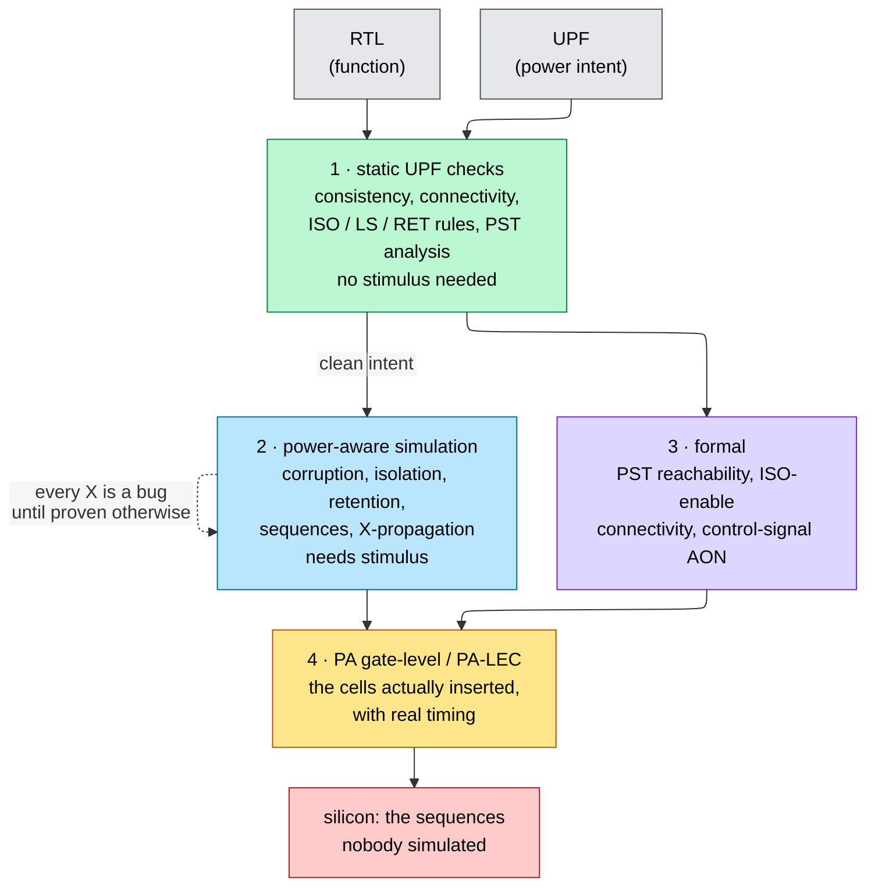
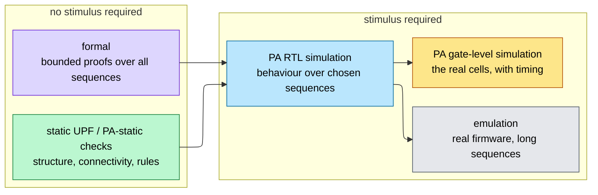
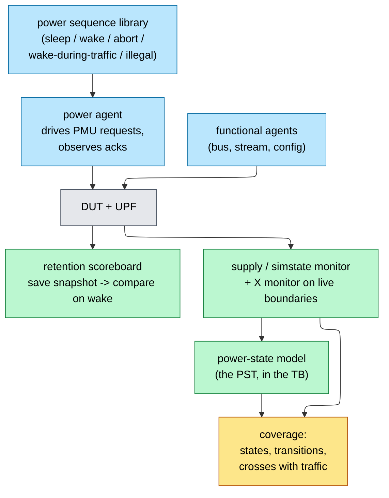
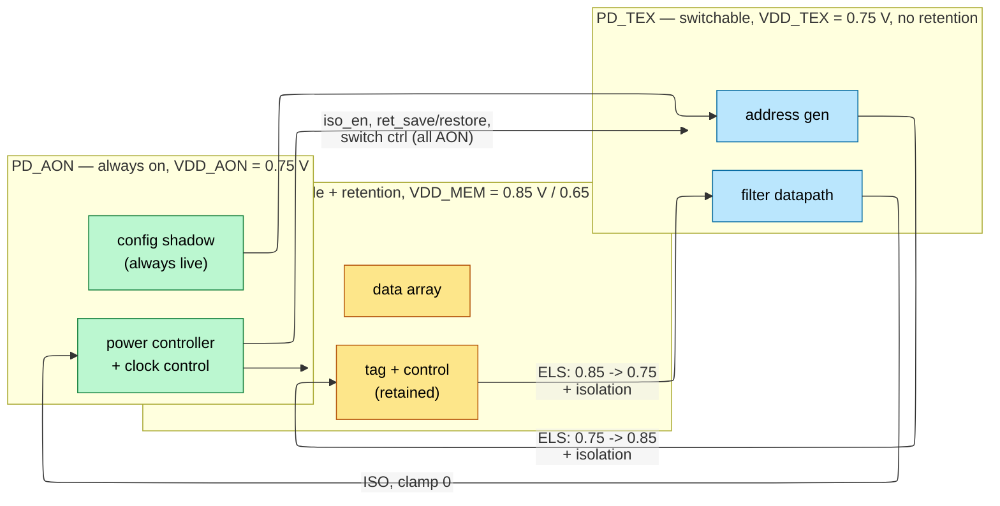

# Power-Aware Verification and UPF Checking — Proving the Power Intent



> **Prerequisites:** [UPF/CPF Power Intent](05_UPF_and_CPF_Power_Intent.md) — this page assumes the UPF language (§10), the simstate lattice and corruption semantics (§11), and the power state table as an artifact (§6). It verifies what that page specifies and re-derives none of it. [Power Gating, Retention and Wake Sequencing](07_Power_Gating_Retention_and_Wake_Sequencing.md) §§8–12 (what retention, isolation, and the power-up/down sequences are *supposed* to do), [Runtime Power Management and AVFS](08_Runtime_Power_Management_and_Adaptive_Voltage_Frequency.md) §§3–5 and §14 (the PMU and its state machine — the thing under test), [Assertions and Coverage](../03_Frontend_RTL_and_Verification/09_Assertions_and_Coverage.md) and [UVM Methodology](../03_Frontend_RTL_and_Verification/10_UVM_Methodology.md) (the testbench machinery this page adds a power axis to), [Verification Planning and Coverage Closure](../03_Frontend_RTL_and_Verification/11_Verification_Planning_and_Coverage_Closure.md).
> **Hands off to:** [Gate-Level Sim and Emulation](../03_Frontend_RTL_and_Verification/13_Gate_Level_Sim_and_Emulation.md) (the PA-GLS runs of §13), [Formal Verification](../03_Frontend_RTL_and_Verification/12_Formal_Verification.md) (the property and equivalence machinery §12 uses), [Power Analysis and Signoff](06_Power_Analysis_and_Signoff.md) (what happens after the intent is proved correct), [Tapeout and Post-Silicon Bring-up](../07_Manufacturing_and_Bringup/03_Tapeout_and_Post_Silicon_Bringup.md) (the sequences that only silicon finds).

---

## 0. Why this page exists

A design with power intent is two specifications that must agree. The RTL says what the chip computes; the UPF says which parts of it are allowed to be dark, at what voltage, with what preserved, and in what order the lights go on and off. Ordinary functional verification proves the first specification with the second one *switched off* — every simulator that ignores UPF is simulating a chip that never powers anything down, which is to say a chip that does not exist.

The bugs that live in the gap are a specific and unpleasant family:

- They are **not visible in normal simulation**, because normal simulation never corrupts anything.
- They are **not visible in most directed tests**, because they need a *sequence* — power down while a transaction is outstanding, wake in the middle of a burst, two domains transitioning in the wrong order — and the sequence space is large.
- They are frequently **fatal rather than degraded**: a chip that will not wake, a block that comes back with corrupted configuration, a domain that latches X into a state machine that never recovers. There is no software workaround for a lost retention register.
- And they are **found late by default**, because power intent tends to be written after the RTL and verified after the function.

So the discipline exists to move that discovery early, and it has a shape worth stating up front: **static checks find structural mistakes without stimulus; power-aware simulation finds behavioural mistakes but only on the sequences you thought to run; formal covers the sequence space for a few narrow, high-value properties; and gate-level power-aware simulation is the only place the *actual inserted cells* are exercised.** No one of the four is sufficient, and the common failure of a project is to do only the second one and believe it.

[UPF/CPF Power Intent](05_UPF_and_CPF_Power_Intent.md) is the specification page — the language, the semantics, the flow. This is the *execution* page: what to prove, how to build the environment that proves it, how to read the failures, and when you are allowed to say it is done.

---

## 1. What power-aware verification must prove

Write the verification plan as claims, not as a list of tests. Nine claims cover almost every real power architecture, and each has a natural owner among the four methods.

| # | Claim | Failure it prevents | Primary method | Backed up by |
|---|---|---|---|---|
| 1 | **Corruption is confined.** When a domain is off, its state and outputs are unknown *inside* the domain and nowhere else. | X leaks into a live domain and poisons a state machine | PA simulation (X-prop) | static ISO checks |
| 2 | **Isolation exists on every crossing that needs it**, with the right sense and the right clamp value. | a floating output is read as a spurious request/grant | static ISO checks | PA sim, formal |
| 3 | **Isolation enables are themselves always-on**, correctly ordered, and asserted for the whole dark window. | the isolation cell dies with the domain it protects | static (AON path) + formal | PA sim sequence tests |
| 4 | **Level shifting exists on every crossing between different voltages**, in the right direction. | logic-level mismatch: a 0.6 V "1" read as a 0 by a 0.9 V receiver | static LS checks | PA-GLS |
| 5 | **Retention saves and restores exactly the state the architecture promised**, across a real power-down. | the block wakes with a corrupted pointer / lost configuration | PA simulation with a scoreboard | formal retention checks |
| 6 | **The power-up / power-down sequences are correct and complete**, including acknowledge handshakes and ordering between domains. | wake hangs; rush current; reset released before supply is stable | PA simulation (sequence tests) | formal on the PMU FSM |
| 7 | **The design never enters a state the PST does not allow**, and every state the PST allows is reachable and works. | an illegal supply combination that no cell was characterized for | formal reachability + PA sim coverage | static PST analysis |
| 8 | **Control logic that manages power is itself powered** — the PMU, clock control, isolation enables, retention controls, and the wake path. | the controller switches itself off | static AON checks | review, formal |
| 9 | **What was inserted matches what was intended**, at every implementation stage. | synthesis or P&R dropped/mis-connected a strategy | PA-LEC + post-synthesis / post-route static checks | PA-GLS |

Two structural observations about that table are worth carrying into an interview. First, **five of the nine are provable without stimulus** — claims 2, 3, 4, 8, and half of 9 are structural, which is why static checking runs first and why a project that starts with simulation wastes weeks debugging things a static tool would have printed in ten minutes. Second, the two claims that *cannot* be reduced to structure — 5 and 6, retention correctness and sequence correctness — are exactly the two that require a real testbench with a scoreboard and a stimulus plan, and they are where the verification effort actually goes.

---

## 2. The four methods, and the boundary of each



| Method | Proves | Cannot prove | Cost | Runs when |
|---|---|---|---|---|
| **Static UPF / PA-static** (Synopsys VC LP, Cadence Conformal Low Power, Siemens Questa PA-static) | intent is self-consistent; every crossing has the strategy it needs; enables and controls are on live supplies; the design's structure matches the intent | anything about *time* — ordering, handshakes, whether the sequence actually works | minutes to a couple of hours; no testbench | from the first day the UPF exists, and at every implementation stage |
| **PA RTL simulation** (VCS NLP, Xcelium with UPF, Questa PA) | corruption behaviour, retention save/restore, sequence correctness, X-propagation, functional recovery after wake | anything you did not stimulate; timing; the real cells | a full testbench, plus 10–30 % simulation-speed penalty | as soon as static is clean |
| **Formal** (property checking, PST reachability, connectivity apps) | properties over *all* sequences within a bound: "the PMU can never reach an illegal PST state", "ISO enable is always asserted before the domain goes off" | large behavioural properties; anything needing deep sequential depth | expert effort, per property | in parallel, on the few properties worth it |
| **PA gate-level simulation** (post-synthesis and post-route, with real ISO/LS/retention cells and SDF) | that the inserted cells behave, with timing; that retention flops save on the real clock edges; X behaviour of the actual library | not a substitute for RTL PA sim — far too slow for sequence coverage | very slow; days of runtime for a handful of tests | at each implementation milestone, on a small hand-picked test list |

A word on **emulation**, which is not a fifth method so much as an accelerator for the second: firmware-driven power sequences (a real driver putting a GPU into and out of a low-power state a thousand times) are simply not runnable in software simulation, and they are the stimulus most likely to resemble what silicon will do. Whether the emulator models UPF corruption depends on the platform; many flows emulate the *sequence* with corruption disabled and rely on RTL PA sim for the corruption semantics. Know which one your project does before you claim coverage from it.

---

## 3. Static checks: the first and cheapest gate

Run these before any simulation. Every violation class below is a bug that would otherwise cost hours of waveform debug.

### 3.1 The rule classes

| Class | Representative violation | What it means | Typical fix |
|---|---|---|---|
| **UPF consistency / syntax-semantics** | a strategy references a port that does not exist; a supply set is declared but never associated; a `-domain` name typo | the intent file does not describe this design | fix the UPF; usually a hierarchy path that changed |
| **Connectivity / PG** | a power domain's primary supply is not connected; a switch has no control; a macro's PG pins are unconnected | the supply network is incomplete | connect the supply; check the `connect_supply_net` / supply-set handles |
| **Isolation (ISO)** | a signal crosses from an off-able domain to an always-on domain with **no** isolation strategy; isolation enable connected to the data pin; clamp value inconsistent with the receiver's expectation; isolation placed in the *switched* domain | the classic X-leak, or an isolation cell that dies with its domain | add/repair the strategy; move the cell's location to the parent |
| **Level shifter (LS)** | a crossing between 0.9 V and 0.6 V domains with no LS; an LS in the wrong direction; a missing enable-LS (ELS) on a signal that must also be isolated | logic-level failure in silicon, invisible in RTL sim | add the strategy; check `-rule low_to_high` / `high_to_low` |
| **Retention (RET)** | a retention strategy whose save/restore signals are not always-on; retention on a register whose reset would clobber it anyway; retention declared but no retention cells available in the library | state loss on wake | fix the control's supply; re-scope the retained set |
| **Power state / PST** | a state in the PST that no combination of switch controls can produce; two strategies that assume contradictory states; a crossing whose ISO is only required in a state the PST says is unreachable | either the PST is wrong or the design is | reconcile PST with the PMU's actual state space |
| **Always-on (AON) path** | a control signal for a switch, isolation, or retention that is routed through a switchable domain | the control dies with the thing it controls — claim 3 and claim 8 | re-route through the AON domain; declare the AON path in UPF |
| **Structural (post-synthesis/P&R)** | an isolation cell present in the netlist that the UPF did not ask for, or vice versa; a retention flop mapped to a non-retention cell; a level shifter with the wrong supplies | implementation dropped or altered the intent — claim 9 | back to synthesis/P&R constraints |

Commercial static low-power checkers ship on the order of hundreds of rules across these classes; the classes are what you should be able to name, not the rule IDs.

### 3.2 How to read a static violation

A well-formed PA-static report has four layers, and reading them in order is the whole skill:

1. **The architecture view** — which strategies exist, on which domains, with what options. Start here to confirm the intent is what you thought.
2. **The design-element view** — where the corresponding cells/ports actually are in the hierarchy.
3. **The connectivity view** — the source port, the sink port, the supplies of each, and the file/line in UPF, HDL, and Liberty that each fact came from.
4. **The violation** — the rule, the specific path, and why it fired.

The most common novice mistake is to start at layer 4 and try to fix the rule. Most ISO/LS violations are not missing strategies at all; they are *hierarchy mismatches* — the UPF names a path that moved, so the strategy landed on nothing. Layer 3 tells you that in one line, and layer 4 never will.

### 3.3 The order that saves a week

1. **Elaborate the UPF alone** and fix every consistency error. No simulation yet.
2. **Run the RTL-stage static checks** (ISO/LS/RET/AON/PST). Fix all of them; a waiver at this stage needs a written reason, because each waived structural rule is a rule that will reappear as a mysterious X later.
3. **Only then** build the PA simulation environment (§4).
4. **Re-run static after synthesis and after P&R** on the netlist plus the refined UPF. This is claim 9, and it is a different run with different rules — the RTL run checks *intent*, the netlist run checks *insertion*.

---

## 4. Building the power-aware simulation environment

### 4.1 What the simulator is doing, in one paragraph

Elaboration reads the RTL *and* the UPF, builds the supply network as a set of simulated supply nets with `{state, voltage}` values, and instruments every design object with its domain's **simstate**. When a domain's simstate says the supply is off, the simulator corrupts that domain's registers and outputs to X; isolation strategies override the corruption at the boundary with the clamp value; retention strategies preserve the retained subset across the corruption; and level-shifter strategies are checked (and, in a voltage-aware run, modelled). The full semantics — the simstate lattice, exactly which objects corrupt and when, the retention save race, and the cycle-by-cycle power-down/up trace — are derived in [05 §11](05_UPF_and_CPF_Power_Intent.md); this section assumes them and builds the testbench on top.

The practical consequences for a verification engineer are three: **(a)** X is now meaningful — it is the tool telling you something is unpowered, so an X-clean regression is a much stronger statement than usual; **(b)** the design has a second state variable (its power state) that the testbench must drive and check; and **(c)** simulation is 10–30 % slower, which matters when the same regression must also run functionally.

### 4.2 The file list and the invocation

A PA simulation needs, at minimum: the RTL, the UPF, and a switch that turns the power-aware mode on. Every vendor spells this differently and the spellings change between releases, so the shape below is deliberately generic — what matters in an interview is that you can name the *pieces*, not the flags.

```tcl
# --- shape of a PA compile/elaborate/run. Exact switches are tool- and
# --- version-specific; check your project's Makefile, not your memory.

#  1. compile RTL as usual
#  2. elaborate WITH the UPF and with power-aware mode enabled:
#        the UPF file (top-level, which may source block-level UPF)
#        the scope the UPF applies to (the design top)
#        X-propagation / corruption options
#        an option enabling the tool's own PA dynamic checks
#  3. run, producing:
#        a waveform database that includes supply nets and simstates
#        a power-aware check/violation report
#        power-state and strategy coverage data
```

The three things to insist on in the setup, whatever the tool:

- **Turn the tool's built-in dynamic PA checks on.** Simulators check things the testbench does not: isolation enable asserted while the domain is off, retention save/restore protocol violations, illegal simstate transitions, writes to a corrupted register. These are free and they catch a large fraction of real bugs.
- **Dump supply nets and simstates into the waveform.** Debugging a corruption without seeing the supply state is guesswork.
- **Keep a non-PA regression running too.** Function and power intent are separable specifications (that is the premise of UPF); regressing them separately localizes failures. A functional test that fails only in PA mode is a power bug; one that fails in both is not.

### 4.3 The testbench architecture



Four components are specific to power-aware verification and do not exist in an ordinary UVM environment:

**(a) The power agent.** A UVM agent whose transactions are *power state requests*: "enter RET", "wake", "abort a pending sleep", "switch the voltage". Its driver pokes the PMU's register interface or its Q-/P-Channel port; its monitor observes acknowledgements and the resulting supply changes. Treating power as a protocol with an agent — rather than as a few `force` statements in a directed test — is what makes randomized power sequences possible.

**(b) The power-state predictor.** A model of the PST in the testbench. It knows which states are legal and which transitions are allowed, so it can flag "the design just entered a state the PST does not contain" independently of the tool's own checks. This is the testbench's copy of claim 7.

**(c) The retention scoreboard.** Before a power-down, snapshot the values the architecture promised to retain; after wake, compare. This is the *only* way to prove claim 5, and it is the component most often missing — many projects check that the block still works after wake, which catches a corrupted control register but not a corrupted data value that the next test happens to overwrite.

**(d) The X monitor.** An always-on checker asserting that signals in live domains are never X. This is the enforcement of claim 1, and it deserves a design decision: it should watch the *boundary* of every switchable domain and every input of every always-on state machine, not every signal in the design (too noisy).

### 4.4 Reaching supply state from the testbench

Checkers need to know the power state, and there are three ways to get it, in decreasing order of robustness:

1. **The tool's UPF query/probe API** — a supply-net or simstate value readable from SystemVerilog. This is the correct way; it reads what the simulator actually believes. The function names are vendor-specific (the standard defines UPF query functions; each simulator also offers HDL-visible supply objects).
2. **The design's own power-state registers** — the PMU's status register, which is what firmware would read. Good for end-to-end tests; useless for checking that the *tool's* corruption matches the *design's* belief, which is precisely the disagreement you are hunting.
3. **Hierarchical references to the switch control signals** — fragile, but sometimes the only option in a mixed environment.

Use (1) for checkers and (2) for tests. When they disagree, you have found a real bug: the design thinks it is powered and the supply network says otherwise, or vice versa.

### 4.5 Randomizing power sequences

The sequence space is the reason PA verification is hard, and constrained randomization is the only practical answer. A useful sequence-item shape:

```systemverilog
class pwr_seq_item extends uvm_sequence_item;
  rand pwr_state_e   target_state;    // ON, CLK_OFF, RET, OFF, ...
  rand int unsigned  delay_cycles;    // when to request, relative to traffic
  rand bit           abort_midway;    // withdraw the request after N cycles
  rand int unsigned  dwell_cycles;    // how long to stay there
  rand bit           traffic_active;  // is functional traffic running?

  // The interesting bugs cluster where power transitions collide with traffic.
  constraint c_interesting {
    traffic_active dist { 1 := 70, 0 := 30 };
    delay_cycles inside {[0:64]};
    abort_midway dist { 0 := 85, 1 := 15 };
  }
endclass
```

The constraint that matters is `traffic_active`: the vast majority of power bugs are *collisions*, not steady-state errors. A sleep request that arrives while a burst is in flight, a wake that lands during a cache fill, an abort that arrives one cycle after the acknowledge — these are where claims 5 and 6 fail. A regression that only sleeps an idle block proves almost nothing.

---

## 5. Isolation verification

Isolation is the single most common source of power-aware bugs, and the reason is that it has four independent things to get right and each fails differently.

### 5.1 The four questions

| Question | Wrong answer looks like | Found by |
|---|---|---|
| **Does it exist?** Every signal leaving an off-able domain into a domain that stays on needs a strategy. | X propagates into live logic on power-down | static ISO check; X monitor in PA sim |
| **Which value does it clamp to?** 0, 1, or latch-the-last-value. | no X, but the receiver sees a spurious `request = 1` and starts a transaction to a dead block | functional check / assertion; the clamp choice is a *design* decision, see [07 §10](07_Power_Gating_Retention_and_Wake_Sequencing.md) |
| **Is the enable correct in sense and timing?** Asserted before the supply goes, released after it returns and the outputs are valid. | a window where the domain is off and the outputs are unclamped — a short X pulse that may or may not be captured | PA sim with sequence tests + SVA |
| **Is the cell itself powered?** The isolation cell and its enable must live on a supply that stays up. | the clamp evaporates exactly when it is needed | static AON check |

The clamp-value question is the one that separates people who have done this from people who have read about it. **The correct clamp value is a protocol question, not a default.** For a `valid`/`request` output, clamp to **0** — a dead block must not appear to be asking for anything. For a `ready`/`grant`/`ack` input to a live arbiter, clamping to 0 may *hang* the live side waiting for a response, so the right value may be 1, or the live side must be told the block is gone by other means. For a bus that feeds a parity or ECC checker, clamping to a value that computes to a valid codeword avoids a spurious error interrupt at every power-down. Getting this wrong produces a design that is X-clean and still broken — which is why claim 2 needs a functional check on top of the structural one.

### 5.2 The timing window, drawn

```wavedrom
{ "signal": [
  { "name": "clk",           "wave": "p........." },
  { "name": "iso_en (AON)",  "wave": "0.1......0", "node": ".a.......e" },
  { "name": "pwr_ack_off",   "wave": "0..1....0.", "node": "..b.....d." },
  { "name": "supply (VDD_sw)","wave": "1..0....1.", "node": "...c......" },
  { "name": "domain out",    "wave": "3.4x....x4", "data": ["live","clamped","clamped","live"] }
 ],
 "edge": ["a<b iso BEFORE power removal", "d<e iso released AFTER supply is back"],
 "head": {"text": "isolation must enclose the dark window on both sides"}
}
```

The rule is one sentence and it is worth memorizing verbatim: **isolation asserts before the supply is removed and de-asserts after the supply is restored and the domain's outputs are valid again.** Both edges are ordering requirements, both are checkable, and the second one is the one people forget — releasing isolation the same cycle the supply returns exposes whatever garbage the domain powers up with, which after a reset-less wake is X.

### 5.3 The assertions

```systemverilog
// Bind this to every isolated boundary. `pwr_off` comes from the supply probe
// (§4.4), not from the design's own status register.

// (1) While the domain is off, the isolated output equals its clamp value.
property p_iso_clamped;
  @(posedge clk) pwr_off |-> (iso_out == CLAMP_VALUE);
endproperty
a_iso_clamped : assert property (p_iso_clamped)
  else $error("ISO: output not clamped while domain is off");

// (2) Isolation is enabled before the supply drops (ordering, not just value).
property p_iso_before_off;
  @(posedge clk) $fell(supply_on) |-> $past(iso_en, 1);
endproperty
a_iso_before_off : assert property (p_iso_before_off)
  else $error("ISO: supply removed before isolation was enabled");

// (3) Isolation is released only after the supply is stable AND the domain
//     has been reset/initialized (project-specific: `dom_valid`).
property p_iso_release_late;
  @(posedge clk) $fell(iso_en) |-> supply_on && dom_valid;
endproperty
a_iso_release_late : assert property (p_iso_release_late)
  else $error("ISO: released before the domain was valid");

// (4) The enable itself never goes X — it lives on the always-on supply.
a_iso_en_known : assert property (@(posedge clk) !$isunknown(iso_en))
  else $error("ISO: enable is X — it is probably in the switched domain");
```

Assertion (4) is small and catches claim 3 directly: if the isolation enable can be X, the cell driving it is not always-on, and a static AON check should already have said so.

### 5.4 The redundancy question

A crossing that is isolated *and* whose receiver is also off does not need isolation — both sides are dark. Static tools report these as "redundant isolation", and the temptation is to delete them. Do not, until you have checked the PST: the isolation is redundant only in the states the PST *currently* contains, and adding an independent-sleep state later makes it necessary again. Redundant isolation costs a cell and a small delay; missing isolation costs a respin. The reviewable answer is to keep it and record why.

---

## 6. Level-shifter verification

Level shifting is structurally simpler than isolation and is verified almost entirely statically, but it has two traps.

**Trap 1: the combined cell.** A crossing that goes *both* between voltages and between an off-able and an on domain needs isolation *and* level shifting, usually as one **enable level shifter (ELS)**. Declaring only the LS strategy leaves the crossing unisolated; declaring only the ISO strategy leaves it un-shifted. Static tools catch this when both domains are correctly described — which is why claim 4's real prerequisite is that the *voltages* in the UPF match the ones the design will actually use.

**Trap 2: RTL simulation cannot see a level problem at all.** A logic 1 is a logic 1 in RTL, whatever the rail. So a missing level shifter is **invisible in RTL PA simulation** and shows up either in static checking or in silicon. This is the cleanest example of why the four-method stack exists, and it makes a good interview answer to "why isn't PA simulation enough?"

Voltage-aware simulation modes narrow the gap by tracking supply *values* and flagging a crossing where the driver's voltage cannot drive the receiver's threshold, but the structural check remains the primary proof. At gate level, the inserted LS cells are real and PA-GLS exercises them properly.

---

## 7. Retention verification

Retention is where the interesting testbench work is, because it is the only claim that requires remembering something across a corruption.

### 7.1 The protocol, and its four failure modes

A retention register has a save control, a restore control, and a retained shadow on an always-on supply. The sequence is: quiesce → **save** → isolate → power off → (dark) → power on → **restore** → release isolation → resume. The failures:

| Failure | Symptom | Check |
|---|---|---|
| **Save too late** — the register changed after the snapshot | wake with a value one transaction stale | scoreboard compares against the value *at the save edge*, not the last value the test wrote |
| **Restore too early** — restore asserted before the supply is stable | retained value corrupted by the restore itself; often intermittent | assertion on ordering vs the supply probe |
| **Retention set is wrong** — a register the architecture assumed retained is not | block wakes and behaves oddly under a specific later stimulus | scoreboard over the *specified* set, plus a review of the spec |
| **Save/restore controls not always-on** | controls go X exactly when needed | static AON check + assertion (4) pattern from §5.3 |

### 7.2 The scoreboard

```systemverilog
// Retention scoreboard. Snapshot at the save edge; compare after restore.
// The `ret_set` is the architectural promise: read it from a list, not from
// whatever happens to be convenient to sample.
class ret_scoreboard extends uvm_component;
  bit [63:0] snapshot [string];

  function void take_snapshot();
    foreach (cfg.ret_set[i])
      snapshot[cfg.ret_set[i]] = read_hier(cfg.ret_set[i]);
  endfunction

  function void check_restore();
    foreach (cfg.ret_set[i]) begin
      bit [63:0] now = read_hier(cfg.ret_set[i]);
      if (now !== snapshot[cfg.ret_set[i]])
        `uvm_error("RET", $sformatf("%s: saved %0h, restored %0h",
                   cfg.ret_set[i], snapshot[cfg.ret_set[i]], now))
    end
  endfunction
endclass
```

Two design points. **The snapshot is taken on the save event**, driven by the power monitor, not at an arbitrary time chosen by the test — otherwise a legitimate write between the snapshot and the save looks like a retention failure. And **the retained set comes from a specification list**, so that a register that was *supposed* to be retained and is not shows up as a mismatch rather than being silently excluded.

### 7.3 The negative test that is worth more than the positive one

The positive test — sleep, wake, everything matches — passes on day one and stays passing. The test that finds bugs is the **corruption-injection** test: while the domain is off, deliberately verify that the *non*-retained state really is destroyed, so that no downstream logic has quietly grown a dependency on state that will not survive silicon. PA simulation gives this for free (non-retained flops corrupt to X), and the value is that any test which then passes *because* a non-retained register kept its value is exposed immediately. A project that disables corruption "because it makes the tests noisy" has deleted its most valuable checker.

### 7.4 Partial retention, and what "state" means

Real designs retain a small fraction of their flops — the architectural state that is expensive to rebuild (configuration, pointers, credit counters, a few control-FSM states) and not the pipeline. That makes wake a *reconstruction* problem, and the verification question becomes: **is the retained set sufficient to reconstruct a consistent machine?** A credit counter retained while the queue it counts is not is a classic inconsistency — the block wakes believing it has outstanding credits for entries that no longer exist. This is a review-and-formal question more than a simulation one: enumerate the retained set, and for each, name the invariant that ties it to the non-retained state around it.

---

## 8. Sequence verification: switches, acknowledges, and ordering

Claim 6 is the one that hangs chips. The power-down and power-up sequences are derived edge by edge in [07 §12](07_Power_Gating_Retention_and_Wake_Sequencing.md); the verification job is to prove the design implements them, including the cases where the sequence does not complete.

### 8.1 The sequence as a checkable ordering

Power-down, as a partial order the checker enforces:

```
quiesce request  →  quiesce accept (no outstanding transactions)
                 →  clocks stopped
                 →  retention save
                 →  isolation enabled
                 →  switch acknowledge deasserted / supply removed
```

Power-up reverses it, with two additions that have no power-down counterpart:

```
supply restored  →  (rush current staged: switch ack asserts in phases)
                 →  supply stable / ack complete
                 →  reset released (if the domain is reset on wake)
                 →  retention restore
                 →  isolation released
                 →  clocks started
                 →  quiesce request withdrawn / block resumes
```

Every arrow is an assertion. The two that catch the most bugs:

```systemverilog
// Nothing may be in flight when the domain goes dark.
a_no_outstanding_at_off : assert property (@(posedge clk)
  $fell(supply_on) |-> (outstanding_cnt == 0))
  else $error("SEQ: powered down with %0d transactions outstanding", outstanding_cnt);

// Retention restore happens after the supply is stable, before isolation release.
a_restore_ordering : assert property (@(posedge clk)
  $rose(ret_restore) |-> supply_stable && iso_en)
  else $error("SEQ: restore asserted outside the safe window");
```

### 8.2 The cases that are not the happy path

A sequence test list that only contains "sleep, then wake" is a test list that will let a bug through. The list that matters:

| Test | What it catches |
|---|---|
| Sleep request **denied** (block is busy) | the refusal path exists and the PMU handles it — the Q-Channel `qdeny` case |
| Sleep **aborted** after the request but before the acknowledge | a half-committed transition that leaves isolation on and clocks off |
| Wake **during** power-down (request reversal) | the most common hang: the FSM has no path back from a partial power-down |
| Wake **immediately** after sleep (minimum dwell) | timers and delays that assume a long dark period |
| Two domains transitioning **simultaneously** | ordering dependencies between domains, and rail droop |
| Traffic arriving **exactly at** the isolation boundary | the ISO enable window of §5.2 |
| Repeated sleep/wake for thousands of cycles | slow leaks: a counter that does not reset, a queue that grows by one each cycle |
| Reset **during** a power transition | the interaction nobody specifies and everybody hits in bring-up |

### 8.3 Formal is the right tool for a piece of this

The PMU's state machine is small, its properties are simple, and the sequence space is enormous — which is the exact profile for formal property checking. Three properties worth proving formally rather than simulating:

- **No deadlock:** from every reachable state, `ON` is reachable. This is the "will it wake?" property, and it is worth more than any single simulation.
- **Ordering:** `iso_en` is asserted in every state where `supply_off` is asserted (an invariant, not a sequence — cheap to prove).
- **PST containment:** the set of supply-control combinations the FSM can produce is a subset of the PST's legal states (§9).

[Formal Verification](../03_Frontend_RTL_and_Verification/12_Formal_Verification.md) has the machinery; [08 §14.2](08_Runtime_Power_Management_and_Adaptive_Voltage_Frequency.md) has the PMU-specific framing.

---

## 9. Power state table verification

The PST is the contract that collapses the combinatorial explosion of supply states into an enumerated, verifiable list ([05 §6](05_UPF_and_CPF_Power_Intent.md)). Verifying it has two directions, and both are required.

### 9.1 Direction 1 — the design never leaves the table

Every state the design can actually produce must be in the PST. If it is not, some cell in the design is operating in a combination that was never characterized, and timing and function are both undefined there. Two ways to prove it:

```systemverilog
// Simulation: the testbench's PST model flags any unlisted combination.
always @(supply_states) begin
  if (!pst_model.is_legal(supply_states))
    `uvm_error("PST", $sformatf("illegal supply combination: %p", supply_states))
end
```

and, more strongly, formally: constrain the inputs, let the tool explore the PMU's reachable state space, and assert that the projection onto supply controls lies inside the PST. This is a small, high-value formal property.

### 9.2 Direction 2 — every state in the table is reachable and works

The opposite failure is a PST that lists states the design cannot reach. It sounds harmless and is not: those states were characterized, constrained, and timed at cost, and — worse — a state listed in the PST but never simulated is a state whose isolation and level-shifting requirements were *derived* by the static tool from an assumption nobody tested. Coverage closes this direction: **every PST state must be visited, and every legal transition between PST states must be taken**, in simulation.

```systemverilog
covergroup cg_power_state @(posedge clk);
  cp_state : coverpoint cur_pst_state {
    bins all_states[] = {PST_ON, PST_CLK_OFF, PST_RET, PST_OFF};
  }
  cp_trans : coverpoint cur_pst_state {
    bins legal_trans[] = (PST_ON => PST_CLK_OFF), (PST_CLK_OFF => PST_RET),
                         (PST_RET => PST_ON),     (PST_CLK_OFF => PST_ON),
                         (PST_RET => PST_OFF),    (PST_OFF => PST_ON);
    illegal_bins bad   = (PST_OFF => PST_RET);   // no path exists; must not happen
  }
  // The cross is where the real coverage lives: power states against traffic.
  cx_state_traffic : cross cp_state, cp_traffic_active;
endcovergroup
```

`cx_state_traffic` is the line that matters. Visiting every power state with the block idle is easy and proves little; visiting them with traffic in flight is the coverage goal that corresponds to the bug population of §8.2.

### 9.3 When the PST and the PMU disagree

This happens on every project, and knowing the resolution order is a good answer to give:

1. **The architecture spec wins.** Both the PST and the FSM are supposed to encode it.
2. **If the FSM can reach a state the PST omits**, either the FSM is wrong (fix the design) or the PST is incomplete (fix the UPF, then re-run static ISO/LS analysis — because new states can create new isolation requirements).
3. **If the PST lists a state the FSM cannot reach**, either the FSM is missing a feature or the PST is aspirational. Aspirational PST entries should be deleted, because they inflate the verification and characterization burden and give false confidence.

Note the second-order effect in step 2: **adding a PST state can create new isolation and level-shifting requirements**, because a strategy is only needed in the states where one side is off and the other is on. This is why PST changes are not "just UPF edits" and why the static checks must be re-run after any PST change.

---

## 10. The X-debug cookbook

An X in a power-aware simulation is the tool telling you something is unpowered. Most of the debugging skill is knowing the small number of causes and the order to check them.

### 10.1 The taxonomy

| Where the X is | Likely cause | First thing to check |
|---|---|---|
| Inside a domain that is off | **Correct behaviour.** Corruption is working. | Nothing — unless the domain should not be off |
| On a boundary output, domain off | Missing or wrong isolation (claim 2) | static ISO report for that crossing |
| On a boundary output, domain on | Isolation released too early, or the domain woke without reset/init | ordering assertions of §5.3 |
| In an always-on domain, arriving from a switched one | Isolation exists but the *enable* is wrong, or the X came through a path the UPF did not classify as a crossing (a hierarchy problem) | trace back to the last known-good signal |
| In a retention register after wake | Restore failed or fired outside the safe window | the retention scoreboard and the restore ordering assertion |
| In an isolation/retention **control** signal | The control is in a switched domain (claims 3 and 8) | static AON report |
| Everywhere, from the first cycle | Reset not applied to a domain, or the UPF's supply network is not connected | static connectivity/PG report |
| Only in gate-level, not RTL | A real cell's X behaviour, or a missing level shifter that RTL cannot model | PA-GLS-specific; §6 and §13 |

### 10.2 The procedure

1. **Find the first X in time**, not the one you noticed. Power-aware Xs propagate fast; the symptom is usually many cycles downstream.
2. **Identify the domain and its simstate at that instant.** The supply nets must be in the waveform (§4.2) or this step is impossible.
3. **Ask: should this domain be off right now?** If no, the bug is in the sequence, not in the isolation — stop and debug the PMU.
4. **If yes: is this signal a domain crossing?** If it crosses to a live domain, it needs isolation. Check the static report for that exact crossing; most of the time the strategy exists but the hierarchy path in the UPF no longer matches the design.
5. **If the strategy exists, check the enable** — value, timing, and its own supply.
6. **If everything checks out, suspect the RTL**: a signal that was X *before* power-down (an uninitialized register, an unreachable case default) and was simply invisible until corruption made everything X-sensitive. This is more common than people expect, and it is a real bug being surfaced rather than a false one.

### 10.3 A worked debug session

*Symptom.* A GPU sub-module's regression fails only in PA mode, ~4000 cycles after the first sleep/wake cycle: the block's AXI master issues a read to an address of all X.

*Step 1.* Search backwards for the first X. It appears 3800 cycles earlier, in `u_core/u_desc/desc_base_q[31:0]` — a descriptor base-address register — at the exact cycle the domain's supply goes off.

*Step 2.* Check the simstate: the domain is legitimately `OFF`. So corruption is correct, and the question becomes why `desc_base_q` is X *after* wake.

*Step 3.* Look at the retention report: `desc_base_q` is not in the retained set. Look at the spec: it should have been — it is configuration written once at initialization, and nothing rewrites it on wake.

*Step 4.* Two candidate fixes, and the choice is architectural, not a verification decision. Either **retain it** (a handful of retention flops, and the always-on save/restore controls they need) or **re-initialize it on wake** (firmware or a hardware init sequence rewrites the descriptor base). Cost of the first: retention cell area and a slightly longer save/restore. Cost of the second: wake latency, and a firmware dependency.

*Step 5.* Whichever is chosen, add the register to the retention scoreboard's specified set (§7.2), so the next time someone changes the retention list this test fails at the *save/restore* comparison instead of 3800 cycles later at an AXI transaction. **The lesson generalizes: every PA bug fix should also move the point of detection earlier.**

---

## 11. Coverage: when are you done?

Functional coverage for power intent has four axes. A verification plan that names all four is a plan that will close.

| Axis | Coverage goal | Typical closure |
|---|---|---|
| **Power states** | every PST state visited | easy; the first thing to hit 100 % |
| **Transitions** | every legal PST transition taken, in both directions where both exist | moderate; needs the sequence library of §8.2 |
| **Strategies** | every isolation strategy exercised with the domain off; every retention strategy exercised through a full save/restore; every level shifter's crossing toggled in both directions | this is the axis people forget — a strategy that never fired is a strategy that is not verified |
| **Crosses** | power state × traffic active; transition × outstanding-transaction count; transition × reset; wake × each functional mode | the axis where the bugs are; close last, and expect it to find things |

Two supplementary metrics worth reporting to a project lead, because they answer "is the *environment* any good?" rather than "is the *design* any good?":

- **X-cleanliness of live domains** across the whole regression — a single unexplained X in an always-on domain is a stop-ship until it is explained.
- **Static-check waiver count and age.** Waivers accumulate silently; a growing waiver list is the leading indicator of a power-intent problem, because each waiver is a structural guarantee traded for a schedule.

The honest closure criterion, and a good thing to say in an interview: **coverage of the power-state space does not prove the design is correct; it proves the testbench visited the specification.** Claims 1–9 are the correctness argument; coverage tells you the argument was actually exercised.

---

## 12. The reusable checker library

Power-aware checks are highly repetitive across domains, which makes them a natural `bind` target. Own one checker module per strategy type, bind it once per instance from a single file, and the project gets uniform coverage of claims 1–3 and 5 for free.

```systemverilog
// ----------------------------------------------------------------------------
// pa_domain_checker — bind one per switchable power domain.
//   supply_on / supply_stable come from the UPF supply probe (§4.4).
//   iso_en, ret_save, ret_restore are the design's control signals.
// ----------------------------------------------------------------------------
module pa_domain_checker #(
  parameter string   DOMAIN         = "PD_UNNAMED",
  parameter bit      CLAMP          = 1'b0,
  parameter int      MAX_OFF_CYCLES = 100000   // bound the liveness check
)(
  input logic clk, rst_n,
  input logic supply_on, supply_stable,
  input logic iso_en, ret_save, ret_restore,
  input logic dom_valid,            // domain has been reset/initialized
  input logic outstanding,          // any transaction still in flight
  input logic [31:0] boundary_out   // a representative isolated output
);
  // C1 corruption confinement is checked by the X monitor, elsewhere.

  // C2/C3 isolation: enclose the dark window on both sides.
  a_iso_before_off : assert property (@(posedge clk) disable iff (!rst_n)
      $fell(supply_on) |-> $past(iso_en))
    else $error("[%s] supply removed before isolation", DOMAIN);

  a_iso_release_late : assert property (@(posedge clk) disable iff (!rst_n)
      $fell(iso_en) |-> supply_on && supply_stable && dom_valid)
    else $error("[%s] isolation released before the domain was valid", DOMAIN);

  a_clamped : assert property (@(posedge clk) disable iff (!rst_n)
      (iso_en && !supply_on) |-> (boundary_out == {32{CLAMP}}))
    else $error("[%s] boundary not at clamp value while dark", DOMAIN);

  a_ctrl_known : assert property (@(posedge clk) disable iff (!rst_n)
      !$isunknown({iso_en, ret_save, ret_restore}))
    else $error("[%s] a power control signal went X - not always-on?", DOMAIN);

  // C5 retention ordering.
  a_save_before_off : assert property (@(posedge clk) disable iff (!rst_n)
      $fell(supply_on) |-> $past(ret_save, 1) || $past(ret_save, 2))
    else $error("[%s] powered down without a save", DOMAIN);

  a_restore_window : assert property (@(posedge clk) disable iff (!rst_n)
      $rose(ret_restore) |-> supply_stable && iso_en)
    else $error("[%s] restore outside the safe window", DOMAIN);

  // C6 sequencing: nothing in flight when the lights go out.
  a_quiesced : assert property (@(posedge clk) disable iff (!rst_n)
      $fell(supply_on) |-> !outstanding)
    else $error("[%s] powered down with traffic outstanding", DOMAIN);

  // Liveness: from any off state, the domain returns within a bounded window.
  // Bounded rather than `##[1:$]` on purpose: an unbounded eventuality can only
  // be reported at end-of-simulation, which is far too late to be useful, and a
  // real design always has a specified maximum wake latency to check against.
  a_wakes : assert property (@(posedge clk) disable iff (!rst_n)
      $fell(supply_on) |-> ##[1:MAX_OFF_CYCLES] supply_on)
    else $error("[%s] did not wake within %0d cycles", DOMAIN, MAX_OFF_CYCLES);

  // Coverage that proves the checker was exercised at all.
  c_full_cycle : cover property (@(posedge clk)
      $fell(supply_on) ##[1:$] $rose(supply_on) ##[1:$] $fell(iso_en));
endmodule

// One bind file for the whole project.
bind gpu_tex_core pa_domain_checker #(.DOMAIN("PD_TEX"), .CLAMP(1'b0),
                                      .MAX_OFF_CYCLES(200000))
  u_pa_chk (.clk(clk), .rst_n(rst_n), /* ... */);
```

Two habits make this library actually useful. **Every assertion has a `cover` twin** — an assertion that never fires because its antecedent never occurred is worse than no assertion, and `c_full_cycle` is the proof that the domain really went through a complete cycle in this test. And **the checker takes supply state as an input rather than reaching into the design**, so the same module works at RTL, at gate level, and in an emulation shell.

---

## 13. Across the implementation stages

Power intent is verified four times against four different objects, and the checks are not the same each time. Being able to say what changes at each stage is a standard senior-level question.

| Stage | Object under check | What is proved here and nowhere else | Method |
|---|---|---|---|
| **RTL + UPF** | the intent, against the RTL hierarchy | that the intent is complete and consistent; behaviour of corruption, isolation, retention, and sequences | static + PA RTL sim + formal |
| **Post-synthesis netlist + refined UPF** | the *inserted cells* | that synthesis inserted every strategy, with the right cells, on the right supplies; that no strategy was dropped or duplicated | static (structural rules) + **PA-LEC** + a small PA-GLS list |
| **Post-P&R netlist + final UPF** | placement and the physical supply network | that isolation/retention cells are in the domains their supplies require; always-on routing survived; power switches are connected and staged | static (PG/physical rules) + PA-GLS with SDF |
| **Silicon** | the real thing | the sequences nobody simulated; droop; firmware races | bring-up and lab debug |

Three stage-specific points worth knowing:

**Successive refinement.** UPF is written once at the top and *refined* down the flow — the RTL-stage file describes intent abstractly; the implementation-stage file adds cell names, supply-net connections, and physical detail. The verification consequence is that **the file you check at each stage is a different file**, and a mismatch between them is itself a bug class. [05 §12](05_UPF_and_CPF_Power_Intent.md) covers the mechanism.

**PA equivalence checking.** Ordinary LEC compares RTL to netlist and would flag every inserted isolation cell as a difference. Power-aware LEC understands the strategies: it proves the netlist is equivalent to the RTL *given* the power intent, i.e. that the inserted cells implement exactly the declared strategies and change nothing else. This is claim 9, and it is the check that catches "synthesis put the isolation cell in the switched domain."

**Why PA-GLS is small and precious.** Gate-level power-aware simulation is the only place the real ISO/LS/retention cells run with real timing, and it catches things nothing else can: a retention flop whose save happens on the wrong clock edge, a level shifter with a slow enable, an X-behaviour difference between the RTL model and the library cell. It is also brutally slow. So the list is hand-picked — one power-down/up per domain, one retention save/restore, one multi-domain sequence — rather than a regression.

---

## 14. Emulation, firmware, and regression strategy

**What emulation adds.** Real firmware doing real power management for millions of cycles: the driver's idle detection, the actual sleep/wake cadence under a workload, thermal throttling entering and leaving states thousands of times. This finds the *policy* bugs and the slow leaks (§8.2's "repeated sleep/wake" row) that simulation cannot reach. Verify first whether your emulation flow models UPF corruption; many do not, in which case emulation proves the sequences run, not that the corruption semantics hold.

**A regression that works.** Three tiers, because a PA regression that runs everything in PA mode is too slow and one that runs nothing in PA mode is fiction:

| Tier | Content | Frequency | PA mode |
|---|---|---|---|
| Smoke | one sleep/wake per domain, retention scoreboard, all static checks | every commit | on |
| Main | the full sequence library × functional traffic, randomized seeds | nightly | on |
| Functional | the ordinary functional regression | nightly | off (faster), with a weekly PA-mode pass |
| Deep | PA-GLS list; emulation firmware runs; formal property regression | per milestone | on |

**The seed discipline.** Power bugs are collision bugs, so seed count matters more than test count. Prefer 200 seeds of one well-constrained random power sequence over 20 directed tests, and record which seed found what — a PA bug that reproduces on one seed and not another is usually an ordering bug, which tells you where to look before you open the waveform.

---

## 15. Failure catalogue

| # | Symptom | Root cause | Where it should have been caught |
|---|---|---|---|
| 1 | X floods a live domain the moment a block sleeps | missing isolation on a crossing | static ISO check, day one |
| 2 | Live arbiter hangs when a block sleeps | isolation clamps `ready`/`ack` to 0; the live side waits forever | clamp-value review + functional assertion (§5.1) |
| 3 | Spurious transaction to a sleeping block | isolation clamps `request` to 1 | same |
| 4 | Isolation enable goes X exactly at power-down | the enable is generated inside the switched domain | static AON check |
| 5 | Block wakes with a corrupted configuration register | register not in the retention set, and nothing re-initializes it | retention scoreboard against the *specified* set (§10.3) |
| 6 | Wake is intermittent; fails ~1 in 50 | restore asserted before the supply was stable | restore-ordering assertion |
| 7 | Chip never wakes | PMU FSM has no path back from a partially completed power-down | formal liveness (§8.3) |
| 8 | Works in RTL PA sim, fails in silicon at low voltage | missing level shifter — RTL cannot model it | static LS check; PA-GLS |
| 9 | Post-synthesis netlist behaves differently from RTL | synthesis dropped a strategy or mapped a retention flop to a plain flop | PA-LEC + post-synthesis static |
| 10 | Rail droop / reset at wake | switches turn on together; no staged daisy chain | sequence check + [07 §6](07_Power_Gating_Retention_and_Wake_Sequencing.md) |
| 11 | Everything is X from cycle 0 | supply network not connected in UPF, or a domain never reset | static connectivity check |
| 12 | Test passes only because a non-retained register kept its value | corruption disabled in that run | never disable corruption; §7.3 |
| 13 | PST-illegal supply combination reached in a rare sequence | PMU FSM and PST diverged | formal PST containment (§9.1) |
| 14 | Sleep during an outstanding burst loses a response | quiescence handshake accepted while transactions were in flight | `a_quiesced` (§12) and the Q-Channel deny path |
| 15 | A crossing is fine in the current PST and breaks after a new state is added | isolation requirements are state-dependent | re-run static after every PST change (§9.3) |

---

## 16. The lab: verifying a GPU texture slice end to end

This section is a complete worked example. It is deliberately small enough to hold in your head and complete enough that every claim in §1 gets exercised. [05 §10](05_UPF_and_CPF_Power_Intent.md) teaches the UPF language line by line; here the language is assumed and each construct is annotated with **the obligation it creates for the verification engineer** — because that is the mental move the job requires: every line of power intent is a promise that something must be proved.

### 16.1 The design

A texture slice inside a GPU shader core: an address generator and filter datapath, a small texture L1 with its tags and control, and an always-on island holding the power controller, the clock control, and the configuration shadow.



Three domains, chosen so the example contains every strategy type: an always-on island, a switchable domain with **no** retention (its state is rebuilt on wake), and a switchable domain at a **different voltage** that supports retention. Note the realistic detail that makes the level shifters necessary: the cache arrays sit on their own, higher memory rail — an extremely common arrangement, since SRAM $V_{min}$ is above logic $V_{min}$.

```systemverilog
module gpu_tex_slice (
  input  logic        clk, rst_n,
  // --- always-on control interface (PD_AON) ---
  input  logic        pmu_sleep_req_i,      // request to power down
  output logic        pmu_sleep_ack_o,
  output logic        pmu_busy_o,
  input  logic [31:0] cfg_wdata_i,
  input  logic        cfg_we_i,
  // --- functional interface ---
  input  logic        tex_req_valid_i,
  input  logic [39:0] tex_addr_i,
  output logic        tex_rsp_valid_o,      // isolated: clamp 0
  output logic [127:0] tex_rsp_data_o       // isolated: clamp 0
);
  // PD_AON
  tex_pmu       u_pmu  (...);   // sequencer: quiesce, save, isolate, switch
  tex_cfg_shdw  u_cfg  (...);   // configuration, always live
  // PD_TEX
  tex_addrgen   u_agen (...);
  tex_filter    u_filt (...);
  // PD_CACHE
  tex_l1_tag    u_tag  (...);   // control state: RETAINED
  tex_l1_data   u_data (...);   // data array: not retained, refilled on wake
endmodule
```

### 16.2 The power intent, annotated with its verification obligations

```tcl
# =============================================================================
# gpu_tex_slice.upf   —   power intent for the texture slice
# Each block is followed by the obligation it creates. Syntax follows IEEE 1801;
# a few constructs have older and newer spellings (noted) — a project picks one.
# =============================================================================
upf_version 3.1
set_design_top gpu_tex_slice

# ---- 1. Domains -------------------------------------------------------------
create_power_domain PD_AON   -include_scope
create_power_domain PD_TEX   -elements {u_agen u_filt}
create_power_domain PD_CACHE -elements {u_tag u_data}
# OBLIGATION: every element of the design belongs to exactly one domain. A module
# added later that lands in PD_AON by default is a silent always-on leak — a
# static "unassigned element" check must be part of the regression, not a
# one-time review.

# ---- 2. Supplies ------------------------------------------------------------
create_supply_port VDD_AON  ; create_supply_net VDD_AON
create_supply_port VDD_SOC  ; create_supply_net VDD_SOC     # switch input
create_supply_port VDD_MEM  ; create_supply_net VDD_MEM
create_supply_port VSS      ; create_supply_net VSS
create_supply_net  VDD_TEX                                   # switched output
create_supply_net  VDD_CACHE                                 # switched output

connect_supply_net VDD_AON -ports {VDD_AON}
connect_supply_net VDD_SOC -ports {VDD_SOC}
connect_supply_net VDD_MEM -ports {VDD_MEM}
connect_supply_net VSS     -ports {VSS}

set_domain_supply_net PD_AON   -primary_power_net VDD_AON   -primary_ground_net VSS
set_domain_supply_net PD_TEX   -primary_power_net VDD_TEX   -primary_ground_net VSS
set_domain_supply_net PD_CACHE -primary_power_net VDD_CACHE -primary_ground_net VSS
# OBLIGATION: the connectivity/PG static check must be clean before any
# simulation. An unconnected primary supply produces X everywhere from cycle 0
# and wastes a day of waveform debug for a one-line fix (failure catalogue #11).

# ---- 3. Switches ------------------------------------------------------------
create_power_switch sw_tex \
  -domain PD_TEX \
  -input_supply_port  {vin  VDD_SOC} \
  -output_supply_port {vout VDD_TEX} \
  -control_port {sw_ctrl u_pmu/tex_sw_en} \
  -on_state  {on_state  vin {sw_ctrl}} \
  -off_state {off_state {!sw_ctrl}}

create_power_switch sw_cache \
  -domain PD_CACHE \
  -input_supply_port  {vin  VDD_MEM} \
  -output_supply_port {vout VDD_CACHE} \
  -control_port {sw_ctrl u_pmu/cache_sw_en} \
  -on_state  {on_state  vin {sw_ctrl}} \
  -off_state {off_state {!sw_ctrl}}
# OBLIGATION (claim 8): `u_pmu/tex_sw_en` and `u_pmu/cache_sw_en` are inside
# PD_AON. If the PMU were ever moved into a switchable domain, the switch
# control would die with the thing it controls. This is the check that a static
# AON rule performs automatically and that a human review reliably misses.

# ---- 4. Isolation -----------------------------------------------------------
set_isolation iso_tex_out \
  -domain PD_TEX \
  -isolation_power_net VDD_AON -isolation_ground_net VSS \
  -clamp_value 0 \
  -applies_to outputs \
  -location parent
set_isolation_control iso_tex_out \
  -domain PD_TEX \
  -isolation_signal u_pmu/iso_tex_en \
  -isolation_sense high
# OBLIGATIONS, four of them, one per §5.1 question:
#   exists   -> static ISO check proves no unisolated PD_TEX output escapes.
#   value    -> clamp 0 is only correct because every PD_TEX output is a
#               request/valid-style signal. `tex_rsp_valid_o` clamped to 1 would
#               announce a response from a dead block. This is a DESIGN review
#               item, and it needs a functional assertion, not just a rule.
#   timing   -> `a_iso_before_off` / `a_iso_release_late` (§12).
#   powered  -> `-isolation_power_net VDD_AON` and `-location parent` put the
#               cell on the always-on rail, outside the domain it protects.
#               `-location self` here would be failure catalogue #4.

# ---- 5. Level shifting ------------------------------------------------------
set_level_shifter ls_tex_to_cache \
  -domain PD_CACHE -applies_to inputs \
  -rule low_to_high -location parent
set_level_shifter ls_cache_to_tex \
  -domain PD_CACHE -applies_to outputs \
  -rule high_to_low -location parent
# OBLIGATION: these crossings are BOTH voltage crossings AND on/off crossings,
# so each needs isolation as well — in implementation, a combined enable level
# shifter (ELS). Declaring only the LS leaves the crossing unisolated; declaring
# only the ISO leaves it unshifted. RTL power-aware simulation CANNOT see the
# level problem (§6), so the static LS check is the primary proof here and
# PA-GLS is the confirmation.

# ---- 6. Retention -----------------------------------------------------------
set_retention ret_cache_ctrl \
  -domain PD_CACHE \
  -elements {u_tag} \
  -retention_power_net VDD_MEM -retention_ground_net VSS
set_retention_control ret_cache_ctrl \
  -domain PD_CACHE \
  -save_signal    {u_pmu/cache_save    high} \
  -restore_signal {u_pmu/cache_restore high}
# OBLIGATIONS (claim 5): the retained set is `u_tag` and NOT `u_data` — the data
# array is refilled from memory on wake. That is an architectural decision, and
# the verification consequence is that the retention scoreboard's specified set
# is exactly `u_tag`'s state, and that a test which passes because a `u_data`
# register survived is a test that is lying (§7.3). Note also that the retention
# supply is VDD_MEM, which must therefore stay up in the retention state — which
# is exactly what the PST below has to say.

# ---- 7. Power states and the PST -------------------------------------------
add_power_state VDD_TEX   -supply -state {TEX_ON   -supply_expr {power == FULL_ON}}
add_power_state VDD_TEX   -supply -state {TEX_OFF  -supply_expr {power == OFF}}
add_power_state VDD_CACHE -supply -state {MEM_ON   -supply_expr {power == FULL_ON  0.85}}
add_power_state VDD_CACHE -supply -state {MEM_RET  -supply_expr {power == ON       0.65}}
add_power_state VDD_CACHE -supply -state {MEM_OFF  -supply_expr {power == OFF}}
add_power_state VDD_AON   -supply -state {AON_ON   -supply_expr {power == FULL_ON}}

# The table itself (older create_pst/add_pst_state spelling shown for clarity;
# newer flows express the same thing with add_power_state -domain).
create_pst tex_pst -supplies {VDD_AON VDD_TEX VDD_CACHE}
add_pst_state RUN        -pst tex_pst -state {AON_ON TEX_ON  MEM_ON}
add_pst_state TEX_GATED  -pst tex_pst -state {AON_ON TEX_OFF MEM_ON}
add_pst_state CACHE_RET  -pst tex_pst -state {AON_ON TEX_OFF MEM_RET}
add_pst_state DEEP_OFF   -pst tex_pst -state {AON_ON TEX_OFF MEM_OFF}
# OBLIGATIONS (claim 7), in both directions:
#   forward  -> the PMU must never produce a combination outside these four.
#               Prove formally (§9.1); check in simulation with the PST model.
#   backward -> all four must be visited, and every legal transition taken, with
#               traffic (§9.2). DEEP_OFF is the one people forget to test,
#               because reaching it takes the longest sequence.
#   derived  -> notice what the table implies: there is no state with TEX_ON and
#               MEM_OFF, so the tex->cache crossing never has a live driver into
#               a dead receiver. If someone later adds such a state, the
#               isolation requirements change and every static check must be
#               re-run (§9.3, failure catalogue #15).
```

### 16.3 The test plan, mapped to the claims

| Test | Claims | Stimulus | Checkers that must fire |
|---|---|---|---|
| `t_static` | 2,3,4,8,9 | none — static only | zero ISO/LS/RET/AON/PG violations |
| `t_tex_gate_idle` | 1,2,6 | idle, then sleep PD_TEX, then wake | X monitor clean in PD_AON; `a_iso_before_off`; `c_full_cycle` |
| `t_tex_gate_traffic` | 1,2,6 | continuous texture requests, sleep request mid-burst | `a_quiesced`; the sleep must be **denied** while a request is outstanding |
| `t_cache_retention` | 5 | fill the cache, sleep to `CACHE_RET`, wake, compare | retention scoreboard over `u_tag`; `a_restore_window` |
| `t_deep_off` | 5,6,7 | full sequence to `DEEP_OFF`, wake, re-init, re-run traffic | scoreboard must show `u_data` **not** retained; block must recover |
| `t_abort` | 6 | sleep request, then withdraw before the acknowledge | no half-committed state: clocks and isolation consistent |
| `t_wake_during_down` | 6 | wake request while the power-down sequence is running | `a_wakes`; the FSM must have a path back |
| `t_reset_during_transition` | 6,8 | assert reset in each phase of the sequence | AON control signals stay known; block converges to a legal state |
| `t_pst_random` | 7 | randomized power sequences × randomized traffic, 200 seeds | PST model reports no illegal combination; transition coverage closes |
| `t_gls_smoke` (post-syn, post-route) | 5,9,4 | one power-down/up, one retention cycle | real cells behave; retention saves on the right edge |

The two rows worth defending in an interview are `t_tex_gate_traffic` and `t_deep_off`. The first exists because **the interesting behaviour is refusal**, not compliance: a sleep request during outstanding traffic must be denied, and a design that accepts it will lose a response. The second exists because it is the only test that proves the *negative* half of the retention specification — that the data array really is destroyed — which is the check that stops downstream logic from quietly depending on state that will not survive silicon.

### 16.4 Three injected bugs, and exactly how each surfaces

The most useful thing a lab can teach is the mapping from *bug* to *symptom*, because in an interview you will be given the symptom.

**Bug A — isolation location changed to `-location self`.**
*What it means:* the isolation cells are placed inside PD_TEX, on the switched rail.
*Symptom in static:* an AON/ISO rule fires immediately — "isolation cell powered by the domain it isolates." Cost to find: seconds.
*Symptom if static is skipped:* in PA simulation, `tex_rsp_valid_o` goes **X** rather than 0 at power-down, the X propagates into `u_pmu`, and the sleep acknowledge itself becomes X — so the block appears to hang. Cost to find: hours, and the waveform points at the PMU, which is not where the bug is.
*Lesson:* this is why §3.3 puts static first. It is also the archetype of a power bug whose symptom appears in a different module from its cause.

**Bug B — `u_tag` removed from the retention set.**
*What it means:* the cache control state is not retained across `CACHE_RET`.
*Symptom in static:* **nothing**. The intent is self-consistent; it just does not match the architecture.
*Symptom in simulation:* the retention scoreboard fires at the first wake, naming the exact registers whose values changed — provided the scoreboard's specified set came from the architecture document rather than from the UPF (§7.2). If the scoreboard was built by reading the UPF, it agrees with the bug and reports nothing, and the failure appears thousands of cycles later as a bogus cache hit.
*Lesson:* **a checker derived from the same source as the design under test proves nothing.** This is the single most valuable methodological point in the lab.

**Bug C — the sleep acknowledge is generated one cycle before the quiesce condition is actually true.**
*What it means:* the PMU acknowledges while one texture request is still in flight.
*Symptom in static:* nothing — this is behaviour, not structure.
*Symptom in a directed idle test:* nothing — there is no traffic to lose.
*Symptom in `t_tex_gate_traffic`:* `a_quiesced` fires on the cycle the supply drops, with `outstanding == 1`. Downstream, the functional scoreboard reports one missing response.
*Symptom in silicon if it escapes:* an occasional dropped texture fetch under load, appearing as a rendering artifact in one frame in ten thousand, and essentially undebuggable.
*Lesson:* claim 6 needs stimulus that **collides** power transitions with traffic (§4.5). This bug is invisible to every method except the one test that creates the collision, which is why the randomized power-sequence agent exists.

### 16.5 What the lab demonstrates in one paragraph

Three bugs, three different detection methods, and no method finds more than one of them. Bug A is structural and belongs to static checking. Bug B is a specification mismatch and belongs to a scoreboard built from an independent source. Bug C is a timing collision and belongs to randomized sequence stimulus. That is the argument for the four-method stack of §2, stated as a demonstration rather than an assertion — and it is the answer to the interview question "why do you need all of these?"

---

## Numbers and facts to have ready

| Item | Value / fact | Why it comes up |
|---|---|---|
| PA simulation speed penalty | ~10–30 % vs the same test without UPF | why the functional regression stays non-PA and a PA pass runs alongside |
| Static low-power rule count, commercial checkers | hundreds of rules across ~8 classes | you name the *classes*, not the rule IDs |
| Fraction of the nine claims provable without stimulus | 5 of 9 (claims 2, 3, 4, 8, half of 9) | the argument for running static first |
| Current UPF standard | **IEEE 1801-2024 (UPF 4.0)**; widely deployed flows still on 1801-2018 (UPF 3.1) | says you follow the standard, and that you know deployment lags |
| Notable UPF 4.0 additions | richer state-retention modelling, value conversion methods (VCMs) replacing VCTs, refinable macros for soft IP, mixed-signal/real-number support | one concrete sentence beats a version number |
| Corruption value | X on registers and outputs of an unpowered domain; isolation overrides at the boundary with the clamp value | the mechanism behind every PA symptom |
| Isolation ordering rule | assert **before** supply removal; release **after** supply restored *and* domain valid | memorize verbatim |
| Retention ordering rule | save before isolation and power-off; restore after supply stable and before isolation release | memorize verbatim |
| What RTL PA sim cannot see | voltage-level errors (a missing level shifter), real cell X-behaviour, timing | the standard "why isn't simulation enough?" answer |
| PA-GLS test list size | a handful of hand-picked tests, not a regression | it is orders of magnitude slower |
| Most common PA bug class | isolation: missing, wrong clamp, wrong enable timing, or cell on the wrong supply | the four questions of §5.1 |
| The one metric that indicates a sick project | growing count and age of static-check waivers | each waiver trades a structural guarantee for schedule |

---

## Interview drills

### Q1: "What is power-aware simulation, and what does it add?"

**A.** It is RTL (or gate-level) simulation with the UPF elaborated alongside the design, so the simulator models the supply network and applies power semantics: an unpowered domain's registers and outputs corrupt to X, isolation strategies clamp boundary signals, retention strategies preserve a declared subset across the corruption, and level-shifting and power-state rules are checked. What it adds over ordinary simulation is the entire second specification — ordinary simulation verifies the design as if it were never powered down, which is to say it verifies a chip that does not exist. Concretely it catches missing or mis-enabled isolation, incorrect retention sets, and sequence bugs where a domain goes dark with work outstanding.

### Q2: "Walk me through what happens, cycle by cycle, when a domain powers down."

**A.** Quiesce first — the block is asked to stop and either accepts or denies; acceptance means no outstanding transactions. Then clocks stop. Then retention save is pulsed, capturing the retained subset into always-on shadow storage. Then isolation is enabled, so the domain's outputs are clamped at the boundary. Only then is the switch turned off and the supply collapses; from that instant the simulator corrupts the domain's state and outputs to X, and the clamps are what stop the X from reaching live logic. Power-up reverses it with two additions: the switch turns on in stages to limit rush current, and reset/restore happens before isolation is released — because releasing isolation onto a domain that has not been restored or reset exposes X.

### Q3: "You see an X in simulation. Walk me through the debug."

**A.** Find the *first* X in time, not the one I noticed — corruption propagates fast. Identify which domain it is in and what that domain's supply state is at that instant, which requires the supply nets to be in the waveform. Then ask whether the domain should be off right then: if it should not be, the bug is in the power sequence and I go to the PMU. If it should be, and the X is on a signal that crosses into a live domain, then isolation is missing, mis-enabled, or mis-placed — and I check the static report for that specific crossing first, because most often the strategy exists but the UPF's hierarchy path no longer matches the design. If the strategy and the enable both check out, I suspect the RTL: a signal that was already X before power-down, invisible until corruption made everything X-sensitive.

### Q4: "Why is isolation needed, and how do you pick the clamp value?"

**A.** An output of an unpowered domain is electrically floating — in simulation it is X, in silicon it is an indeterminate level that can cause crowbar current in the receiver. Isolation puts a cell on an always-on supply at the boundary that drives a defined value while the source is dark. The clamp value is a **protocol** decision, not a default: a `request`/`valid` output clamps to 0 so a dead block does not appear to be asking for something; a `ready`/`ack` going *into* a live arbiter may need to clamp to 1, or the live side hangs waiting for a response that will never come; a bus feeding a parity or ECC checker should clamp to something that computes to a valid codeword so wake does not raise a spurious error. The mistake is to accept the tool's default, which produces a design that is X-clean and still functionally broken.

### Q5: "Why must the isolation cell be in the always-on domain?"

**A.** Because a clamp that dies with the domain it is clamping is not a clamp. The cell and its enable must be on a supply that stays up across the dark window — in UPF that is the `-isolation_power_net`/`-isolation_ground_net` plus `-location parent`. This is a structural property, so a static always-on check finds it instantly; if you skip static, the symptom in simulation is that the boundary goes X instead of clamping, and the X then propagates into the controller, so the waveform points at a module that is not where the bug is.

### Q6: "Isolation versus level shifter — when do you need both?"

**A.** Isolation handles the on/off boundary: it gives a defined value while the source is unpowered. A level shifter handles the *voltage* boundary: it translates a logic level valid at one rail into one valid at another. They are independent, and a crossing that is both — a switchable domain at a different voltage — needs both, usually implemented as one combined enable level shifter (ELS). Declaring only the level shifter leaves the crossing unisolated; declaring only the isolation leaves it unshifted. And the direction matters: low-to-high and high-to-low shifters are different circuits with different rules.

### Q7: "Can power-aware RTL simulation catch a missing level shifter?"

**A.** No — and this is the cleanest reason the verification stack has four methods rather than one. A logic 1 is a logic 1 in RTL regardless of which rail produced it, so a missing shifter has no RTL symptom at all. It is caught by the static level-shifter check, confirmed at gate level where the real cells exist, and otherwise found in silicon at low voltage. Voltage-aware simulation modes narrow the gap by tracking supply values, but the structural check is the primary proof.

### Q8: "What is a power state table, and how do you verify it?"

**A.** The PST enumerates the legal combinations of supply states, which collapses an exponential space into a verifiable list and tells the tools which crossings need isolation and level shifting in which states. Verifying it goes in both directions. Forward: the design must never produce a combination outside the table — best proved formally, by exploring the PMU's reachable state space and asserting its projection onto the supply controls lies inside the PST, with a simulation-time PST model as a backstop. Backward: every state in the table must be reached and every legal transition taken, in simulation, *with traffic* — a state that is listed but never exercised had its isolation requirements derived from an assumption nobody tested. And a change to the PST is never "just a UPF edit," because adding a state can create new isolation requirements, so every static check must be re-run.

### Q9: "How do you verify retention?"

**A.** With a scoreboard, not with 'the block still works.' Snapshot the architecturally specified retained set at the save event, power down, wake, restore, and compare value by value. Three details make it real. The specified set comes from the architecture document, not from the UPF — a checker derived from the same source as the thing under test proves nothing. The snapshot is taken on the save event driven by the power monitor, so a legitimate write just before the save is not mistaken for a failure. And the *negative* half matters: verify that non-retained state really is destroyed, which power-aware simulation gives for free by corrupting it, so no downstream logic can quietly depend on state that will not survive silicon. On top of that, assertions on ordering: save before power-off, restore after the supply is stable and before isolation release, and the save/restore controls themselves always-on.

### Q10: "What can static checking prove that simulation cannot, and vice versa?"

**A.** Static proves structure without stimulus: every crossing has the strategy it needs, in the right direction, with the right sense; the cells are on live supplies; the controls are always-on; the netlist contains exactly the strategies the intent declared. It proves those over the whole design, not over the tests you happened to write. It can say nothing about time — ordering, handshakes, whether the sequence actually works, whether the block recovers. Simulation proves behaviour, but only on the sequences you stimulate. That is the split, and it is why static runs first: it is cheap, exhaustive over its domain, and it removes the structural noise that would otherwise dominate simulation debug.

### Q11: "How do you build coverage for low-power verification?"

**A.** Four axes. Power states — every PST state visited. Transitions — every legal transition taken, in both directions where both exist. Strategies — every isolation strategy exercised with its domain off, every retention strategy through a full save/restore, every level-shifted crossing toggled; a strategy that never fired is not verified. And crosses, which is where the value is: power state × traffic active, transition × outstanding-transaction count, transition × reset, wake × functional mode. Closure on the first two is easy and proves little; closure on the crosses is what corresponds to the real bug population, because power bugs are overwhelmingly *collisions* between a transition and something in flight.

### Q12: "You are given a new block with a UPF. What is your first week?"

**A.** Day 1–2: read the power architecture and write the claims — what must be proved, not what tests to run. Elaborate the UPF alone and clear every consistency error; run the RTL-stage static checks and clear ISO/LS/RET/AON/PG, waiving nothing without a written reason. Day 3–4: build the environment — power agent, supply probes, the bound checker library, the PST model, the retention scoreboard with its set taken from the architecture spec. Day 5: the smoke sequence — one clean sleep/wake per domain, with corruption on and the X monitor armed — then the collision tests, because that is where the bugs are. In parallel, hand two properties to formal: no-deadlock on the PMU, and PST containment. What I would flag to the lead in that first week is the list of static waivers and any crossing whose clamp value is a tool default rather than a reviewed decision.

### Q13: "What changes between RTL, post-synthesis, and post-route power-aware verification?"

**A.** The object under check changes, so the questions change. At RTL the object is the *intent* — is it complete and consistent, and does the design behave correctly under it. Post-synthesis the object is the *inserted cells* — did synthesis actually insert every strategy, with the right cells on the right supplies, and did it change nothing else, which is what power-aware equivalence checking proves. Post-route the object is *physical* — are the isolation and retention cells in domains whose supplies reach them, did always-on routing survive, are the switches connected and staged. And the UPF is not the same file at each stage: successive refinement adds implementation detail as you go down, so a mismatch between the stage files is its own bug class. Gate-level power-aware simulation runs at the last two stages on a small hand-picked list, because it is the only place the real cells run with real timing and it is far too slow to be a regression.

---

## Cross-references

- **Down the stack (what this page proves):** [UPF/CPF Power Intent](05_UPF_and_CPF_Power_Intent.md) — the language (§10), the simstate lattice and corruption semantics (§11), the PST as an artifact (§6), and successive refinement (§12); this page verifies all of it and re-derives none of it. [Power Gating, Retention and Wake Sequencing](07_Power_Gating_Retention_and_Wake_Sequencing.md) — what isolation, retention, and the power-up/down sequences are supposed to do, including clamp-value selection and rush-current staging. [Runtime Power Management and AVFS](08_Runtime_Power_Management_and_Adaptive_Voltage_Frequency.md) — the PMU, its state machine, and the Q-/P-Channel quiescence handshake that §8 checks. [Low-Power Architecture and Domain Partitioning](03_Low_Power_Architecture_and_Domain_Partitioning.md) — where the domains being verified came from.
- **Sideways (the machinery this page uses):** [Assertions and Coverage](../03_Frontend_RTL_and_Verification/09_Assertions_and_Coverage.md) — SVA and functional coverage. [UVM Methodology](../03_Frontend_RTL_and_Verification/10_UVM_Methodology.md) — the agent/scoreboard structure of §4.3. [Verification Planning and Coverage Closure](../03_Frontend_RTL_and_Verification/11_Verification_Planning_and_Coverage_Closure.md) — how claims become a plan. [Formal Verification](../03_Frontend_RTL_and_Verification/12_Formal_Verification.md) — the property checking and equivalence machinery of §§8.3, 9.1, and 13. [Gate-Level Sim and Emulation](../03_Frontend_RTL_and_Verification/13_Gate_Level_Sim_and_Emulation.md) — PA-GLS and the emulation flow of §14. [Lint, CDC, RDC Signoff](../03_Frontend_RTL_and_Verification/07_Lint_CDC_RDC_Signoff.md) — the neighbouring static-checking discipline, and the reset-domain crossings a power-gated block creates.
- **Up the stack (what comes after):** [RTL Low-Power Design and Coding](09_RTL_Low_Power_Design_and_Coding.md) — the design side of the same boundary; the isolation clamp of §5 is the UPF-level version of the RTL data gating of [09 §5](09_RTL_Low_Power_Design_and_Coding.md), and the liveness assertion of [09 §2.4](09_RTL_Low_Power_Design_and_Coding.md) is the block-level version of §12's `a_wakes`. [Low Power in CPU, GPU, and NPU](11_Low_Power_in_CPU_GPU_and_NPU.md) — the domain structures and power states that make each architecture's verification plan different. [Power Analysis and Signoff](06_Power_Analysis_and_Signoff.md) — what happens once the intent is proved correct. [Tapeout and Post-Silicon Bring-up](../07_Manufacturing_and_Bringup/03_Tapeout_and_Post_Silicon_Bringup.md) — the sequences only silicon finds.
- **Interview drills:** [Power and Low-Power Questions](../interview_prep/02_Power_and_Low_Power_Questions.md), [Frontend RTL and Verification Questions](../interview_prep/03_Frontend_RTL_and_Verification_Questions.md), [Digital-IC Frontend Interview Bank](../interview_prep/10_Digital_IC_Frontend_Interview_Bank.md).

---

## References

1. IEEE Std 1801-2024, *IEEE Standard for Design and Verification of Low-Power, Energy-Aware Electronic Systems* (UPF 4.0). The current standard; 1801-2018 (UPF 3.1) remains the deployed baseline in many flows.
2. Accellera Systems Initiative, *Introduction of IEEE 1801-2024 (UPF 4.0)* workshop materials, 2025. The 4.0 additions summarized in the numbers table: retention modelling, value conversion methods, refinable macros, mixed-signal support.
3. M. Keating, D. Flynn, R. Aitken, A. Gibbons, K. Shi, *Low Power Methodology Manual: For System-on-Chip Design*, Springer, 2007. The isolation/retention/level-shifter contracts and the sequence definitions this page verifies.
4. P. Khondkar, *Low-Power Design and Power-Aware Verification*, Springer, 2018. Book-length treatment of the static/dynamic PA verification split, the check taxonomy of §3, and PA-GLS.
5. Siemens EDA, *Power Aware Simulation User's Manual* (Questa). Vendor documentation for corruption semantics, PA static checks, and the check/report structure of §3.2.
6. Synopsys, *A Unified Solution for End-to-End Low Power Verification* (white paper). The VC LP static-check classes, VCS NLP power-aware simulation, and power-aware equivalence of §13.
7. Verification Academy (Siemens EDA), *Power Aware Verification* course materials. The testbench architecture and coverage-model framing of §§4 and 11.
8. S. Sutherland and D. Mills, "Standard Gotchas: Subtleties in the Verilog and SystemVerilog Standards," DVCon. Background for the X-semantics reasoning in §10.
9. Accellera/DVCon, "Debug Challenges in Low-Power Design and Verification." The X-tracing procedure of §10.2 in its published form.
10. IEEE Std 1800, *SystemVerilog*. The assertion and coverage constructs used throughout §§5, 9, and 12.

---

⬅ prev [RTL Low-Power Design and Coding](09_RTL_Low_Power_Design_and_Coding.md) · [Section Index](00_Index.md) · [Root Index](../Index.md) · next ➡ [Low Power in CPU, GPU, and NPU](11_Low_Power_in_CPU_GPU_and_NPU.md)
