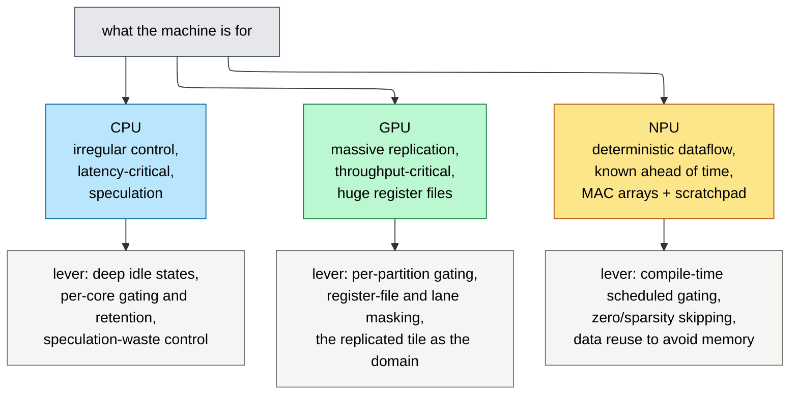
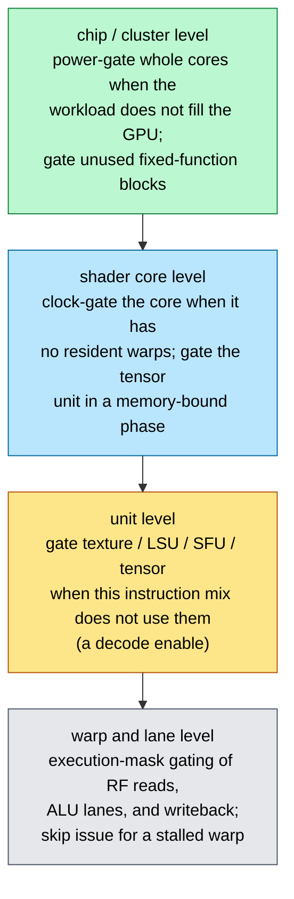

# Low Power in CPU, GPU, and NPU — The Same Levers, Three Different Machines

> **Prerequisites:** [Power Fundamentals](01_Power_Fundamentals.md) and [Power Reduction Techniques](04_Power_Reduction_Techniques.md) (the lever map this page *applies* — nothing new is derived here), [Low-Power Architecture and Domain Partitioning](03_Low_Power_Architecture_and_Domain_Partitioning.md) (why domains exist and what a partition costs), [RTL Low-Power Design and Coding](09_RTL_Low_Power_Design_and_Coding.md) (the coding patterns each architecture's opportunities turn into). The architecture books themselves: [CPU](../01_Architecture_and_PPA/01_CPU_Architecture/00_Index.md), [GPU](../01_Architecture_and_PPA/02_GPU_Architecture/00_Index.md), [NPU](../01_Architecture_and_PPA/03_NPU_Architecture/00_Index.md).
> **Hands off to:** [Runtime Power Management and AVFS](08_Runtime_Power_Management_and_Adaptive_Voltage_Frequency.md) (the controller that runs the policies named here), [Power-Aware Verification](10_Power_Aware_Verification_and_UPF_Checking.md) (how each architecture's domain structure is proved), [Power Analysis and Signoff](06_Power_Analysis_and_Signoff.md) (the peak and thermal numbers each engine generates).

---

## 0. Why this page exists

The lever map does not change between architectures. Clock gating still attacks $\alpha$, power gating still attacks idle leakage, DVFS still attacks $V^2f$, and the break-even arithmetic is the same in all three machines. What changes — completely — is **which lever is worth reaching for, at what granularity, and who decides**, and that is set by the machine's workload structure rather than by anything in the power equation.

Three sentences capture the whole page, and they are worth having ready because a good interviewer will ask some version of "how is low-power design different for a GPU than for a CPU?":

- **A CPU is idle in large, unpredictable gaps and busy in irregular, latency-critical bursts.** Its low-power design is therefore about *deep idle states with fast wake* — power gating, retention, C-states, and a controller that guesses well — plus a running fight against the energy that speculation wastes.
- **A GPU is a replicated machine that is almost never fully idle and almost never fully busy.** Its low-power design is therefore about *fine-grained gating of identical tiles* and about the two structures that replication makes enormous: the register file and the clock network. Its idleness lives inside a busy kernel, not between kernels.
- **An NPU knows what it is going to do before it does it.** Its low-power design is therefore about *scheduled* gating — the compiler knows which lanes and buffers are idle in cycle $N$ — plus exploiting the data itself (zeros, low precision) and, above all, not touching memory.

Everything below is those three sentences with numbers, structures, and the RTL consequences.

---

## 1. The comparison frame: five workload properties that decide the strategy

Before any architecture-specific content, the frame that generates all of it. Five properties of a workload determine which levers pay.

| Property | What it decides | CPU | GPU | NPU |
|---|---|---|---|---|
| **Idleness structure** — long gaps, short bubbles, or none | whether power gating (long) or clock gating (short) is the right lever | long, unpredictable gaps between bursts | short bubbles inside kernels; whole-engine gaps between frames/kernels | short, *predictable* bubbles; long gaps between inferences in duty-cycled devices |
| **Control predictability** | whether idleness can be known *early* enough to gate on it | poor — branchy, data-dependent | moderate — warp scheduling is dynamic but structured | excellent — a static schedule |
| **Data reuse / memory intensity** | how much of the energy is memory, and whether reuse can remove it | caches hide reuse automatically; memory is a large share | high bandwidth demand; memory system is a huge share | reuse is *the* design variable; dataflow choice sets it |
| **Latency sensitivity** | how much wake latency and DVFS lag the design can tolerate | very high — µs wake latency is visible to a user | moderate — throughput matters more than any single request | low for batch; high for real-time and always-on |
| **Replication** | whether the same gating structure can be instantiated many times | 2–16 cores | 10s–100s of identical cores/tiles | 100s–1000s of identical lanes |

Two general laws fall out of the table, and both are good things to say out loud:

**Law 1 — predictability converts clock gating into scheduled gating.** If you know an idle cycle is coming, you can gate it precisely and early. That is why an NPU can gate at a granularity a CPU cannot: not because its designers are better, but because its compiler knows the future.

**Law 2 — replication converts a design cost into a design bargain.** An engineer who designs one gating scheme for one GPU tile has designed it for all 80 tiles. That changes the economics: effort that would never pay on a one-off block pays 80× here, which is why GPU and NPU low-power work goes to a finer granularity than CPU work at the same engineering budget.

---

## 2. Where the power actually goes

Planning-grade decompositions. Treat every number as a range and a starting point for a conversation, not a fact — the actual split depends on node, node options, frequency, and workload, and the *shape* is what you should remember.

**CPU core (high-performance out-of-order, running a mixed integer workload)**

| Component | Share of core dynamic | Note |
|---|---|---|
| Clock network | 20–35 % | the usual, and the reason gating comes first |
| L1 caches + TLBs | 15–25 % | accessed nearly every cycle |
| Out-of-order machinery (rename, ROB, scheduler wakeup/select, LSU CAMs) | 20–30 % | associative structures are power-hungry per access |
| Execution units (INT/FP/vector) | 10–20 % | vector units dominate when they are active |
| Register file + bypass network | 5–15 % | smaller relative share than a GPU's |
| Frontend (fetch, branch prediction, decode) | 10–15 % | predictors are large tables read every cycle |

**GPU shader core / SM (running a mixed graphics or compute kernel)**

| Component | Share of core dynamic | Note |
|---|---|---|
| Register file | 15–20 % | the defining structure; hundreds of KB per core, read 2–3× per instruction |
| Clock network | 20–30 % | a huge, highly replicated tree |
| Execution units (ALU/FMA/SFU/tensor) | 20–35 % | tensor/matrix units dominate when active |
| L1 / shared memory + LSU + coalescer | 15–25 % | address coalescing is itself substantial logic |
| Scheduler, scoreboard, operand collector | 5–15 % | the price of hiding latency with many warps |

**NPU (systolic or spatial array running a transformer or CNN layer)**

| Component | Share of dynamic | Note |
|---|---|---|
| MAC array | 30–50 % | the point of the machine; strongly precision- and sparsity-dependent |
| Local scratchpad / SRAM | 25–40 % | the memory-access energy that dataflow choice is trying to minimize |
| DMA + on-chip interconnect | 10–20 % | moving tiles is not free |
| Control, sequencing, compiler-driven state | 5–10 % | strikingly small — no speculation, no dynamic scheduling |
| Clock network | 15–25 % | large but very gateable, because idleness is scheduled |

Read the three tables against each other and the strategies almost write themselves. The CPU's power is spread across many *different* structures, so no single lever dominates and the win comes from deep idle states. The GPU's power concentrates in two *replicated* structures — register file and clock tree — so the win comes from attacking those two at every granularity. The NPU's power is in the array and the memory beneath it, so the win comes from not doing multiplies (sparsity, precision) and not touching memory (reuse).

There is also one number that belongs to all three and is worth stating separately: **off-chip memory**. DRAM access energy is on the order of **hundreds of pJ to a few nJ per access at the device**, one to three orders of magnitude above an on-chip SRAM access and three to four above an arithmetic operation. In an accelerator running a memory-bound layer, the DRAM traffic can exceed everything the chip does internally. That single ratio is why "low power" at architecture level so often reduces to "move less data," and it is the connective tissue between this page and [Tensor Tiling and Data Movement](../01_Architecture_and_PPA/03_NPU_Architecture/02_Mapping_and_Memory/01_Tensor_Tiling_and_Data_Movement.md).

---

## 3. CPU: deep idle, fast wake, and the cost of guessing

### 3.1 The defining problem — idleness is long and unpredictable

A CPU spends most wall-clock time doing nothing at all. Even a "busy" interactive system is mostly between keystrokes, between packets, between frames. The gaps are long enough that leakage during them matters more than any dynamic saving, which makes **power gating and retention the headline levers**, and makes their two costs — wake latency and break-even residency — the numbers the whole design revolves around.

The break-even is the same arithmetic as [04 §8](04_Power_Reduction_Techniques.md) and [07 §7](07_Power_Gating_Retention_and_Wake_Sequencing.md): a state is worth entering only if the expected idle period exceeds the energy the transition costs divided by the power it saves. What is *CPU-specific* is that the idle period is unknown, so the design ships a ladder of states with increasing savings and increasing wake latency, and a governor that guesses which rung to climb.

| State family | What is off | Wake latency | Break-even idle |
|---|---|---|---|
| Clock-gated (C1-like) | core clocks | ~ns–tens of ns | tens of ns |
| Retention (C6-like, core off, state retained) | core supply; state in retention flops / retained caches | ~µs | tens of µs |
| Cluster / package off | shared cache, interconnect, PLLs | ~tens of µs to ms | ms |

**The interview question this generates** is "a core is idle — should it sleep?", and the correct answer is not yes: compute the break-even, compare it to the *expected* idle length, and note that since the expectation is unknown, a policy must predict it — a timeout, a history-based predictor, or a modelled decision process. [08 §6](08_Runtime_Power_Management_and_Adaptive_Voltage_Frequency.md) has the governors.

### 3.2 The structures a CPU gates, from coarse to fine

- **Per-core power gating** with a header switch and retention on architectural state. This is the big one, and everything about isolation, retention, and wake sequencing in [07](07_Power_Gating_Retention_and_Wake_Sequencing.md) exists because of it.
- **Cluster/uncore gating** — the shared cache, ring or mesh, and the memory controller can drop into low-power states only when *all* cores agree, which makes the last active core the one that determines package power. This is the multi-agent problem of [08 §12](08_Runtime_Power_Management_and_Adaptive_Voltage_Frequency.md), and it is why "one background thread pinned to one core" is such a disproportionate power cost.
- **Per-unit clock gating** — the FPU/vector unit gated when the workload is integer (a §2.1b decode enable, worth a lot because vector units are wide), the second load/store port, the divider, the trace/debug logic.
- **Frontend gating** — a loop buffer or micro-op cache lets the entire fetch/decode front end sleep while a tight loop runs from the buffer. This is one of the highest-value gating structures in a modern core, because the frontend is 10–15 % of the core and a loop keeps it doing nothing new.
- **Cache way and bank enables** — way prediction or serial tag-then-data (see [09 §6.2](09_RTL_Low_Power_Design_and_Coding.md)), plus drowsy or retention modes for cold ways.

### 3.3 Speculation: the CPU's unique waste term

A CPU deliberately does work it may throw away. Mispredicted-path instructions fetch, decode, rename, issue, execute, and access caches, and every one of those is $\alpha C V^2 f$ spent on nothing. At a 5 % branch misprediction rate with a deep window, the wasted-work fraction is commonly quoted in the **10–20 %** range of core dynamic energy — a term that simply does not exist in a GPU or NPU.

The levers are architectural rather than RTL, and knowing them is the difference between a power answer and a microarchitecture answer:

- **Better prediction** is a power optimization, not only a performance one — every avoided misprediction is avoided energy.
- **Confidence-gated speculation:** on low-confidence branches, throttle fetch or stop speculating past a certain depth. Costs a little performance, saves the wasted work.
- **Squash early:** resolve branches as soon as possible and kill the wrong path before it reaches the expensive stages.
- **Do not update expensive state speculatively** where it can be deferred — this is an observability-don't-care enable ([09 §2.1e](09_RTL_Low_Power_Design_and_Coding.md)) at architectural scale.

### 3.4 Voltage, frequency, and heterogeneity

CPUs got the finest-grained DVFS first, because the workload varies fast and per-core: per-core voltage/frequency domains, hardware-managed P-states with microsecond-scale response, adaptive voltage scaling to recover the guardband, and adaptive clocking to survive droop. And when DVFS ran out of range, the industry added **heterogeneity** — big and little cores with different design points on the same ISA — which is a power technique disguised as a scheduling feature: a little core is not merely a slower big core, it is a core built at a lower-energy point of the design space, often several times more energy-efficient at the same task.

### 3.5 What a CPU low-power interview asks

- "A core is idle for 50 µs. Which state, and why?" (break-even arithmetic; wake latency; what retention costs)
- "Where does a CPU waste energy that a GPU does not?" (speculation, and the associative OoO structures)
- "How would you cut frontend power?" (loop buffer / µop cache, gating fetch when the buffer hits, predictor sizing)
- "One thread keeps the whole package awake. What do you do?" (consolidate onto one core so others can gate; the multi-agent problem; timer coalescing in software)
- "Why is a little core more efficient than a big core at the same frequency?" (different design point: shorter pipeline, in-order or narrow OoO, smaller structures, lower $V_{min}$ — not just a clock difference)

---

## 4. GPU: replication, register files, and idleness inside a busy kernel

This is the architecture the JD-shaped job lives in, so it gets the most detail — and the framing that matters is that a GPU's low-power problem is *not* the CPU's problem at a larger scale. It is a different problem.

### 4.1 The defining problem — never fully idle, never fully busy

A GPU running a kernel is busy at the chip level and full of holes at every level below it. Warps stall on memory; lanes are masked off by divergence; the tensor unit is idle during a memory-bound phase; one shader-core partition finishes its work group before its neighbours; a fixed-function block is unused by this API path. **The idleness is real, large, and short-lived**, which points the strategy at fine-grained clock gating and away from power gating — you cannot power-gate a unit that will be needed again in twelve cycles.

Power gating still appears, but at the boundaries where idleness is long: whole shader-core clusters when the workload does not fill the chip, fixed-function blocks that this frame does not use, and the entire graphics engine between frames on a mobile part.

### 4.2 Replication is the structural fact

A GPU is tens to hundreds of copies of the same core, each with the same sub-blocks. Three consequences dominate the design:

1. **The tile is the natural domain.** Power and clock domains follow the replication boundary — per-core, per-partition, per-cluster — because that is where the design already has clean interfaces. Domain partitioning ([03](03_Low_Power_Architecture_and_Domain_Partitioning.md)) is easier here than anywhere else, and the number of domains can be large without the interface cost exploding, because every instance is identical.
2. **Gating effort amortizes.** A gating scheme designed once inside a shader core is instantiated everywhere. This is why GPU RTL goes to a granularity that would be uneconomic in a one-off block — and it is why a job description says "RTL-level low-power coding for a GPU sub-module" rather than "for the GPU": the sub-module *is* the leverage.
3. **The clock tree is enormous.** Distributing a clock across a large, highly replicated die is a substantial fraction of total power, and it is the strongest argument for gating at the root of each tile rather than only at the leaves ([09 §4](09_RTL_Low_Power_Design_and_Coding.md)).

### 4.3 The register file is the structure to know

If you remember one GPU-specific power fact, make it this one: **the register file is 15–20 % of shader-core dynamic power** — comparable to the entire clock network, and larger than any single execution unit. The reason is structural: to hide memory latency, a GPU keeps many warps resident, and each needs its full architectural register state, so the file is hundreds of KB per core and is read two or three times and written once per instruction, at full issue rate.

Four levers, all of them enable decisions expressible in RTL ([09 §6.4](09_RTL_Low_Power_Design_and_Coding.md)):

| Lever | Mechanism | Why it works |
|---|---|---|
| **Bank and gate per bank** | enable only the banks holding this instruction's operands | the operand collector already knows which banks it needs; the rest of the file need not be accessed |
| **Operand reuse / register caching** | a small cache or reuse buffer in front of the file catches operands read again immediately | instruction streams re-read the same registers constantly; a hit avoids a full RF read |
| **Bypass instead of read** | take the operand from the forwarding network when the producer just wrote it | same saving, no extra storage |
| **Lane masking on read and write** | suppress read and writeback for lanes that divergence or predication has turned off | under divergence, a large fraction of a wide access is wasted; the active mask is a free enable |

The last row generalizes into the GPU's most characteristic power idea: **the execution mask is an enable**. Divergence is usually discussed as a performance problem (idle lanes waste throughput). It is equally a power opportunity, because the mask tells you, cycle by cycle and for free, exactly which lanes' register reads, ALU operations, and writebacks are pointless.

### 4.4 The gating hierarchy of a shader core

Four levels, and the useful observation is that they are gated by *different owners on different timescales*: the chip level by driver and firmware over milliseconds, the core level by the work distributor over microseconds, the unit level by the decoder every few cycles, and the lane level by the execution mask every cycle. That mapping — owner, timescale, enable source — is a strong structure for answering "how would you approach low power in a GPU?"

### 4.5 The memory system, which is where a GPU's power really lives at chip level

Inside a core, the levers are the ones above. At chip level, a large GPU's power is dominated by moving data:

- **Coalescing is a power optimization.** Merging 32 lane addresses into the minimum number of memory transactions reduces both the number of L1/L2 accesses and the number of DRAM bursts. Poorly coalesced access patterns are a power bug as much as a performance bug.
- **Shared memory / scratchpad beats L1 when reuse is explicit.** An access that hits a programmer-managed scratchpad avoids tag lookup and, more importantly, avoids the traffic behind a miss.
- **HBM/GDDR interfaces are a large, and largely fixed, cost.** Their power scales with bandwidth actually used, so bandwidth reduction techniques — compression, cache-hit-rate improvements, better tiling — translate directly into watts. [HBM and Advanced Memory Systems](../01_Architecture_and_PPA/02_GPU_Architecture/02_Memory_System/02_HBM_and_Advanced_Memory_Systems.md) has the interface details.
- **Memory-side DVFS is a separate knob.** During a compute-bound phase the memory clock can drop; during a memory-bound phase the core clock can drop with little performance loss. This is the counter-based phase classification of [08 §7](08_Runtime_Power_Management_and_Adaptive_Voltage_Frequency.md), applied to two clock domains instead of one.

### 4.6 What a GPU sub-module low-power RTL job actually looks like

Concretely, for the kind of role that says "RTL-level low-power coding for a GPU sub-module, implementing clock gating and data gating, plus power-aware verification support":

1. **Own a sub-module** — a texture unit, an LSU slice, a tensor pipeline stage, a scheduler partition — and its power budget.
2. **Get the decomposition** on a real workload window, not a directed test ([09 §1.2](09_RTL_Low_Power_Design_and_Coding.md)). For a shader-core sub-module the answer is usually clock network first, then the local storage, then the datapath.
3. **Build the enable table** ([09 §2.3](09_RTL_Low_Power_Design_and_Coding.md)): where every candidate enable comes from — warp valid, execution mask, decode, stall, mode — with a $CGE$ estimated from the trace.
4. **Implement the gating hierarchy** — a module-level gate on the enable that says "this sub-module has no work," cluster gates per pipeline, leaves by inference — through the project's ICG wrapper, with `test_en` and a reset policy ([09 §§3–4](09_RTL_Low_Power_Design_and_Coding.md)).
5. **Isolate the wide datapaths** — filters, interpolators, address arithmetic — on their decode/valid enables ([09 §5](09_RTL_Low_Power_Design_and_Coding.md)).
6. **Shape the memory accesses** — no speculative reads whose results are discarded, per-bank and per-lane enables ([09 §6](09_RTL_Low_Power_Design_and_Coding.md)).
7. **Measure, reconcile, and defend** — per-gate $CGE$, gated-flop coverage, predicted vs measured ([09 §8](09_RTL_Low_Power_Design_and_Coding.md)).
8. **Support the power-aware verification** of whatever domain the sub-module sits in: reviewing the UPF's isolation strategies and clamp values against the sub-module's protocol, checking that its outputs clamp to safe values, and making sure its quiescence signal ("I have no outstanding work") is honest — which is exactly claim 6 of [10 §1](10_Power_Aware_Verification_and_UPF_Checking.md), and the single most common place a sub-module owner introduces a chip-level hang.

Step 8 is the one candidates underestimate. A sub-module owner's power-aware verification obligation is small but sharp: **your block's "I am quiet" signal must be true**, and your block's outputs must clamp to values the rest of the chip can survive.

### 4.7 What a GPU low-power interview asks

- "Where does a shader core's power go?" (register file, clock network, execution units, memory path — with the RF number)
- "How is GPU low-power design different from CPU?" (replication, no speculation waste, idleness inside kernels rather than between them, RF dominance, coarse power gating at the cluster rather than fine at the core)
- "You have a warp with 4 of 32 lanes active. What can you save?" (RF read/write per lane group, ALU lanes, writeback — the mask as an enable; and at the architectural level, whether the scheduler should have coalesced the warp at all)
- "Design the clock-gating scheme for this sub-module." (the four-level hierarchy of §4.4, with enable sources and timescales)
- "Why can't you power-gate a shader core between two instructions?" (break-even: wake latency is orders of magnitude longer than the idle gap; clock gating is the right lever at that timescale)
- "What clamp value would you pick for your block's output signals, and why?" ([10 §5.1](10_Power_Aware_Verification_and_UPF_Checking.md) — this is where the RTL and verification halves of the job meet)

---

## 5. NPU: the machine that knows what it will do

### 5.1 The defining problem — determinism turns power management into scheduling

An NPU executes a compiled graph. The compiler knows, before the chip runs a single cycle, which lanes are active in which cycle, which buffers are being filled and which drained, when the array is waiting on a DMA, and how long a layer takes. Almost nothing is speculative and almost nothing is data-dependent in the *control* sense.

That single property changes the character of every lever:

- **Clock gating becomes scheduled gating.** The enable for a MAC row is not "did something happen?" but "the schedule says this row is idle for the next 40 cycles." Enables are early, wide, and accurate — the three properties [09 §2.2](09_RTL_Low_Power_Design_and_Coding.md) says are hard to get, obtained for free.
- **Power gating becomes practical at fine granularity**, because idle durations are *known*, so the break-even test can be evaluated at compile time rather than guessed by a governor.
- **DVFS becomes deterministic**, or unnecessary: a layer's duration and intensity are predictable, so the operating point can be set per layer instead of chased by a feedback loop.
- **The controller shrinks.** Notice the 5–10 % control share in §2: no branch predictor, no scheduler CAM, no reorder buffer. The energy the CPU spends *deciding* is spent by the compiler, offline, once.

### 5.2 The two levers that come from the data, not the schedule

**Sparsity / zero skipping.** Weights and activations in real networks contain many zeros — structurally (pruning), naturally (post-ReLU activations), or by construction (padding, masking). A multiply by zero is a no-op whose energy can be skipped entirely if the hardware detects it early enough. In RTL this is the zero-detect enable of [09 §5.6](09_RTL_Low_Power_Design_and_Coding.md); at architecture level it is a whole design axis, including compressed formats that avoid *fetching* the zeros in the first place — which is the larger saving, because the memory access dominates the multiply. Two honest caveats to state alongside the claim: unstructured sparsity costs indexing logic and irregular memory access that can eat the saving, which is why structured (e.g. N:M) sparsity exists; and the saving is workload-dependent, so it belongs in a range, not a spec.

**Precision.** Multiply energy scales roughly with the *square* of operand width for an array multiplier, so INT8 versus FP16 versus FP32 is not a 2× question but closer to a 4× one per operation, and the memory and bandwidth savings scale linearly on top. This is the highest-leverage single decision in accelerator power, and the reason quantization is a hardware topic and not only a machine-learning one. The RTL consequence, and the interview-grade detail: **in a mixed-precision unit the unused upper datapath must be isolated, not merely unused** ([09 §7.4](09_RTL_Low_Power_Design_and_Coding.md)), or you pay the wide unit's toggling while getting the narrow unit's answer.

### 5.3 Dataflow and reuse: not touching memory is the biggest lever of all

Given the energy ratios of §2 — an off-chip access is orders of magnitude more expensive than a MAC — the dominant architectural decision is how much reuse the dataflow extracts before data has to move again. Weight-stationary, output-stationary, and row-stationary dataflows are, from a power point of view, three different answers to "which operand do we refuse to re-fetch?", and the tiling decision that goes with them is a power decision as much as a performance one. This is the subject of [Tensor Tiling and Data Movement](../01_Architecture_and_PPA/03_NPU_Architecture/02_Mapping_and_Memory/01_Tensor_Tiling_and_Data_Movement.md) and [Systolic, Spatial and Vector Dataflows](../01_Architecture_and_PPA/03_NPU_Architecture/01_Compute_Dataflows/02_Systolic_Spatial_and_Vector_Dataflows.md); the point to carry here is that an NPU architect's biggest power lever is not a gating cell, it is a loop order.

### 5.4 Scratchpad and DMA

- **Bank the scratchpad and enable one bank.** Same argument as [09 §6.2](09_RTL_Low_Power_Design_and_Coding.md), with more force, because the scratchpad is 25–40 % of the power.
- **Double-buffer, but gate the half that is not being read.** A ping-pong buffer has, by construction, one half idle at all times — an enable that is known at compile time and costs nothing to exploit.
- **Do not fetch what will be multiplied by zero.** Compressed weight formats mean the DMA moves less, which is the sparsity saving that actually dominates.
- **Right-size the transfer.** DMA burst length and alignment set how many DRAM row activations occur, and row activation is a large part of DRAM energy — see [DDR Controller](../01_Architecture_and_PPA/04_SoC_and_Chiplet_Architecture/02_Shared_Memory/01_DDR_Controller.md).

### 5.5 The always-on NPU: duty cycling as the whole design

A large class of NPUs — keyword spotting, wake-word detection, sensor fusion, always-on vision — run a small model at a low rate, forever, on a battery. Here the power profile inverts: the chip is *off* most of the time, so **leakage during the off phase and the energy per wake dominate**, and the active-phase efficiency barely matters.

The design consequences are worth knowing because they are the mirror image of everything above: aggressive power gating with retention of only the model's essential state; a very small always-on domain holding the wake logic; a wake path that must be cheap because it fires constantly; and an energy metric of **joules per inference including the wake and sleep transitions**, not watts while running. A design that is 20 % more efficient while computing but takes 2× the energy to wake up loses at a 1 % duty cycle. This is exactly the break-even framing of [04 §8](04_Power_Reduction_Techniques.md) and [07 §7](07_Power_Gating_Retention_and_Wake_Sequencing.md), applied where it bites hardest.

### 5.6 What an NPU low-power interview asks

- "Where does the energy go in an inference?" (memory movement first, then the array; the per-access ratios)
- "How does sparsity save power, and when does it not?" (skip the multiply *and* the fetch; indexing overhead and irregular access can eat it; structured sparsity as the compromise)
- "INT8 versus FP16 — how much do you save?" (roughly quadratic in the multiplier, linear in memory and bandwidth; plus the isolation requirement on the unused datapath)
- "Your accelerator is idle between layers for 200 cycles. Clock gate or power gate?" (break-even: 200 cycles is nowhere near a power-gating break-even; clock gate — and the fact that you *know* it is 200 cycles is what makes the gating precise)
- "How would you use compile-time information to save power?" (scheduled gating, per-layer operating points, buffer enables known statically, DMA prefetch aligned to the schedule)
- "What is the metric for an always-on NPU?" (energy per inference including transitions; leakage in the off phase; not peak TOPS/W)

---

## 6. The three machines side by side

| Dimension | CPU | GPU | NPU |
|---|---|---|---|
| **Dominant idleness** | long gaps between bursts | short bubbles inside kernels | scheduled bubbles; long gaps in duty-cycled parts |
| **Is idleness predictable?** | no | partly | yes, at compile time |
| **Headline lever** | power gating + retention + C-states | fine-grained clock gating, at every level of the replication | scheduled clock gating + sparsity + precision + reuse |
| **Biggest single structure** | caches and OoO machinery | register file | MAC array and scratchpad |
| **Unique waste term** | speculation (10–20 % of core dynamic) | masked-off lanes under divergence | zeros multiplied for nothing |
| **DVFS granularity** | per core, µs response | per partition / core vs memory clock | per layer, or none |
| **Power gating granularity** | per core, per cluster | per cluster / fixed-function block; rarely per core mid-kernel | per tile; whole-engine in always-on parts |
| **Who decides** | hardware governor + OS | driver/firmware + work distributor + hardware | compiler, mostly |
| **Verification emphasis** | retention correctness, C-state sequences, multi-core ordering | many identical domains; clamp values on a wide functional interface; quiescence honesty | fewer, larger domains; the wake path in duty-cycled parts |
| **The metric** | performance per watt at a latency target; idle power | performance per watt at a thermal cap | energy per inference (or TOPS/W, with the caveats) |

The row worth memorizing is **"unique waste term."** Each machine wastes energy in a way the others structurally cannot, and naming that term is the fastest way to show you understand the architecture rather than the checklist.

---

## 7. Domain structures, compared

A sketch of how the three tend to be partitioned, because the shape of the power state table follows directly from it.

| | CPU | GPU | NPU |
|---|---|---|---|
| **Always-on island** | PMU, interrupt controller, wake logic, a few timers, debug entry | PMU, host/PCIe interface enough to receive a wake, display/scan-out on a mobile part | PMU, the wake detector (always-on parts), host mailbox |
| **Switchable domains** | one per core (+ retention), one per cluster/L3, uncore blocks | per shader-core cluster, per fixed-function block (video, display, raytracing), memory-controller partitions | per compute tile, per scratchpad bank group, DMA engines |
| **Voltage domains** | per core or per cluster; separate SRAM rail | per cluster; separate memory-system rail; separate SRAM rail | logic rail + a higher SRAM rail; sometimes a retention rail |
| **Retention scope** | architectural register state, control state; caches sometimes retained at low voltage | usually little inside a core — GPUs prefer to rebuild rather than retain; configuration and context state at cluster level | model configuration, sequencer state; weights sometimes retained in SRAM to avoid re-fetching them |
| **PST size** | large — many cores × several states each; hierarchically decomposed | moderate per instance, multiplied by identical instances | small and very regular |

Two observations for an interview. **GPUs prefer rebuild over retain**: a shader core's state is enormous and cheap to reconstruct (a new work group can simply be dispatched), so paying for retention flops across a huge replicated structure is a bad trade — whereas a CPU core's architectural state is small and *expensive* to reconstruct, since the software context must be preserved. And **an NPU may retain weights in SRAM** for a reason that has nothing to do with state: re-fetching them from DRAM would cost more energy than keeping the array powered at retention voltage, which is the break-even calculation applied to data rather than to control state.

---

## 8. How the verification plan differs

The nine claims of [10 §1](10_Power_Aware_Verification_and_UPF_Checking.md) apply to all three machines. Where the *effort* goes differs:

| | CPU | GPU | NPU |
|---|---|---|---|
| **Hardest claim** | 5 and 6 — retention correctness and multi-core sequence ordering; a lost architectural register is a software-visible corruption | 2 and 6 — clamp values on wide functional interfaces, and honest quiescence from many identical sub-modules | 6 and 7 — long scheduled sequences and a PST that must match a compiler's assumptions |
| **Sequence space** | huge: cores × states × orderings; needs formal on the PMU | large but *repetitive*: verify one instance thoroughly, then verify the composition | smaller and more regular; more amenable to directed sequences derived from real schedules |
| **The characteristic bug** | a core wakes with a corrupted context | a sub-module acknowledges quiescence while a memory response is in flight | the wake path in an always-on part fails after thousands of duty cycles |
| **Where emulation earns its place** | OS-driven idle/wake over billions of cycles | driver-driven frame loops with per-frame power transitions | full-model inference sequences with real weights |

---

## Numbers to memorize

| Quantity | Value | Machine |
|---|---|---|
| Clock network share of core dynamic | 20–35 % | all three |
| GPU register file share of shader-core dynamic | **15–20 %** | GPU — the signature number |
| CPU speculation waste | ~10–20 % of core dynamic at typical misprediction rates | CPU — the unique waste term |
| NPU MAC array share | 30–50 % | NPU |
| NPU local SRAM / scratchpad share | 25–40 % | NPU |
| On-chip SRAM access energy | ~1–5 pJ (small) to 10–50 pJ (large) | all three |
| Off-chip DRAM access energy | hundreds of pJ to a few nJ | all three — the ratio that drives every dataflow decision |
| 32-bit arithmetic op energy | ~0.1–1 pJ | all three |
| Multiplier energy vs operand width | roughly quadratic | NPU/GPU precision argument |
| Clock-gated wake latency | ~ns–tens of ns | all three |
| Retention (core-off) wake latency | ~µs | CPU, mobile GPU/NPU |
| Cluster/package-off wake latency | tens of µs to ms | CPU, GPU |
| DVFS response time | µs (hardware) to ms (OS-driven) | CPU, GPU |
| Droop/adaptive-clocking response | ns | all three |

The four-tier reaction-time hierarchy in the last four rows — **ns droop, µs DVFS and wake, ms governor and package, s thermal** — is one of the most reusable structures in a power interview, because almost any "why didn't X fix it?" question is answered by putting X and the problem on that ladder.

---

## Worked problems

**1. Should a shader core power-gate between two dependent instructions?**
A warp stalls for 300 cycles at 1 GHz waiting on a memory access. Core-level power gating has a wake latency of ~5 µs.
*Solution.* The idle gap is 300 ns; the wake latency alone is ~17× longer, before counting the energy of the transition. Power gating is not merely unprofitable, it is impossible — the work would arrive long before the core was back. **Clock gate.** And note the architectural point behind the arithmetic: a GPU does not idle on that stall at all, it switches to another resident warp, which is why per-core power gating during a kernel is a non-question and why the fine-grained levers are the ones that matter inside a shader core.

**2. Precision change on an NPU.**
An array does $128 \times 128$ MACs per cycle at 1 GHz. Moving from FP16 to INT8 reduces per-MAC energy by roughly 4× and halves the weight bandwidth. The array is 40 % of a 20 W chip; DRAM traffic accounts for another 25 %.
*Solution.* Array: $0.40 \times 20 = 8$ W → ~2 W, saving 6 W. Memory: the bandwidth halves, and if the DRAM term scales with bytes moved, $0.25 \times 20 = 5$ W → 2.5 W, saving 2.5 W. Total ~8.5 W of 20 W — a **42 % reduction**, most of it from the multiplier's quadratic scaling and the rest from moving fewer bytes. The honest caveat to add: this assumes the model tolerates INT8, that the memory term really is bandwidth-proportional, and that the unused upper datapath is *isolated* rather than merely idle — otherwise a chunk of the array saving does not materialize.

**3. Is one background thread worth a core?**
A package draws 2 W with all cores in a deep state and 6 W with one core active in a shallow state, because the shared cache and interconnect cannot enter their low-power state while any core is awake. A background thread wakes every 1 ms for 20 µs.
*Solution.* Duty cycle 2 %, but the package cannot reach its deep state within a 1 ms window if the wake latency plus the work approaches the period — and every wake pays the package's transition energy. Effective average is far above $0.02 \times 6 + 0.98 \times 2 = 2.08$ W once transition energy and the governor's hysteresis are included; measured systems routinely see 3–4 W in this pattern. The fixes are all about the *period*, not the work: coalesce timers so several background threads wake together, consolidate them onto one core so the others stay deep, and lengthen the period. This is the multi-agent problem of [08 §12](08_Runtime_Power_Management_and_Adaptive_Voltage_Frequency.md), and it is why operating systems have timer-coalescing frameworks.

**4. Lane masking under divergence.**
A 32-lane warp executes a branchy kernel where the average active-lane count is 12. Register-file reads and ALU operations are gated per lane; the clock network, scheduler, and instruction fetch are not.
*Solution.* The lane-gated fraction saves $1 - 12/32 = 62.5$ % of the *per-lane* energy. If RF + ALU are, say, 35 % of core dynamic, the saving is $0.625 \times 0.35 \approx 22$ % of core power — substantial, and note what it does *not* touch: the fetch, decode, scheduler, and clock tree costs are paid once per warp regardless of the mask, which is exactly why divergence is a performance problem too, and why the architectural answer (re-converging or compacting warps) beats the RTL answer.

---

## Interview drills

### Q1: "How is low-power design different for a GPU than for a CPU?"

**A.** Four differences, in order of importance. **Idleness structure**: a CPU is idle in long unpredictable gaps, so its levers are power gating, retention, and C-states with a governor guessing how long the gap will be; a GPU running a kernel is busy at chip level and full of short holes below it, so its levers are fine-grained clock gating and it rarely power-gates mid-kernel because the wake latency dwarfs the idle gap. **Where the power is**: a GPU's register file is 15–20 % of shader-core dynamic — the defining structure, because keeping many warps resident to hide latency requires an enormous file — while a CPU's power is spread across caches and out-of-order machinery. **Replication**: a GPU is tens to hundreds of identical tiles, so gating effort designed once amortizes everywhere and the tile is a natural domain boundary; that economics supports a granularity a one-off CPU block could not justify. **Waste terms**: a CPU wastes 10–20 % on speculation, which a GPU does not have; a GPU wastes energy on masked-off lanes under divergence, which a CPU does not have.

### Q2: "Where would you start on a GPU sub-module that is 20 % over its power budget?"

**A.** Measure before touching anything: get the decomposition on a representative workload window — not a directed test — and find out whether I am fighting the clock network, the local storage, or the datapath. Then attack in payoff order. If it is clock, build the gating hierarchy deliberately rather than accepting inferred leaves: a module-level gate on "this sub-module has no work", cluster gates per pipeline driven by pipelined valid signals, and leaves by inference — the coarse gates buy the clock-tree buffers, which leaves never do. If it is storage, qualify every memory enable with "will this result be consumed?", bank the arrays, and use the execution mask to suppress per-lane reads and writebacks. If it is datapath, isolate the wide arithmetic on its decode enables, holding rather than masking where the unit chatters. Then re-measure and reconcile every gate whose measured saving is more than about 20 % off the prediction, because that gap is where a misunderstood enable is hiding. And before committing, check the flow costs: clock-gating checks in STA, ICG count and CTS impact, DFT coverage, and whether any new enable is observability-don't-care-based and therefore a sequential-equivalence problem.

### Q3: "What is the single most important structure to optimize in each of the three?"

**A.** CPU: the caches and the out-of-order machinery, because associative structures are accessed constantly and cost a lot per access — plus the frontend, where a loop buffer lets fetch and decode sleep entirely. GPU: the register file, for the reason above, attacked by banking, operand reuse, bypass, and lane masking. NPU: the memory hierarchy rather than the array — because an off-chip access costs orders of magnitude more than a MAC, the dataflow and tiling choice that determines how often data must move is worth more than any gating cell inside the array.

### Q4: "An accelerator is idle for 200 cycles between layers. Clock gate or power gate?"

**A.** Clock gate. At 1 GHz, 200 cycles is 200 ns; power-gating break-even is in the tens of microseconds once you count the transition energy and the wake latency, so power gating would both lose energy and miss the deadline. The interesting part of the answer is *why an NPU can gate those 200 cycles so effectively*: the schedule is known at compile time, so the enable is exact and available early — which is the property [09 §2.2](09_RTL_Low_Power_Design_and_Coding.md) says is normally the hard part.

### Q5: "How does sparsity save power, and when does it not?"

**A.** Two savings of very different size. The small one is skipping the multiply — a MAC by zero produces nothing, and detecting the zero early gates the multiplier and the accumulator's clock. The large one is never fetching the zero: compressed weight and activation formats reduce the DRAM and scratchpad traffic, which is where the energy actually is. It fails to pay when the sparsity is unstructured, because the indexing and gather logic, the irregular memory access pattern, and the load imbalance across lanes can consume more than the skipped work saved — which is why structured sparsity patterns exist as a compromise. And the saving is workload-dependent, so it belongs in a measured range, never in a datasheet number.

### Q6: "Why do GPUs use retention less than CPUs?"

**A.** Because the cost-benefit is inverted. A CPU core's architectural state is small and expensive to reconstruct — it *is* the software's context, and losing it is not an option — so retaining a few thousand flops is cheap relative to what it buys. A GPU shader core's state is enormous (the register file alone is hundreds of KB) and cheap to reconstruct, because the work distributor can simply dispatch a fresh work group. Paying retention area and always-on routing across a hundred identical cores to preserve state that nobody needs preserved is a bad trade, so GPUs prefer to power down cleanly and rebuild. The exception is the configuration and context state at cluster level, which is small and does need to survive.

### Q7: "What is the right metric for each machine?"

**A.** CPU: performance per watt at a latency target, plus idle power, because a CPU's energy is dominated by the time it spends *not* computing. GPU: performance per watt under a thermal or power cap, because a large GPU is always cap-limited and the design question is how much work fits under the cap. NPU: energy per inference — and for an always-on part, energy per inference *including the wake and sleep transitions*, since at a 1 % duty cycle a design that is more efficient while computing but costs more to wake up loses outright. Peak TOPS/W is the number everyone quotes and the least useful of the three, because it is measured at a utilization no real workload sustains.

---

## Cross-references

- **Down the stack (the levers this page applies):** [Power Fundamentals](01_Power_Fundamentals.md) — the equation, the energy-per-op numbers, and the reaction-time hierarchy. [Power Reduction Techniques](04_Power_Reduction_Techniques.md) — the lever map and every break-even used here. [Low-Power Architecture and Domain Partitioning](03_Low_Power_Architecture_and_Domain_Partitioning.md) — how the domain structures of §7 are drawn and what each boundary costs. [Block Activity and Power](02_Block_Activity_and_Power.md) — where the per-engine activity numbers of §2 come from and how to defend one.
- **Sideways (the implementation of everything named here):** [RTL Low-Power Design and Coding](09_RTL_Low_Power_Design_and_Coding.md) — the enable derivation, gating hierarchy, data gating, and memory shaping that each architecture's opportunities turn into. [Power-Aware Verification and UPF Checking](10_Power_Aware_Verification_and_UPF_Checking.md) — the verification plan whose emphasis §8 compares. [Power Gating, Retention and Wake Sequencing](07_Power_Gating_Retention_and_Wake_Sequencing.md) — the switch, retention, and sequence behind every "power gate" in this page. [Runtime Power Management and AVFS](08_Runtime_Power_Management_and_Adaptive_Voltage_Frequency.md) — the governors, C-/P-states, and multi-agent problem behind the policy decisions.
- **The architecture books:** [CPU Architecture](../01_Architecture_and_PPA/01_CPU_Architecture/00_Index.md) — especially [CPU PPA and Physical Implementation](../01_Architecture_and_PPA/01_CPU_Architecture/00_Design_Methodology/02_CPU_PPA_and_Physical_Implementation.md) and [Speculative Execution](../01_Architecture_and_PPA/01_CPU_Architecture/02_Frontend_and_Prediction/03_Speculative_Execution.md). [GPU Architecture](../01_Architecture_and_PPA/02_GPU_Architecture/00_Index.md) — [GPU PPA and Physical Implementation](../01_Architecture_and_PPA/02_GPU_Architecture/00_Design_Methodology/02_GPU_PPA_and_Physical_Implementation.md), [SIMT Scheduling and Occupancy](../01_Architecture_and_PPA/02_GPU_Architecture/01_Core_Architecture/02_SIMT_Scheduling_and_Occupancy.md), and [Operand Collectors, Register Files and Scoreboards](../01_Architecture_and_PPA/02_GPU_Architecture/01_Core_Architecture/03_Operand_Collectors_Register_Files_and_Scoreboards.md). [NPU Architecture](../01_Architecture_and_PPA/03_NPU_Architecture/00_Index.md) — [NPU PPA and Physical Implementation](../01_Architecture_and_PPA/03_NPU_Architecture/00_Design_Methodology/02_NPU_PPA_and_Physical_Implementation.md), [Systolic, Spatial and Vector Dataflows](../01_Architecture_and_PPA/03_NPU_Architecture/01_Compute_Dataflows/02_Systolic_Spatial_and_Vector_Dataflows.md), [Tensor Tiling and Data Movement](../01_Architecture_and_PPA/03_NPU_Architecture/02_Mapping_and_Memory/01_Tensor_Tiling_and_Data_Movement.md), and [Sparsity, Quantization and Compression](../01_Architecture_and_PPA/03_NPU_Architecture/02_Mapping_and_Memory/02_Sparsity_Quantization_and_Compression.md).
- **Interview drills:** [Power and Low-Power Questions](../interview_prep/02_Power_and_Low_Power_Questions.md), [Architecture and PPA Questions](../interview_prep/01_Architecture_and_PPA_Questions.md), [Condensed Cram Sheet](../interview_prep/11_Condensed_Cram_Sheet.md).

---

## References

1. M. Horowitz, "Computing's Energy Problem (and what we can do about it)," *ISSCC*, 2014. The per-operation and per-access energy ratios that underpin §2 and every dataflow argument in §5.
2. V. Sze, Y.-H. Chen, T.-J. Yang, and J. Emer, "Efficient Processing of Deep Neural Networks: A Tutorial and Survey," *Proceedings of the IEEE*, 2017. Dataflow taxonomy, reuse, and the memory-versus-compute energy argument of §5.3.
3. Y.-H. Chen, J. Emer, and V. Sze, "Eyeriss: A Spatial Architecture for Energy-Efficient Dataflow for Convolutional Neural Networks," *ISCA*, 2016. Row-stationary dataflow and measured energy breakdowns.
4. N. Jouppi et al., "In-Datacenter Performance Analysis of a Tensor Processing Unit," *ISCA*, 2017. Systolic-array power and utilization data behind §2's NPU table.
5. M. Gebhart, D. R. Johnson, D. Tarjan, S. W. Keckler, W. J. Dally, E. Lindholm, and K. Skadron, "Energy-Efficient Mechanisms for Managing Thread Context in Throughput Processors," *ISCA*, 2011. The register-file energy result and the register-caching/reuse mechanisms of §4.3.
6. S. Hong and H. Kim, "An Integrated GPU Power and Performance Model," *ISCA*, 2010. GPU component power modelling behind §2's shader-core table.
7. W. Huang et al. and the broader dynamic-thermal-management literature; plus Intel and Arm platform documentation on C-states, P-states, and PSCI. The state ladders and wake latencies of §3.1.
8. R. Kumar, K. Farkas, N. Jouppi, P. Ranganathan, and D. Tullsen, "Single-ISA Heterogeneous Multi-Core Architectures for Multithreaded Workload Performance," *ISCA*, 2004. The big.LITTLE argument of §3.4.
9. A. Buyuktosunoglu et al., work on resizable issue queues and adaptive structures; and S. Manne, A. Klauser, and D. Grunwald, "Pipeline Gating: Speculation Control for Energy Reduction," *ISCA*, 1998. The confidence-gated speculation of §3.3.
10. A. Parashar et al., "SCNN: An Accelerator for Compressed-sparse Convolutional Neural Networks," *ISCA*, 2017. Sparsity exploitation and its overheads, the honest caveats in §5.2.

---

⬅ prev [Power-Aware Verification and UPF Checking](10_Power_Aware_Verification_and_UPF_Checking.md) · [Section Index](00_Index.md) · [Root Index](../Index.md)
